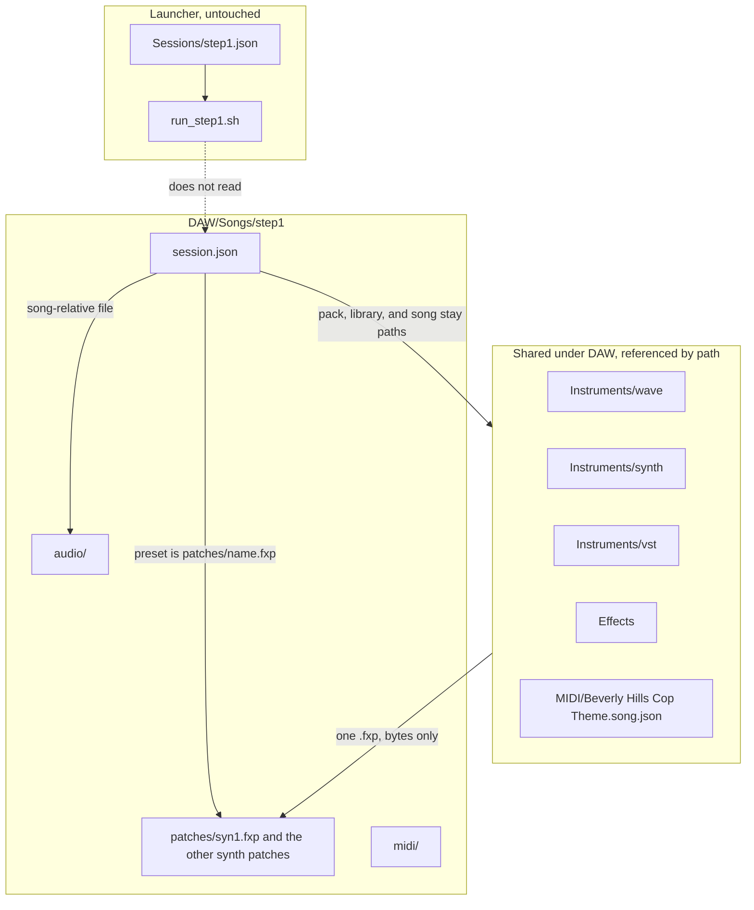
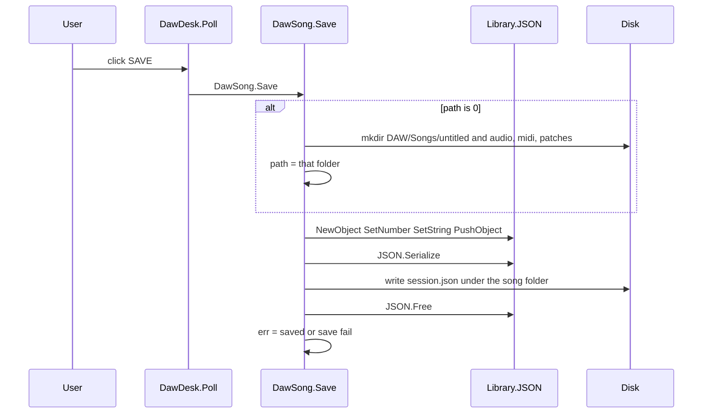
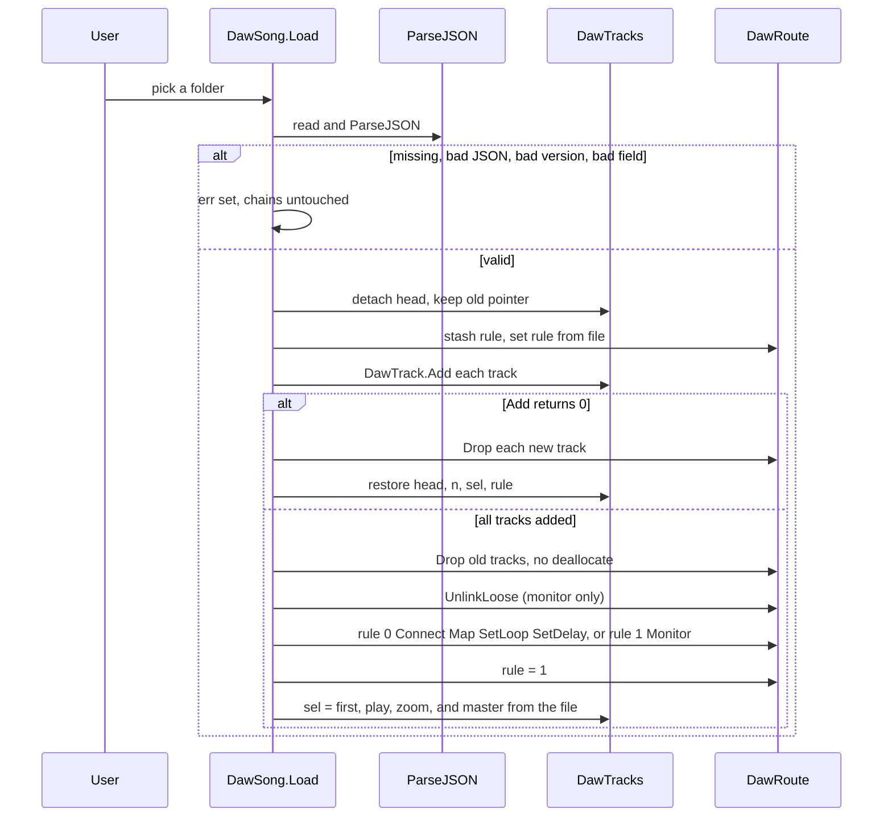

# Song project folders, JSON session, Open and Save

**Project:** AILANG Media / SynthKit DAW
**Author:** Sean Collins, 2 Paws Machine and Engineering. SCSL v1.0.
**Date:** 2026-09-28
**Status:** Spec. Open, Save, New, and Close are in the tree. The checklist is the work list. The sections below are the spec those functions follow.

Copyright © 2026 Sean Collins, 2 Paws Machine and Engineering. SCSL v1.0.

## Checklist

Order is `DAW/PLAN.md`. Song work does not start the mixer, SynthKit, Surge, or `wave_play`, and it does not change the mix law or the `route.bin` layout. The FILE menu is the control that is drawn. The OPEN and SAVE rectangles later in this spec are the older placement. Do not add a second pair beside FILE.

- [x] **SO-1** `DAW/Songs/step1/` and `DAW/Songs/untitled/` exist, with `session.json`, `patches/`, `audio/`, and `midi/`. `DAW/tools/session_from_step1.py` is the writer. `DAW/Sessions/step1.json` stays the launcher file.
- [x] **SO-2** Pool fields and setters are in the tree: `preset`, `library`, `pack`, `midi` on the track, `file` on the clip, `DawSong.CopyStr`, `SetArm`, `SetMute`, `SetSolo`, `SetFader`, `SetPan`, `DawRoute.FindName`, `SetDelay`, `UnlinkLoose`.
- [x] **SO-3** `DawSong.Save` writes the open folder, or `DAW/Songs/untitled/` when none is open.
- [x] **SO-4** `DawSong.Load`, `OpenAsk`, `NewAsk`, and `Close` are in the tree. The arrange header draws FILE. The menu is New, Open, Save, Close. Zoom hides when content width is under 680.
- [ ] **SO-5** Round-trip `offset` once **ED-4** adds it. Depends on **ED-4**. Version 1 gains the integer on the clip object. A file from before that field still opens.
- [ ] **SO-6** Card-free round-trip. Depends on **SO-3** and **SO-4**. A `song check` saves and opens a fixture folder and prints the track count, the first clip start, master travels, the cord count, and `zoom`. It does not open `/dev/snd` and does not exec the mixer, SynthKit, or `wave_play`. Missing file, bad JSON, and `"version": 2` leave the previous chain. A live desk run waits for an ask.
- [ ] **SO-7** Launcher reads a song folder. Depends on **SO-6**. Convert desk travel back through `DawLevel.Gain` at the launcher edge. `run_step1.sh` stays on `DAW/Sessions/step1.json` until that PR, and until a listen is asked for. Fader 700 is not a mixer gain.
- [ ] **SO-8** A take path under `audio/`. Depends on **AU-3**. The clip `file` field already exists. Capture is what fills it.
- [x] **SO-9** Hold, each its own later box: automation lanes, freeing unlinked pool nodes, listing more than 8 song folders, renaming a song. Version 1 already requires `automation` and ignores its elements.

## Overview

The desk draws a session that `Function.DawDesk.Seed` hardcodes: twenty `LinkagePool.DawTrack` nodes, a handful of clips and editor notes, and the default route cords from `DawRoute.Attach` plus `DawRoute.Monitor`. Nothing in that picture is a file. The file that actually feeds the launcher, `DAW/Sessions/step1.json`, is a different document: seven tracks, mixer gains in the `fader` field, a path to the Beverly Hills MIDI 3 song, and no clips. `DAW/run_step1.sh` reads that file and must keep reading it.

This design splits those two jobs. Each song becomes a folder under `DAW/Songs/<name>/`. The desk reads and writes `session.json` inside that folder. The patch the track is using is copied into that song's `patches/` directory, so the song owns the bytes it was saved with. Sample packs, and the shared directories `DAW/Instruments` and `DAW/Effects`, stay references and are not copied. Audio that belongs to the song is a file under that song's `audio/` directory. The MIDI 3 performance file stays where it is and is referenced. Open and Save are two visible header buttons. They round-trip the in-memory desk. They store the patch bytes. They do not apply them, and they do not start the mixer, SynthKit, Surge, or a song.

## Background & Motivation

The mixer is `DAW/Mixer/daw_mix.ailang`. It reads `levels.bin` and `route.bin` (`DAW/ROUTE.md`). This document is the song folder. It does not define the mix. `DAW/Sessions/step1.json` remains the launcher file. The connection list and the six-tier Route window are in the desk.

What hurts today:

- `DawDesk.Seed` in `DAW/Desk/daw_desk.ailang` always rebuilds the same twenty tracks. Quitting the desk throws the picture away. The seven names that match step1 (`syn1`, `syn2`, `bass`, `xylo1`, `xylo2`, `glass`, `drums`) are mixed with scratch rows (`take`, `pad`, `guitar`, and the rest).
- `step1.json` stores mixer gain. `fader` 256 is unity in `daw_mix.ailang` (`sample * gain / 256`). `fader` 80 is the xylophone gain. Desk travel is a different integer: `DawTrack.fader` and `DawCon.ml` / `DawCon.mr` run 0..1000, and `DawLevel.Gain` maps 700 to mixer gain 256. Loading 256 as travel would call `DawLevel.Gain(256)` and write about 11 into `levels.bin`, not 256.
- `step1.json` `"master": 80` is one mixer gain (`DAW/Sessions/step1.graph` line 1 is `master 80`). The desk has two travels, `DawCon.ml` and `DawCon.mr`, both initialized to 700 in `Librarys/DAW/Library.DawConsole.ailang`.
- Recorded audio must not be base64 inside the JSON. A take has to remain a wav in the song folder so the song still opens after the original drop path is gone. `/dev/shm` rings are rebuilt on a later play and are not part of the file.
- The Route bay can be patched. Those cords live only in `DawRoute.conns`. Saving them must not change mix law.

`Librarys/Library.JSON.ailang` is already the parser. The entry points that exist are `ParseJSON` and `JSON.Serialize`. There is no `JSON.Parse` and no `JSON.Stringify`. The comment in `Demo Programs/programs/137_json_roundtrip.ailang` names functions that are not in the library. Use the real ones.

## Goals & Non-Goals

### Goals

- One folder per song, siblings under `DAW/Songs/`. The example song is `DAW/Songs/step1/`.
- Shared library directories stay shared and are not copied: `DAW/Instruments/wave`, `DAW/Instruments/synth`, `DAW/Instruments/vst`, `DAW/Effects`. The one exception is the single `.fxp` a track is using: Save copies that file into `DAW/Songs/<name>/patches/`.
- A versioned `session.json` the desk can save and open, including every current desk setting: track order, kind, view, inst, preset, library, pack, midi, arm, mute, solo, fader travel, pan, fx, clips, editor notes, route cords, master L/R travel, playhead, and `zoom`. Viewport scrolls are not settings and are not saved.
- Visible `OPEN` and `SAVE` controls. No modifier key is the only way to reach them.
- A failed open leaves the previous in-memory session on screen.
- `DAW/Sessions/step1.json` and `DAW/run_step1.sh` keep working, byte-for-byte keys included.
- A one-time writer produces `DAW/Songs/step1/session.json` from `step1.json`. The desk refuses to open the old file.

### Non-Goals

- Starting or stopping the mixer, SynthKit, or `wave_play`. No new spawn on Open or Save. `DawDesk.Alsa` is not called again.
- Editing `DAW/Mixer/daw_mix.ailang`, `levels.bin`'s layout, `route.bin`'s layout, or the mix law. The desk already writes `levels.bin` and `route.bin` every frame. Song Open and Save leave those writers alone.
- Effect DSP. The EQ worker is specified in `DAW/EFFECTS.md`. Song Open and Save do not start it and do not change it. `DAW/Instruments/vst` is a directory, not a host.
- Rewriting `DAW/MIDI/Beverly Hills Cop Theme.song.json` or the `.mid` beside it. Channel 10 is not drums. Do not regenerate that MIDI.
- Copying a sample pack or a shared library directory into the song. `pack` stays a path and may be a symlink to another drive. Do not copy it. Do copy the one `.fxp` the track is using into `patches/<trackname>.fxp`. That copy is the song's patch. It does not replace a file or a symlink under `DAW/Instruments` or the factory path, and these PRs do not start Surge to apply it.
- Drawing automation lanes. The `automation` array is reserved and empty in these PRs. No lane pixels, no lane hit testing, no `DawTrack` field for it.
- Deallocating unlinked route, track, clip, or note nodes. `DawTrack.Remove` and `DawRoute.Drop` already unlink only.
- Strip IN/OUT/KEY rows, pan law in the mixer, and playback from the song folder. A later PR points `run_step1.sh` at a song folder. Not these PRs.
- Saving `/dev/shm` rings, ALSA labels, the cord-draw cache (`DawConn.row`), or viewport scrolls (`DawTracks.arr_x`, `arr_y`, `edit_x`, `edit_y`, `con_y`, `DawRoute.scroll`). `zoom` is a setting and is saved. Scroll position is not.

## Proposed Design

### Directory tree

Paths are relative to the repo root. Empty directories are tracked with a zero-length file named `.keep` so git keeps them. `.keep` is not a session and is not an instrument.

```
DAW/
  Instruments/
    wave/.keep          shared wave-player instruments (empty)
    synth/.keep         shared synth instruments (empty)
    vst/.keep           place for VST-class instruments later (not a host)
  Effects/              effect programs (eq.ailang). Song save does not add DSP.
  Songs/
    step1/
      session.json      the song document (version 1)
      patches/          the .fxp files this song owns
        syn1.fxp        bytes of Megasynth 1, a regular file
        syn2.fxp        bytes of Megasynth 1, its own regular file
        bass.fxp        bytes of Dirty Hole, a regular file
      audio/.keep       recorded takes and copied wavs, when a later PR copies them
      midi/.keep        MIDI that belongs only to this song (empty for step1)
  Sessions/
    step1.json          unchanged launcher session
    step1.graph         unchanged
    step1.events        unchanged
  MIDI/
    Beverly Hills Cop Theme.song.json    note source, not rewritten
    Beverly Hills Cop Theme.mid          not rewritten
  Mixer/                not this work
  Desk/                 Open/Save land in later PRs
  tools/
    session_from_step1.py
```

`DAW/Songs/step1/` is the example song for the current step1 session. Further songs are siblings (`DAW/Songs/<name>/`), never nested, and never a single shared `DAW/Song` file. The folder name is the song name: 1..32 bytes, ASCII letters, digits, `_`, or `-`. `step1` and `untitled` are legal. Spaces, `/`, and `..` are not.



What else is copied into the song, later, is a recorded take or a dropped wav. These PRs reserve `audio/` and store that path. They do copy one file per synth track: the `.fxp` that track is using, into `patches/<trackname>.fxp`. They do not copy a sample pack. The step1 packs stay `/home/bob/Downloads/midi3-packs/...`. The factory `.fxp` paths stay the `library` string. The writer does not move packs or factory files into `DAW/Instruments`, and it does not rewrite the factory files.

### Units

| Quantity | Where it lives today | Unit in `session.json` version 1 |
| --- | --- | --- |
| Track fader | `DawTrack.fader`, init 700 | Desk travel 0..1000. 700 is 0 dB. |
| Master | `DawCon.ml`, `DawCon.mr`, init 700 | Two travels, `master_l` and `master_r`, each 0..1000. |
| Mixer gain | `step1.json` `fader` and `master`, and `DawLevel.Gain` | Not stored. The desk already converts on the way to `levels.bin`. |
| Pan | `DawTrack.pan`, init 500 | 0..1000. 500 is center. |
| Playhead | `DawTracks.play`, init 360, clamp 0..4000 in `DawTransport.Clamp` | Same integer. Not samples, not ticks. |
| Zoom | `DawTracks.zoom`, init 100. `DawArrange.Zoom` clamps to 25..400 and writes that clamp back | Same integer, top-level `zoom`, legal 25..400. Not a scroll offset. |
| Arrange / editor / route scroll | `arr_x`, `arr_y`, `edit_x`, `edit_y`, `con_y`, `DawRoute.scroll` | Not stored. Open resets them. |
| Clip start, length | `DawClip.start`, `DawClip.length` | Same arranged-time integers the arrange already uses. |
| Editor note | `DawNote.start`, `length`, `pitch` | Those three integers. `sel`, `start0`, `pitch0`, `length0` are drag state and are not saved. |

`DawLevel.Gain` in `Librarys/DAW/Library.DawLevel.ailang` is the only conversion, and only the migration writer uses the inverse. The desk loader never calls it.

```
p <= 0                         -> 0
p >= 700                       -> 256 + (p - 700) * 256 / 300
p >= 560                       -> 128 + (p - 560) * 128 / 140
p >= 430                       ->  64 + (p - 430) *  64 / 130
p >= 300                       ->  16 + (p - 300) *  48 / 130
p >= 160                       ->   1 + (p - 160) *  15 / 140
else                           -> 0
```

Division is integer division toward zero, matching AILANG `Divide`. The inverse used by the writer is the lowest `p` in 0..1000 whose `Gain(p)` equals the mixer gain. Checked values:

| Mixer gain in `step1.json` | Desk travel written |
| --- | --- |
| 256 | 700 |
| 80 | 463 |

`Gain(700)` is 256. `Gain(699)` is 255. `Gain(463)` is 80. `Gain(462)` is 79. The decibel marks from `DawLevel.Tenths` are a different piecewise curve. Travel 463 reads near -13.5 dB while 80/256 is about -10 dB. The migration matches mixer gain, not the readout. Do not change `DawLevel.Gain` to force them together.

### session.json version 1

JSON only. Integers only, because `JSON.ParsePrimitive` runs `StringToNumber` and `JSON.AsNumber` returns an Integer. No floats, no base64, no audio bytes, no MIDI bytes.

Top-level keys:

| Key | Type | Required | Meaning |
| --- | --- | --- | --- |
| `version` | number | yes | `1`. Any other number, or a missing key, is refused. |
| `name` | string | yes | Song folder name. Must match the folder that holds this file. |
| `song` | string | yes | MIDI 3 performance file. Empty string if this song has none. Not rewritten by Open or Save. |
| `master_l` | number | yes | Desk travel 0..1000. |
| `master_r` | number | yes | Desk travel 0..1000. |
| `play` | number | yes | Playhead 0..4000. |
| `zoom` | number | yes | `DawTracks.zoom`. Integer 25..400, the same clamp `DawArrange.Zoom` writes back. Seed and the step1 writer use 100. 1..24 and 401..1000 are `bad json`. |
| `rule` | number | yes | `0` explicit cord list. `1` means "factory cords only"; the `conns` array is ignored. |
| `tracks` | array | yes | Chain order. Index 0 is `DawTracks.head`. This is the later `levels.bin` slot order. |
| `conns` | array | yes | Present even when empty. Applied only when `rule` is 0. |

There is no top-level clip array and no top-level note array. Clips and editor notes hang off the track, which is how `DawTrack.clips` and `DawTrack.notes` already work. Route cords are top-level because a cord names two ports and is not owned by one track.

`JSON.GetNumber` returns 0 when the key is missing and when the value is 0. Every required number is read only after `JSON.GetType` returns `JType.NUMBER` (2). A missing fader is a bad file, not silence. `JSON.GetType` returns `JType.NULL` (0) for a missing key.

#### Track object

Integers `kind` and `view` match the pool, not the strings `"synth"` and `"sample"` in `step1.json`.

| `kind` | `view` | Meaning | `DawTrack.Use` code |
| --- | --- | --- | --- |
| 1 | 1 | synth | 1 |
| 0 | 1 | sample | 2 |
| 0 | 0 | wave | 3 |
| 2 | 0 | bus, no clips required | not a `Use` target |

Any other pair fails the file. A bus is accepted so a later Route-created bus round-trips. These PRs do not add a bus button.

| Key | Type | Required | Pool |
| --- | --- | --- | --- |
| `name` | string | yes | `DawTrack.name`. 1..40 bytes, unique in the file, no `/`. Port names are this string plus a suffix. `hw` and `master` are illegal: they alias `DawRoute.Ensure`. |
| `kind` | number | yes | `DawTrack.kind` |
| `view` | number | yes | `DawTrack.view` |
| `inst` | string | yes | `DawTrack.inst`. May be empty for a bus. This is the MIDI 3 instrument name, not a path. |
| `preset` | string | no | new `DawTrack.preset`. Empty, or the song-relative path `patches/<trackname>.fxp`. Not the factory path. |
| `library` | string | no | new `DawTrack.library`. The path the patch bytes were read from, unchanged. Empty when `preset` is empty. Not opened by these PRs. |
| `pack` | string | no | new `DawTrack.pack`. Sample-pack directory, or empty. A path only. Not copied. |
| `midi` | string | no | new `DawTrack.midi`. Space-separated MIDI 3 track ids, or empty. |
| `arm` | number | yes | 0 or 1 |
| `mute` | number | yes | 0 or 1 |
| `solo` | number | yes | 0 or 1 |
| `fader` | number | yes | desk travel 0..1000 |
| `pan` | number | yes | 0..1000 |
| `fx` | number | yes | `DawTrack.fx`. Picture slot only. 0 if none. |
| `clips` | array | yes | may be empty |
| `notes` | array | yes | editor notes; may be empty |
| `automation` | array | yes | Extension point for lanes drawn later. These PRs write `[]`. No pool field. |

One track in full, as the writer emits it for step1's first row. `fader` 700 came from mixer gain 256. `midi` `"0"` is `song_track` 0. `preset` is the song's own patch. `library` is the factory path the bytes were copied from.

```json
{
  "name": "syn1",
  "kind": 1,
  "view": 1,
  "inst": "lead_saw",
  "preset": "patches/syn1.fxp",
  "library": "/home/bob/.local/share/surge-xt/patches_factory/Polysynths/Megasynth 1.fxp",
  "pack": "",
  "midi": "0",
  "arm": 0,
  "mute": 0,
  "solo": 0,
  "fader": 700,
  "pan": 500,
  "fx": 0,
  "clips": [],
  "notes": [],
  "automation": []
}
```

The other six step1 rows are the same shape. Only these fields differ:

| name | kind | view | inst | fader | preset | library | pack | midi |
| --- | --- | --- | --- | --- | --- | --- | --- | --- |
| syn1 | 1 | 1 | lead_saw | 700 | `patches/syn1.fxp` | Megasynth 1.fxp absolute | `""` | `0` |
| syn2 | 1 | 1 | lead_saw | 700 | `patches/syn2.fxp` | same Megasynth 1.fxp absolute | `""` | `1` |
| bass | 1 | 1 | bass_synth_2 | 700 | `patches/bass.fxp` | Dirty Hole.fxp absolute | `""` | `5` |
| xylo1 | 0 | 1 | xylophone | 463 | `""` | `""` | `.../midi3-packs/Xylophone` | `2` |
| xylo2 | 0 | 1 | xylophone | 463 | `""` | `""` | `.../midi3-packs/Xylophone` | `3` |
| glass | 0 | 1 | glass | 700 | `""` | `""` | `.../midi3-packs/Glass` | `4` |
| drums | 0 | 1 | kit_standard | 700 | `""` | `""` | `.../midi3-packs/MuldjordKit` | `6 7 8` |

`inst` on the migrated song is the MIDI 3 name (`lead_saw`), not the scratch label `DawDesk.Seed` passes (`"Megasynth 1"`). The song file `patches/syn1.fxp` is the Surge patch. `library` only records where those bytes were read. After Open, the inspector shows `lead_saw`. That is deliberate. Open does not load the `.fxp` into Surge.

`automation` is required on every track and is `[]` in every file these PRs write. Open checks `JSON.GetType(track, "automation")` equals `JType.ARRAY` (5). A missing key or any other type fails the file (`bad json`) before the chain changes. The elements are not validated and are not copied into a pool. An empty array stores nothing. A non-empty array is ignored the same way: no lane nodes, no draw, no hit test. That is what lets a later file that already contains lanes still open under version 1.

A later PR may append lane objects without a version bump, because version 1 already ignores the contents. Bump the version only if Open must start rejecting a lane that does not match the shape. Do not add that check now. Do not add a `DawTrack` field for automation in these PRs. The array is the extension point.

Save on this desk has no lanes, so it writes `[]` for every track. It does not echo a non-empty array it ignored. A later PR that draws lanes has to read the array into its own store before Save, or a Save from that desk will replace lanes with `[]`. These PRs do not do that read.

One lane object, for that later PR, not read now:

```json
{
  "param": "fader",
  "points": [
    { "t": 0, "v": 700 },
    { "t": 480, "v": 400 }
  ]
}
```

`param` names one track setting (`fader` or `pan`). `t` is arranged time, the same integer as `DawClip.start`. `v` is that setting's own unit (fader travel 0..1000, pan 0..1000). Version 1 does not look at `param`, `points`, `t`, or `v`.

`midi` is how `DAW/tools/midi_fan.py` chooses events today (`song_track` or `song_tracks`). Track id plus `inst` is the musical route. The string keeps the numeric ids so a later playback PR can fan without guessing, including the kit's three ids. Channel 10 is not consulted. The Beverly Hills file is not the place those ids are edited.

`step1.json` has no clips and no piano-roll notes. The writer does not invent the rectangles or the notes from `DawEditor.Seed`. Those exist only in the hardcoded desk. A desk Save of the seed is a different file from the migrated step1 song.

#### Clip object

| Key | Type | Required | Meaning |
| --- | --- | --- | --- |
| `start` | number | yes | 0..100000, arranged time |
| `length` | number | yes | 0..100000 |
| `src` | number | yes | `1` MIDI clip, `0` wave clip. Same integer `DawClip.Add` stores. `DawClip.Copy` treats `src == 1` as the clip that carries editor notes. |
| `label` | string | yes | Draw label (`"lead"`, `"wav"`). Not a path. |
| `file` | string | no | Wave path when `src` is 0. Empty when there is no file yet. |

Seed's wave row is `DawClip.Add(tw, 200, 300, 0, "wav")` with no path. A desk Save writes `"file": ""`. A later record PR copies the take into `audio/` and sets `file` to a song-relative path such as `audio/rec.wav`. These PRs do not copy a take. Capture is not built.

#### Editor notes

Notes in `session.json` are the piano-roll chain, not the performance.

```json
{ "start": 48, "length": 28, "pitch": 64 }
```

`pitch` is 0..127. `start` and `length` use the same 0..100000 range as clips. `DawEditor.Seed` writes this shape onto `syn1`, `bass`, and `xylo1` of the scratch desk (for example `DawNote.Add(track, 48, 28, 64)`). A Save of that desk stores them under that track's `notes` array so Open can call `DawNote.Add` again.

The performance stays in the MIDI 3 file named by `song`. For step1 that path is DAW-relative: `DAW/MIDI/Beverly Hills Cop Theme.song.json`. The writer references it. It does not copy it into `Songs/step1/midi/` and does not rewrite it. `Songs/step1/midi/` stays empty until some later song actually owns a MIDI file of its own.

#### Connection object

Ports are not a separate array. `DawTrack.Add` calls `DawRoute.Attach`, which calls `DawRoute.Ensure` and builds the ports. Saved cords name those ports with the strings `DawRoute.PName` already stores.

Suffixes from `DawRoute.NameBuf` and `DawRoute.NameBay`:

| Suffix | Bay | Dir | Role |
| --- | --- | --- | --- |
| `.in` | 1 mixer | 0 in | track input |
| `.out` | 1 mixer | 1 out | track output |
| `.fxs` | 2 effects | 1 out | effect send |
| `.fxr` | 2 effects | 0 in | effect return |
| `.sds` | 3 side | 1 out | side send |
| `.sdr` | 3 side | 0 in | side return |
| `.mst` | 4 master | 0 in | this channel's master input |

Hardware names from `DawRoute.Ensure`: `hw.in` (bay 0), `hw.out` (bay 5), `master.out` (bay 4), and `master.in` (bay 9). Bay 9 `master.in` is the hidden shared port. It is not the default destination. A default cord goes to `<name>.mst`, not to `master.in`.

| Key | Type | Required | Pool |
| --- | --- | --- | --- |
| `src` | string | yes | port name |
| `dst` | string | yes | port name |
| `kind` | number | yes | 0 audio, 1 send, 2 return, 3 key |
| `loop` | number | yes | 0 for a dry cord. Send and return that are a pair share one non-zero loop id. |
| `delay` | number | yes | samples of delay, integer, 0 if none. Not applied to audio in these PRs. |
| `map` | array of numbers | yes | Flat pairs `src_i, dst_i, ...` in the file. Even length, 2..16 numbers. Stereo default is `[0, 0, 1, 1]`. In memory this is a `LinkagePool.DawMap` chain (`src_i`, `dst_i`), not a flat array on `DawConn`. |

`DawConn.row` is not saved. Binds from `DawRoute.Bind` are not saved. `Attach` rebuilds them.

`DawRoute.Connect` always stores `delay` 0, `loop` 0, and `map` 0. One `DawRoute.Map(conn, src_i, dst_i)` call appends one pair. It does not consume the whole JSON array. `DawRoute.SetLoop` is the existing writer for `loop` (the same helper `Wire` and `Finish` use). `delay` has no setter today; Open adds `DawRoute.SetDelay`, which stores through `PoolFieldOffset(LinkagePool.DawConn, "delay")`. Do not `cable@delay` on the pointer `Connect` returned. `@` is only legal on the pointer just returned by `AllocateLinkage` inside that function. Do not call `Wire` for a map other than `[0, 0, 1, 1]`. Save walks the `DawMap` chain and writes one flat pair per node. Load calls `Map` once per pair, then `SetLoop`, then `SetDelay`.

A step1 default list is `rule` 0 with eight cords: for each of the seven names, `<name>.out` to `<name>.mst`, kind 0, loop 0, delay 0, map `[0, 0, 1, 1]`, then one monitor cord `master.out` to `hw.out` with the same kind, loop, delay, and map. No cord ends on `master.in`.

#### Path rules

A later playback open joins one of three prefixes. These PRs do not canonicalize. Save joins a song-relative pool `preset` to the open song folder only to copy that file into `patches/`. It does not join `pack`, `library`, a wav, or the MIDI file in order to open them. The desk already hardcodes absolute paths (`DawDesk.Spawn` uses `/home/bob/Ailang-Self-Hosting-/DAW/Mixer/wave_play`). The same prefix is the constant for the song folder itself:

- Song root: `/home/bob/Ailang-Self-Hosting-/DAW/Songs`
- DAW root: `/home/bob/Ailang-Self-Hosting-/DAW`

| Form | How it is recognized | Join rule for a later open |
| --- | --- | --- |
| Song-relative | Does not start with `/` and does not start with `DAW/` | `<song folder>/<path>`. Used for `patches/<trackname>.fxp`, `audio/...`, and `midi/...`. |
| DAW-relative | Starts with `DAW/` | `<repo>/` + the string. `DAW/MIDI/Beverly Hills Cop Theme.song.json` and, later, `DAW/Instruments/...`, `DAW/Effects/...`. |
| Absolute | Starts with `/` | Used as stored. `library` and `pack` that are not under the song stay absolute. The saved `preset` is not an absolute factory path. |

A `..` segment inside a song-relative path string is illegal and fails the file. A `..` segment inside a DAW-relative string is illegal too, so `DAW/../etc/passwd` is `bad json` and is not joined later. Do not call `realpath` to decide that. Do not rewrite a stored path into a resolved target. An absolute `library` or `pack` is stored as written, including when it contains `..` or points at a symlink. A non-empty `preset` in version 1 is the song-relative string `patches/<trackname>.fxp` and nothing else. A factory absolute path in `preset` is `bad json`. Open does not open `preset`, `library`, or `pack`. Save does open the current pool `preset` when that string is non-empty, and only to copy its bytes into `patches/`. The kernel may follow a symlink on that one read. Save does not open the wav and does not open the pack. A later playback PR is what opens the stored patch for Surge and follows `library` only if it chooses to. These PRs store the bytes and do not apply them.

#### Worked top of the migrated file

`play` is 360 because `step1.json` has no playhead and `DawTracks.play` initializes to 360. `zoom` is 100 because `step1.json` has no zoom and `DawTracks.zoom` initializes to 100. `master_l` and `master_r` are both 463 because the launcher's single `master` 80 is a mixer gain.

```json
{
  "version": 1,
  "name": "step1",
  "song": "DAW/MIDI/Beverly Hills Cop Theme.song.json",
  "master_l": 463,
  "master_r": 463,
  "play": 360,
  "zoom": 100,
  "rule": 0,
  "tracks": [ "{ syn1 object above }", "{ six more }" ],
  "conns": [
    {
      "src": "syn1.out",
      "dst": "syn1.mst",
      "kind": 0,
      "loop": 0,
      "delay": 0,
      "map": [0, 0, 1, 1]
    }
  ]
}
```

The `conns` array in the real file has all eight cords. One is shown here so the shape is fixed.

### In-memory model

Existing pools stay the source of the picture.

- `LinkagePool.DawTrack` in `Librarys/DAW/Library.DawTrack.ailang`: `next`, `name`, `kind`, `view`, `inst`, `clips`, `arm`, `mute`, `solo`, `fader`, `pan`, `notes`, `fx`. Add `preset`, `library`, `pack`, and `midi`, each `Initialize=0` (string addresses).
- `LinkagePool.DawClip`: `next`, `start`, `length`, `src`, `label`. Add `file`, `Initialize=0`.
- `LinkagePool.DawNote`: unchanged. Save `start`, `length`, `pitch` only.
- `LinkagePool.DawConn`: unchanged. Save `src`, `dst`, `kind`, `loop`, `delay`, `map`.
- No automation field on `DawTrack`. The JSON array is not mirrored in the pool in these PRs.
- `DawTracks.zoom` already exists. Save and Open use it. Do not add a second zoom field.

New setters, each two arguments, because `DawTrack.Add` and `DawClip.Add` are already at four and five:

- `DawTrack.SetPreset(track, text)`
- `DawTrack.SetLibrary(track, text)`
- `DawTrack.SetPack(track, text)`
- `DawTrack.SetMidi(track, text)`
- `DawClip.SetFile(clip, text)`

`DawTrack.Add` still calls `DawRoute.Attach`. Do not add a sixth argument to `Add`.

String ownership. `JSON.SetString` and `JSON.PushString` tag the pointer they are given. They do not copy it. `SHash.Insert` copies keys only (`Helpers.StringCopy` on the key). `JSON.Free` then `Deallocate`s every string value with `StringLength + 1`. `DawTrack.Add` today stores `t@name = name` and `t@inst = inst` with no copy. `DawClip.Add` stores `label` the same way. Seed names are literals (`"syn1"`, `"Megasynth 1"`). Putting a pool pointer or a literal into the tree and then calling `JSON.Free`, or putting a parser string into the pool and then calling `JSON.Free`, frees a string the next paint still draws.

- `DawSong.CopyStr` is the only copier. If the pointer is 0, it does not call `StringLength`. `StringLength` is an SSE strlen (`FPUCompileX86_StringLength`) and a null pointer faults. A null becomes an empty string: `Allocate(1)`, store byte 0, return that pointer. If the pointer is not 0, `n = StringLength(text)`, `buf = Allocate(n + 1)`, copy `n` bytes, store 0 at `n`.
- Every `SetString` / `PushString` value is that copy. The tree owns it. Never a literal, never a pool pointer, never a `PName` buffer, never a raw 0. Seed leaves `preset`, `library`, `pack`, `midi`, and `DawClip.file` at 0. Save of the seed still writes `""` for those fields, and it writes no patch file.
- `DawTrack.Add`, `DawClip.Add`, and `SetPreset`, `SetLibrary`, `SetPack`, `SetMidi`, and `SetFile` call `CopyStr` before they store. They do not call `StringLength` on the argument themselves. A caller must not pass 0 into those setters. Open turns a missing optional string into the empty copy first, then calls the setter. Those pool copies are made before `JSON.Free`. The pool keeps them. The tree does not.
- Do not use `Helpers.StringCopy` for a buffer `JSON.Free` will `Deallocate`. That helper is `Arena_Alloc`. It does special-case a 0 pointer, and so does `JSON.EscapeString`. `CopyStr` is still `Allocate`, including the one-byte empty string, so `JSON.Free` can `Deallocate` it with size 1.
- `JSON.Free` still frees the tagged root after Save and after Open. It does not free the `JSON.Serialize` text. `Deallocate` that text with `StringLength + 1` after the write.
- Port-name strings used only to look up a cord, and then dropped before `JSON.Free`, do not need a pool copy. `Connect` stores port pointers, not the name.

`FixedPool.DawSong` in a new file `Librarys/DAW/Library.DawSong.ailang`:

| Field | Role |
| --- | --- |
| `path` | Absolute song-folder path, or 0 if the desk is still the seed. |
| `file` | Absolute `session.json` path, or 0. |
| `on` | 1 while the Open list is up. |
| `n` | How many folder names were listed. Cap 32. |
| `names` | Base of 32 buffers, 64 bytes each. |
| `hot` | Hovered row, or -1. |
| `err` | Short status string. 0 if none. |
| `root` | Constant song root. |
| `daw` | Constant DAW root. |

### Save sequence

Save serializes the live chains. It does not read `step1.json`. It does not spawn.



Steps:

1. If `DawSong.path` is 0, create `DAW/Songs/untitled/`, `audio/`, `midi/`, and `patches/` and set `path` and `file`. If a song is already open, write that folder. `mkdir` `patches/` when it is absent (`EEXIST` is success). Never write `DAW/Sessions/step1.json`.
2. Walk `DawTracks.head` via `PoolFieldOffset(LinkagePool.DawTrack, "next")`. For each track, copy the patch first, then walk `clips` and `notes`. Build one JSON object per node. Fader, pan, and master are the pool integers, not `DawLevel.Gain` of them. Write top-level `zoom` from `DawTracks.zoom` (already 25..400, because `DawArrange.Zoom` clamps on draw). Write `"automation": []` on every track. Do not write `arr_x`, `arr_y`, `edit_x`, `edit_y`, `con_y`, or `DawRoute.scroll`. Every string value passed to `SetString` or `PushString` goes through `DawSong.CopyStr`, including `name`, `inst`, `preset`, `library`, `pack`, `midi`, clip `label`, clip `file`, and the top-level `name` and `song`. A pool field that is still 0 (seed never set `preset`, `library`, `pack`, `midi`, or `file`) becomes `""`. Do not call `StringLength` on that 0. The JSON `preset` and `library` are the results of the patch copy below, not a second reading of a null.
3. Walk `DawRoute.conns`. Write `rule` 0 and one conn object per cord. Copy `DawRoute.PName` into a new buffer before `SetString`. Do not hand the port's name pointer to the tree. Walk `DawConn.map` (`LinkagePool.DawMap`) and push one `src_i`, `dst_i` pair per node. A null name fails the save before any truncate: set `err` to `save fail` and return. Do not leave a half-written file. Write to `session.json.tmp` in the song folder. Do not `rename` it until every patch temp from this save has been renamed.
4. `mkdir` is syscall 83, mode 493 (0755). `EEXIST` (-17) is success. Open for the temp file is syscall 2 with flags 577 (`O_WRONLY|O_CREAT|O_TRUNC`) and mode 420 (0644), the same pair `DawDesk.Levels` uses. Write is syscall 1. Close is syscall 3.
5. After every `patches/<trackname>.fxp.tmp` exists, `rename` each temp onto `patches/<trackname>.fxp` (syscall 82), then `rename` `session.json.tmp` onto `session.json`. Set `DawSong.err` to `saved`. Print `save ok` and the track count. On a missing source, a short write, or a failed rename, `unlink` every remaining `*.fxp.tmp` and `session.json.tmp` with syscall 87, leave the previous `session.json` in place, set `err` to `save fail`, print `save fail`. Do not publish a session whose patch copies are incomplete. The in-memory chains are not rolled back on a disk error; they were not mutated. Update `preset` and `library` in the pool only after the session rename succeeds.

The patch copy, inside step 2, for each track, before that track's object is pushed:

- If the pool `preset` pointer is 0, or its first byte is 0, write no patch file. JSON `preset` is `""` and JSON `library` is `""`. Both go through `CopyStr`. An empty preset does not delete an older `patches/<trackname>.fxp`.
- If the pool `preset` is non-empty, it names the file to read. Join a song-relative string to the open song folder. Use an absolute string as stored. Do not call `realpath`. `stat` it with syscall 4 into `Allocate(144)`. `st_size` is the integer at offset 48. `st_mode` is the integer at offset 24. Require a regular file: `(st_mode & 61440) == 32768` (`S_IFREG`). A missing file, a directory, a size of 0, or a short read is `save fail` now. Unlink temps already created by this save. Do not write `session.json.tmp`. The previous `session.json` stays. Do not write a partial song. Do not copy a directory. A `pack` path is a directory and is never this read.
- Read the file with `open` flag 0 and `read` syscall 0, in 4096-byte chunks, into `patches/<trackname>.fxp.tmp` (open flags 577, mode 420). Finish the read before the temp is closed. The kernel may follow a symlink. This is the one allowed follow, and only to copy bytes. The write path is the temp inside the song's `patches/` directory. Do not open the factory path or anything under `DAW/Instruments` for writing. Do not replace a user symlink by writing through it. `rename` of the temp replaces the directory entry `patches/<trackname>.fxp`, so a symlink sitting at that name becomes a regular file and the symlink's target is not written.
- JSON `preset` is the song-relative string `patches/<trackname>.fxp`. The track name has no `/`. Do not build any other relative path.
- JSON `library` is the path just read, unchanged, when `DawTrack.library` is 0 or empty. When `library` is already a non-empty string, write that string again and do not replace it with `patches/<trackname>.fxp`. The first save of a factory or symlink path records that path. A later save, whose pool `preset` is already the song file, keeps the earlier `library`.
- Do not copy `pack`. A sample pack stays the path string and may be a symlink to another drive. Copying the pack into the song is not part of this step.
- These PRs do not start Surge, SynthKit, or the mixer. The bytes sit in `patches/`. Nothing applies them.

After the session rename succeeds, `SetPreset` the song-relative path and `SetLibrary` the library string just written. Both arguments are `CopyStr` results. Do not pass 0. A track with an empty preset gets `CopyStr(0)` for both, so the next save still sees an empty string and still writes no file. A later save reads the song's own `patches/<trackname>.fxp` (via the temp, so the source is not truncated first) and does not read the factory again.

`JSON.Serialize` returns the text of a tagged value. Tag the root object with `JSON.Tag(JType.OBJECT, obj)` and pass that. Do not pass the bare hash. After the write, `JSON.Free` the tagged root. That frees the tree's string copies and does not free the serialize text. `Deallocate` the serialize text with `StringLength + 1`. `Deallocate` sizes in this library are the real byte counts. Do not pass size 0 for a string longer than 23 bytes. Do not `JSON.Free` a tree that still shares pointers with `DawTrack` or `DawClip`.

Chain order is the file order. Deleting an early track and saving writes the new order. That is the order a later mixer would have to follow. These PRs do not teach `daw_mix.ailang` that fact.

### Open sequence

Open replaces the chain only after the file has been checked. `DawRoute.Drop` unlinks ports and cords for one track and does not deallocate them. `DawTrack.Remove` does the same for the track node. Follow that. Do not add `Deallocate` on a linkage node.



1. `DawSong.Load` uses the same folder rule as the lister: 1..32 bytes, ASCII letters, digits, `_`, or `-`. Anything else, including a space, `/`, `.`, or `..`, is `bad json` before `open`. Build the string `<song root>/<folder>/session.json` and open that string. Do not call `realpath`, and do not refuse because the folder is a symlink to another drive. `open` follows that link.
2. `stat` the path with syscall 4 into `Allocate(144)`. `st_size` is the integer at offset 48, the same layout `AiLang_CoreUtils/dist/file_util/file.ailang` `ReadFileSize` uses. A shorter buffer overruns. Missing file: `err = missing`, print `open miss`, return. Size 0 or size greater than 1048576: `err = bad json`, return. Read `size` bytes into `Allocate(size + 1)` and store a 0 at index `size`. `ParseJSON` calls `StringLength`. A raw read without that 0 is not a string. A short read is `bad json`.
3. `tagged = ParseJSON(buf)`. Do not read `JParse.error`. `ParseJSON` sets it to 0 and no parser path sets it again, so it never flags a bad file. If `tagged` is 0, or `JSON.AsObject(tagged)` is 0, free what was allocated, `err = bad json`, print `open bad`, return. Also reject a parse that did not consume the buffer: after `ParseJSON`, skip trailing spaces, tabs, and newlines from `JParse.pos`, and require `JParse.pos` equal the file size (the last non-space byte of a session file is `}`). A truncated object that still produced some keys is `bad json`. The chains are still the previous session.
4. Validate every required key and range in this document. `version` must be the number 1. `name` must equal the folder name. Track names unique, 1..40 bytes, no `/`. Reject `hw` and `master`. Also walk ports whose `track` field is 0 (those survive `Drop`: `hw.in`, `hw.out`, `master.in`, `master.out`, plus any later hardware jack). If `name` plus `.in`, `.out`, `.mst`, `.fxs`, `.fxr`, `.sds`, or `.sdr` equals that port's `PName`, the file is `bad json`. Do not compare against ports with a non-zero `track`. Those belong to the chain this load replaces, and a file that reuses `syn1` must still open. Track count `n > 168` is `bad json`. `DawDesk.Levels` writes 20 bytes of header, 12 bytes per track, and a trailing seq into `DawDesk.lv` (`Allocate(2048)`). The image fits only when `20 + 12 * n + 4 <= 2048`, so the last safe count is 168. 169 writes past the buffer on the next frame. Do not raise this back to 256. Do not change `kMaxTracks` or `daw_mix.ailang`. Cord count above 1024 is `bad json` for the same early reject; that cap is not the levels buffer. Kind/view pairs legal. Fader, pan, and masters in 0..1000. `play` in 0..4000. `zoom` is a number in 25..400. 1..24 and 401..1000 are not success. `DawArrange.Zoom` would clamp them and the next Save would store the clamp. `rule` is 0 or 1. Each track's `automation` key is an array. Do not walk its elements. When `rule` is 0, every conn has non-empty `src` and `dst`, a legal `kind`, and an even `map`. Clip and note ranges as above. A `..` segment in a song-relative or DAW-relative string fails here. Every string is read only after `JSON.GetType` returns `JType.STRING` (1). `JSON.GetString` returns 0 both when the key is missing and when `JSON.AsString` rejects the value (`Librarys/Library.JSON.ailang` lines 293–302). Do not call `StringLength` or `GetString` on that 0. A required string (`name`, `inst`, `song`, clip `label`, conn `src` and `dst`) that is missing or not a string is `bad json`. An optional string (`preset`, `library`, `pack`, `midi`, clip `file`) that is absent becomes an empty string later, in apply, and is not a failure. A non-empty `preset` must be exactly `patches/` plus that track's `name` plus `.fxp`, song-relative, with no `..`. Any other `preset` string, including a factory absolute path, is `bad json`. `library` and `pack` are not opened. `pack` is not copied. An optional string that is present but not a string is `bad json` too. Any failure: `JSON.Free`, `err = bad version` if the version check failed, otherwise `err = bad json`, print one line, return. No track has been added or removed.
5. Apply, only after step 4 returns success. The copies into the pools happen in this step, before step 7's `JSON.Free`.
   - Stash `old = DawTracks.head`, `old_n = DawTracks.n`, `old_sel = DawTracks.sel`, and `old_rule = DawRoute.rule`. Then set `DawTracks.head = 0`, `DawTracks.n = 0`, `DawTracks.sel = 0`. Do not `Drop` yet. The old ports and cords stay linked, so a failed add can put the old chain back. `n` and `sel` are overwritten here, which is why the stash is required.
   - Set `DawRoute.rule` from the file before any `DawTrack.Add`. `Attach` builds `name.out` to `name.mst` only when `rule` is 1 (`Library.DawRoute.ailang` `Function.DawRoute.Attach`). When `rule` is 0 it builds the ports and no dry cord.
   - For each track object, in order: `t = DawTrack.Add(name, kind, view, inst)`. `Add` copies `name` and `inst` through `CopyStr`. Then store the file integers. Do not call `DawTrack.Flip(track, which)` (`Librarys/DAW/Library.DawTrack.ailang` lines 87–105): `which` 2 toggles mute, `which` 3 toggles solo, anything else toggles arm, and a stored 0 becomes 1. Step1's arms are 0, so `Flip` would turn them on. Do not call `DawConsole.SetFader(track, py)` (lines 101–116 of `Library.DawConsole.ailang`): `py` is a screen y and the store is `rel * 1000 / DawCon.fh`, so `SetFader(track, 700)` is not travel 700. Do not call `DawConsole.SetPan(track, px, py)` (lines 119–134): it adds a drag delta to `DawCon.pan0`. Do not call `DawConsole.SetMaster(side, py)` (lines 185–199): `side` 3 and 4 are pixel maps onto `DawCon.ml` and `DawCon.mr`. The file integers are already checked. Write them with the same body as `DawTrack.SetFx` (lines 152–161): `PoolFieldOffset` of the literal field name, then `StoreValue`. New functions, each `(track, v) -> Integer`: `DawTrack.SetArm` field `"arm"`, `SetMute` field `"mute"`, `SetSolo` field `"solo"`, `SetFader` field `"fader"`, `SetPan` field `"pan"`. Call the existing `DawTrack.SetFx(track, fx)` for `fx`. Master travels stay direct stores in step 6, `DawCon.ml = master_l` and `DawCon.mr = master_r`, not `SetMaster`. Then the string fields. If `GetType` for `preset`, `library`, `pack`, or `midi` was not STRING, the value is the empty `CopyStr(0)`, not a null, and that pointer is what `SetPreset`, `SetLibrary`, `SetPack`, and `SetMidi` receive. Do not pass 0 into those setters. Open stores `library` on `DawTrack.library` and does not open that path. Open does not read `patches/<trackname>.fxp` and does not copy it back to the factory or onto a path under `DAW/Instruments`. The bytes stay where Save or the writer put them. Do not copy `pack`. Then `DawClip.Add` (it copies `label` through `CopyStr`) plus `DawClip.SetFile` for each clip. A missing `file` is `CopyStr(0)`, not 0. Then `DawNote.Add` for each note. `Add` returns 0 on allocation failure.
   - If any `Add` returns 0: `DawTrack.Remove` every track now on `DawTracks.head` (each `Remove` calls `Drop`), then restore `old`, `old_n`, `old_sel`, and `old_rule`. Set `err = bad json`. The previous picture is back, including its cords and its factory-cord rule. `JSON.Free` the tree. Return.
   - If every add succeeded: walk `old` and `DawRoute.Drop` each node, and unlink those track nodes from the private list. Do not deallocate the track, its clips, its notes, or the route nodes `Drop` unhooked. `Drop` / `CutConn` unhooks a cord only when `src` or `dst` has `port.track` equal to the dropped track. New dry cords stay. The monitor cord stays, because `master.out` and `hw.out` have a null track.
   - Call `DawRoute.UnlinkLoose`. It unlinks a cord only when neither end's `port.track` is a track on the new chain. After the `Drop` above, that is the surviving monitor and nothing else. It does not unlink `name.out` to `name.mst` on a new track. It does not deallocate. It does not remove the port nodes `hw.in`, `hw.out`, `master.in`, or `master.out`. `DawRoute.Ensure` will not rebuild them, because `hw_out` is already set. Their ALSA labels from the earlier `DawDesk.Alsa` stay. Do not call `DawDesk.Alsa`. Do not unlink every cord on `DawRoute.conns`.
   - If `rule` is 0: there are no new dry cords (`Attach` did not make them). For each saved cord, `srcp = DawRoute.FindName(src)`, `dstp = DawRoute.FindName(dst)`. `FindName` walks `DawRoute.ports` and `StringCompare`s `PName`. `StringCompare` equal is 0, the same test `JSON.ParsePrimitive` uses. This is not `DawRoute.Find`. That function already exists as `Find(track, bay, dir)` and is what Break, `IndexCols`, and `Join` call. A missing port skips that cord. Print `slot missing` once and keep going. Do not create a track to satisfy a cord. Otherwise `cable = DawRoute.Connect(srcp, dstp, kind)`, then `DawRoute.Map(cable, src_i, dst_i)` once per pair in the flat `map`, then `DawRoute.SetLoop(cable, loop)`, then `DawRoute.SetDelay(cable, delay)`. Do not call `DawRoute.Monitor`. A file that omitted `master.out` to `hw.out` does not get that cord back. Do not call `Wire`.
   - If `rule` is 1: leave the dry cords `Add` just built. `UnlinkLoose` did not remove them. Call `DawRoute.Monitor` so `master.out` to `hw.out` exists again. Ignore `conns`. `Monitor` does not rebuild per-track dry cords, which is why those cords must still be on the list.
   - Set `DawRoute.rule` back to 1. The file's `rule` only chooses how this load builds cords. The next ADD (`DawDesk.AddKind` to `DawTrack.Add` to `Attach`) must still get a dry cord, which it does only while `rule` is 1. Save rewrites `rule` 0 from the live list, including dry cords made after the load.
6. `DawCon.ml = master_l`, `DawCon.mr = master_r`, `DawTracks.play = play`, `DawTracks.zoom = zoom`. `zoom` is already 25..400. Do not overwrite a legal value with 100. `DawTracks.sel` is the first new track. `DawEditor.Show` that track when it is not 0. Viewport scrolls reset: `arr_x` and `arr_y` to 0, `edit_x` to 0, `edit_y` to 42, `con_y` to 0, `DawRoute.scroll` to 0. Those resets are not a dropped setting. `zoom` is the setting; scroll position is not. `DawBoard.has = 0` and `DawBoard.sel = 0`. `DawRoute.sel = 0` and `DawRoute.menu = 0`. Do not draw automation.
7. Set `DawSong.path` and `DawSong.file`. `err = opened`. Print `open ok` and `DawTracks.n`. `JSON.Free` the tree. The pool strings are copies, so this free does not clear `name`, `inst`, `preset`, `library`, `pack`, `midi`, `label`, or `file`. Free the read buffer with `size + 1`.

Open does not write `levels.bin` itself. The next `DawDesk.Frame` loop calls `DawDesk.Levels`, which walks the new chain. The validate cap of 168 keeps that write inside 2048 bytes. If `mix` is not running, the file sits unread. Do not start `mix`.

Repeated Open leaks the detached nodes. `DawTrack.Remove` already leaks the track node the same way. That is accepted for these PRs. A sweep is a later change. Do not paper over it with `Deallocate` on a pool node.

### Visible controls

The session window is `AppDesk` object 1, `"Session"`, default origin (8, 8), size 760 by 410. `DawDesk.Paint` draws the arrange at content origin `(cx, cy) = (x+2, y+26)` and then calls `DawLayout.DrawTools(cx+78, cy+4)`. Hit numbers below are offsets from the `x` and `y` arguments of `DawArrange.Draw`, written here as `(ax, ay)`. That pair is the arrange origin. It is not `DawArr.ax`. In the source `DawArr.ax` is already `x + 328`, the ADD button. `Add(DawArr.ax, 500)` paints SAVE outside the window. OPEN at `x + 444` is `DawArr.ax + 116`. SAVE at `x + 500` is `DawArr.ax + 172`. The window can move. Do not hardcode screen pixels.

Existing tool row, unchanged, five buttons, 44 by 16, stride 48. `DawLayout.Hit` returns 1..5. Do not add OPEN or SAVE to this row. HOME is the fifth button and `DawLayout.Restore` stays on that hit.

| i | Label | Rectangle | Hit |
| --- | --- | --- | --- |
| 0 | EDIT | `[ax+78, ax+122) × [ay+4, ay+20)` | 1 |
| 1 | MIX | `[ax+126, ax+170) × [ay+4, ay+20)` | 2 |
| 2 | INS | `[ax+174, ax+218) × [ay+4, ay+20)` | 3 |
| 3 | ROUTE | `[ax+222, ax+266) × [ay+4, ay+20)` | 4 |
| 4 | HOME | `[ax+270, ax+314) × [ay+4, ay+20)` | 5 |

ADD and DEL stay in `DawArrange.Draw`. ADD is `[ax+328, ax+384) × [ay+3, ay+19)` (56 by 16), hit 7. DEL is `[ax+388, ax+436) × [ay+3, ay+19)` (48 by 16), hit 8. The word `Arrange` stays at `(ax+8, ay+6)` until a song is open; then that slot draws `DawSong` name instead, same ink.

New buttons, drawn by `DawArrange.Draw` in the header band (the header is 22 pixels tall). Fill `FB_RGB(40, 44, 52)`, ink `FB_RGB(220, 220, 214)`, the same colors as an inactive tool button. Not the green ADD fill.

| Label | Rectangle | `DawArrange.Hit` |
| --- | --- | --- |
| OPEN | `[ax+444, ax+496) × [ay+3, ay+19)` (52 by 16) | 9 |
| SAVE | `[ax+500, ax+548) × [ay+3, ay+19)` (48 by 16) | 10 |

OPEN and SAVE labels are drawn at the button origin plus (4, 4), the same offset as an inactive tool (`FB_DrawString` in `DawLayout.DrawTools`). That is not ADD. ADD's string is at `DawArr.ax + 12`, `ay + 4`. DEL's string is 8 pixels in from its own button. `DawArrange.Hit` tests OPEN and SAVE after DEL and before the zoom bar.

ZOOM is right-anchored: the bar is `[ax+w-124, ax+w-14) × [ay+4, ay+18)`. Default content width is 756, so the bar starts at `ax+632`. SAVE ends at `ax+548`. The gap is 84 pixels. If `w < 680`, the bar would cover SAVE. In that case do not draw the ZOOM label or the bar, and the zoom hit returns 0. OPEN and SAVE stay. The default 760-wide window shows all of them.

`DawDesk.Poll` already handles hit 7 (`DawAsk.Open`) and hit 8 (`DawTrack.Remove`). Add hit 9 and hit 10 beside them, still inside the session window, still with no modifier:

- Hit 9 calls `DawSong.OpenAsk`.
- Hit 10 calls `DawSong.Save`.

The Open list is a desk-drawn modal, the same idea as `DawAsk`. It is not a GTK dialog. `DawSong.on` is checked in `DawDesk.Poll` next to `DawAsk.on`, before tool hits. A click while it is up consumes the click.

- Panel 360 by 28 + 20 + n*24 pixels, centered on the framebuffer, clamped to 0. Cap the list at 8 rows; extra names are not shown in this PR (32 is the scan cap, 8 is the draw cap).
- Title `Open song` at the top.
- One row per directory under the song root, 24 pixels tall, the folder name in ink. Skip `.` and `..` and any name that fails the folder rule. `.keep` is a file, not a row.
- A `Cancel` row under the names. Cancel, or a click outside the panel, sets `on` to 0 and does not touch the chains.
- A row calls `DawSong.Load` with that folder name.

Directory listing uses `getdents64`, syscall 217, the same record `OS/Init.ailang` already walks (comment near line 1173): `d_ino` 8 bytes, `d_off` 8, `d_reclen` 2, `d_type` 1, `d_name` at offset 19. Walk `d_reclen` until the returned count is consumed, then call again until the syscall returns 0. One call can return a short count. The 32-name cap fits in one 4096-byte buffer; the loop is still required. `d_type` 4 is a directory. `d_type` 10 is `DT_LNK`. `getdents` does not follow a link, so a filter of `d_type == 4` hides a song folder that is a symlink. Accept the row when `d_type` is 4 or 10. `stat` (syscall 4) follows, so a directory check on the followed path is also true for a symlink to a directory. `lstat` (syscall 6) is the call that reports the link itself. Do not use it to refuse the row. Do not call `realpath`. Skip `.`, `..`, and any name that fails the 1..32 folder rule. Skip files. `.keep` and `session.json` are not children of `DAW/Songs`. Do not shell out.

Status text replaces the `Arrange` / song-name slot until the next successful Open, successful Save, or Cancel: `missing`, `bad json`, `bad version`, `saved`, `opened`, `save fail`. One short string, no dialog stack. Print the same word to stdout so a log has it.

### Failure behavior

| Case | Detection | Chains | Status |
| --- | --- | --- | --- |
| Folder or `session.json` missing | open fd < 0 or stat size error | previous session | `missing` |
| Empty, huge (> 1 MiB), short read, missing trailing 0, `ParseJSON` 0, not an object, or `JParse.pos` did not reach the file size | before any `Remove`. `JParse.error` is not a signal | previous session | `bad json` |
| `version` missing or not 1, including `DAW/Sessions/step1.json` if someone points Open at it | `GetType` / `GetNumber` | previous session | `bad version` |
| Bad kind, fader outside 0..1000, `zoom` outside 25..400, `automation` missing or not an array, duplicate name, track name `hw` or `master` or a port string that matches a null-track port, `n > 168`, `..` in a song-relative or DAW-relative path, folder name outside the 1..32 rule | validate | previous session | `bad json` |
| `automation` is a non-empty array | key type is array; elements ignored | new session, no lanes drawn | `opened` |
| Song folder is a symlink to another drive | `open` follows it; no `realpath` | load proceeds | `opened` or `missing` |
| `AllocateLinkage` fails after detach | restore old head | previous session | `bad json` |
| Conn names a port that is not on the new tracks | skip that cord | new session, other cords kept | `opened`, stdout `slot missing` |
| Disk error on Save | temp file removed | memory unchanged, previous file unchanged | `save fail` |
| Pool `preset` names a missing file, a directory, or an empty file | `stat` / short read, before `session.json` is renamed | memory unchanged, previous `session.json` unchanged | `save fail` |

The desk does not clear to an empty chain on a bad file. Seed remains the session until the first successful Open. Startup does not auto-open `Songs/step1`.

### Migration of step1.json

Open of `DAW/Sessions/step1.json` is refused. It has no `version`, its `fader` values are mixer gains, and its `kind` values are strings. Teaching the loader both shapes is how 256 becomes a travel.

`DAW/tools/session_from_step1.py` is the one-time writer.

- Read `DAW/Sessions/step1.json` only. Do not write it. Do not change its keys: `title`, `song`, `master`, `tracks`, `id`, `kind`, `fader`, `inst`, `song_track`, `song_tracks`, `preset`, `pack`.
- Create `DAW/Songs/step1/`, `patches/`, `audio/`, `midi/`, and the empty library directories if they are absent.
- Write `DAW/Songs/step1/session.json` as version 1, using the tables in this document. `song` becomes the DAW-relative path of the existing MIDI 3 file. The absolute path inside `step1.json` is not copied into the new file and the MIDI file is not opened for rewrite.
- Copy the factory `.fxp` for each synth track into `DAW/Songs/step1/patches/<trackname>.fxp`. `step1.json` names a preset on three of the seven tracks. `patches/syn1.fxp` and `patches/syn2.fxp` are each a full copy of `/home/bob/.local/share/surge-xt/patches_factory/Polysynths/Megasynth 1.fxp`. `patches/bass.fxp` is a full copy of `.../Polysynths/Dirty Hole.fxp`. The read may follow a symlink. Do not call `realpath`. Do not store the resolved path. `library` on those three tracks is the `preset` string from `step1.json`, unchanged. JSON `preset` is `patches/syn1.fxp`, `patches/syn2.fxp`, and `patches/bass.fxp`. The four sample tracks (`xylo1`, `xylo2`, `glass`, `drums`) have `preset` `""` and `library` `""` and get no patch file. Their `pack` stays the absolute pack path. Do not copy the pack directory. Do not write or replace anything under `DAW/Instruments` or the factory directory. If one of those three factory files is missing, write nothing: leave any previous `session.json` and previous patch files in place and exit with a failure. Do not write a partial song.
- Idempotent: a second run overwrites `session.json` and those three patch files. It does not delete `audio/` contents and it does not modify the factory files.
- Self-check before exit: parse the output; assert `version == 1`; assert `zoom == 100`; assert every track has `automation == []`; assert no track `fader` is 256 or 80; assert `syn1.fader == 700` and `xylo1.fader == 463`; assert `drums.midi == "6 7 8"`; assert `song` endswith `Beverly Hills Cop Theme.song.json`; assert `syn1.preset == "patches/syn1.fxp"` and `syn2.preset == "patches/syn2.fxp"` and `bass.preset == "patches/bass.fxp"`; assert those three `library` strings equal the factory paths in `step1.json`; assert `xylo1.preset`, `xylo1.library`, and the other sample `preset` and `library` strings are empty; assert each sample `pack` is still the absolute path; assert the bytes of `patches/syn1.fxp` and `patches/syn2.fxp` equal the Megasynth file and the bytes of `patches/bass.fxp` equal Dirty Hole; assert the factory files' hashes are unchanged; assert the file contains no `base64` key and no `;base64`; assert a hash of `step1.json` is unchanged. Also assert `Gain(inverse(g)) == g` for every gain the writer emits, with `Gain` pasted from `DawLevel.Gain` and a comment pointing at `Librarys/DAW/Library.DawLevel.ailang` lines 54–76. The writer does not call `realpath` and does not copy packs.

`run_step1.sh` keeps `SESSION="$DAW/Sessions/step1.json"`. Playback of Beverly Hills stays on that script until a later PR. The desk and the launcher can disagree on disk on purpose: the launcher file is mixer gains, the song folder is desk travel.

### AILANG constraints for the implementer

These are existing compiler limits, not style.

- Integer only. No nested user call as an argument. No nested call inside `StoreValue`.
- At most 6 function arguments, prefer 5. `DawClip.Add` is already 5. Paths and extra strings go through setters.
- `PoolFieldOffset`'s second argument is a string literal.
- `node@field` only on the pointer just returned by `AllocateLinkage`. A node loaded from a chain uses `PoolFieldOffset` and `Dereference`.
- `WhileLoop` has no `ThenBlock`.
- Do not reuse the name `c` for a `DawConn`. `DawRoute.Connect` uses `cable`. A clip may stay `c` inside `DawClip.Add`, where it already is a clip.
- `p@` is a `DawPort` only.
- New source files carry the copyright line: Sean Collins, 2 Paws Machine and Engineering. SCSL v1.0.
- Import JSON with `LibraryImport.JSON`. Call `ParseJSON` and `JSON.Serialize`.

Host C and GTK stay chrome. `DAW/Desk/view_gtk.cxx` is not given a button. The framebuffer gets the pixels, the same way ADD does.

### Risks

| Severity | Risk | Mitigation |
| --- | --- | --- |
| High | A loader treats `step1.json` gain 256 as desk travel and `DawLevel.Gain` writes ~11 | Version 1 only. Old file refused. Writer's self-check rejects fader 256 and 80. |
| High | Save or Open starts audio and fights the sound card | No `Spawn`, no `Alsa`, no `mix` exec on these paths. Review diff for `SystemCall(57` and `wave_`. |
| Medium | Open clears the chain and then fails the parse | Validate to completion before detach. On `Add` failure restore `old`, `old_n`, `old_sel`, and `old_rule`. `Drop` the old tracks only after the new chain is complete. |
| High | `JSON.Free` frees a string the pool still draws | Tree strings and pool strings are separate `CopyStr` buffers. A non-null copy is `Allocate(StringLength + 1)`. A null is `Allocate(1)` holding a 0 byte, and `StringLength` is not called. `Add` and the setters copy before `JSON.Free`. No `Helpers.StringCopy` into a buffer `JSON.Free` will free. |
| High | `n` of 169..256 smashes `levels.bin` on the next frame | Validate rejects `n > 168` (`20 + 12 * n + 4 <= 2048`). Chains untouched. |
| Medium | A `rule` 0 load leaves ADD without a dry cord | File `rule` is only for this load. Success sets `DawRoute.rule` back to 1. Failure restores the stashed rule. |
| Medium | `JSON.GetNumber` turns a missing key into 0, so a missing fader becomes silence | `JSON.GetType` first. Missing required key fails the file. |
| High | `StringLength` on a null `preset` or a missing optional key faults | `CopyStr` turns 0 into `Allocate(1)` holding a 0 byte and never calls `StringLength` on null. `GetType` must be `JType.STRING` before `GetString`. |
| High | Open calls `Flip` or `SetFader` and toggles mute or maps 700 as a pixel | Integer stores are `SetArm`, `SetMute`, `SetSolo`, `SetFader`, `SetPan`, and `SetFx`, each a `PoolFieldOffset` store. Master is `DawCon.ml` / `DawCon.mr`. Not `Flip`, not `DawConsole.SetFader`, `SetPan`, or `SetMaster`. |
| Medium | Desk Save drops `preset`, `library`, `pack`, or `midi` because the pool has nowhere to put them | Add the four string fields and the setters before the Save PR. Round-trip test includes `drums` midi `6 7 8` and `syn1` preset `patches/syn1.fxp`. |
| High | Save follows a preset symlink and writes the resolved factory path, or copies a pack directory | The one follow is the read that fills `patches/<trackname>.fxp`. `library` stores the path that was read, with no `realpath`. `pack` is not opened. A missing `.fxp` is `save fail` and the previous `session.json` stays. |
| Medium | OPEN or SAVE covers ADD, DEL, or HOME | Rectangles in this document. Narrow windows hide ZOOM, not SAVE. |
| Low | Repeated Open leaks unlinked pool nodes | Accepted. Same policy as `Remove` and `Drop`. No deallocate in these PRs. |
| Low | `JSON.SerializeObject` key order is not stable | Tests compare parsed values, not bytes. |
| Low | Integer arranged time overflows a long song | Documented caps. Playback frames are not this integer. Raising the cap is a later schema version. |

## API / Interface Changes

New file `Librarys/DAW/Library.DawSong.ailang`. The desk imports it. No C ABI change. No mixer ABI change. `levels.bin` magic `827019852` stays as it is.

```text
Function.DawSong.CopyStr     (text) -> Address

Function.DawTrack.SetPreset  (track, text) -> Integer
Function.DawTrack.SetLibrary (track, text) -> Integer
Function.DawTrack.SetPack    (track, text) -> Integer
Function.DawTrack.SetMidi    (track, text) -> Integer
Function.DawClip.SetFile     (clip, text)  -> Integer

Function.DawTrack.SetArm     (track, v) -> Integer
Function.DawTrack.SetMute    (track, v) -> Integer
Function.DawTrack.SetSolo    (track, v) -> Integer
Function.DawTrack.SetFader   (track, v) -> Integer
Function.DawTrack.SetPan     (track, v) -> Integer

Function.DawRoute.FindName   (name) -> Address
Function.DawRoute.SetDelay   (conn, delay) -> Integer
Function.DawRoute.UnlinkLoose () -> Integer

Function.DawSong.Save        () -> Integer
Function.DawSong.Load        (folder) -> Integer
Function.DawSong.OpenAsk     () -> Integer
Function.DawSong.Hit         (px, py) -> Integer
Function.DawSong.Draw        () -> Integer
```

`CopyStr(0)` returns a one-byte empty string and does not call `StringLength`. `SetPreset`, `SetLibrary`, `SetPack`, `SetMidi`, and `SetFile` call `CopyStr` and require a non-null argument. `SetArm`, `SetMute`, `SetSolo`, `SetFader`, and `SetPan` are the body of `DawTrack.SetFx` (`Library.DawTrack.ailang` lines 152–161) with the field literal changed. They store the integer. They are not `DawTrack.Flip(track, which)` (lines 87–105), not `DawConsole.SetFader(track, py)` (lines 101–116), and not `DawConsole.SetPan(track, px, py)` (lines 119–134). Master L/R is `DawCon.ml = master_l` and `DawCon.mr = master_r`. That is not `DawConsole.SetMaster(side, py)` (lines 185–199).

`DawRoute.Find(track, bay, dir)` already exists and stays. Break, `IndexCols`, and `Join` call it. `FindName` is the new `PName` walk. `SetLoop` already exists. `UnlinkLoose` unlinks only cords that do not touch the current chain. It does not collide with `Unlink(conn)`.

`DawArrange.Hit` grows return values 9 and 10. Values 1 through 8 stay. `DawLayout.Hit` stays 0..5.

`DawDesk.Poll` gains two branches next to the ADD and DEL branches, and one modal intercept next to `DawAsk.on`. `DawDesk.Paint` does not draw the buttons itself. `DawArrange.Draw` does, and `DawDesk.Frame` calls `DawSong.Draw` after `DawAsk.Draw`.

## Data Model Changes

On disk: the tree and the version 1 document above. `DAW/Sessions/step1.json` is not migrated in place.

In memory: four string fields on `DawTrack` (`preset`, `library`, `pack`, `midi`), one string field on `DawClip` (`file`), and `FixedPool.DawSong`. No automation field. No field is removed. `DawNote` and `DawConn` layouts do not change. `DawTracks.zoom` is the existing integer; the file stores it and Open writes it back. On disk the song also owns `patches/<trackname>.fxp` for each track whose preset was non-empty. `library` is the source path string. `pack` is not a copied directory.

`midi` is one string, not a new linkage pool. `"6 7 8"` is enough for the kit. A track with no MIDI 3 rows stores `""`. The loader does not split the string into events. It stores it and Save writes it back. Splitting is the later fan, which already lives in Python.

Rollback of the data model is reverting the commits. Old desks ignore the new folder. The launcher never looked at it.

## Alternatives Considered

1. **Extend `step1.json` in place and teach the desk both units.** One file would keep the launcher simple, but the same `fader` key would mean gain for `run_step1.sh` and travel for the desk. That is the bug this design exists to prevent. A parallel key (`fader_travel`) inside the launcher file still couples a playback script to a picture document and still leaves every song in one shared `Sessions` directory. Rejected.

2. **Base64 the wav and the MIDI into the JSON, or use one SQLite blob.** A single file is easier to copy by hand. It fights the JSON library (integer-only numbers, string escaping of megabytes) and the decision that audio and MIDI are files. A 1 MiB cap would then be too small for one take. Rejected.

3. **XML, or a private binary session.** XML was already rejected. A binary file would need a new parser beside `Library.JSON`, which already has `ParseJSON`, the setters, and `JSON.Serialize`. Rejected.

4. **Store piano-roll notes only by rewriting the MIDI 3 file, and store no `notes` array.** That would make the Beverly Hills file a scratch pad and would violate the freeze on that MIDI. The editor chain is small integers already on `DawTrack.notes`. They belong in `session.json`. The performance file stays a reference. Putting both in one array was considered and rejected for the same reason.

5. **A GTK file chooser, or Ctrl+S as the only Save.** The host is chrome. The desk draws hits. ADD is the pattern: a labeled rectangle in the arrange header, handled in `DawDesk.Poll`. A hidden modifier fails the "visible controls" requirement. Rejected.

6. **Auto-convert `step1.json` inside `DawSong.Load`.** Convenient, and it hides the gain conversion inside the click path where it is easy to get wrong. A separate writer is reviewable, keeps the launcher file intact, and lets Open stay strict. Rejected.

## Security & Privacy Considerations

This is a single-user local desk. There is no account, no token, and no network listener in Open or Save.

The write target is the threat. Save may create directories only under `/home/bob/Ailang-Self-Hosting-/DAW/Songs/<legal-name>/` (`audio/`, `midi/`, `patches/`) and may create only `session.json.tmp`, `session.json`, and `patches/<trackname>.fxp.tmp` there, then `rename` those temps onto the final names inside that same folder. A failed save `unlink`s the temps with syscall 87 and does not rename `session.json`. Open may read only the string `<song root>/<legal-name>/session.json`. The folder argument is the 1..32 name, not an absolute path. A `..` segment inside a song-relative or DAW-relative path string in the JSON is still illegal. Absolute strings are not rewritten.

Instruments are large and may live on a second drive behind a symlink. That is an OS follow. Save must not break it.

- Do not call `realpath`. Do not rewrite a stored path into the resolved target. `library` keeps the path that was read, symlink and all.
- Do copy the one patch file the track is using into `patches/<trackname>.fxp`. The kernel may follow a symlink on that read, and only to copy bytes. Write a regular file in the song folder. Do not write the factory path and do not replace a user symlink under `DAW/Instruments`.
- Do not copy a pack or a shared library directory (`DAW/Instruments/*`, `DAW/Effects`) into the song, even if the path is a symlink. `pack` stays a path. A later playback open uses the stored pack path and the kernel follows the link.
- `DAW/Songs/<name>` may itself be a symlink to another drive. Open and Save follow it. Do not refuse that.
- A song-relative `file` such as `audio/rec.wav` may be a symlink the user made. These PRs do not open it. They store the string.
- Absolute `library` and `pack` paths stay absolute strings, including when they point at a symlink. The saved `preset` is the song-relative patch path.

Open does not open `preset`, `library`, or `pack`. Save opens the pool `preset` only when it is non-empty, and only to copy bytes. It does not exec that path. A missing file is `save fail`, not a partial song. A later playback PR must keep the `..` ban on both song-relative and DAW-relative strings, still without `realpath`, and must not treat a session path as a program to exec. This design does not add an exec of `preset`, `library`, or `pack`, and it does not start Surge.

Files are created mode 0644, directories 0755, matching `DawDesk.Levels`. The session holds instrument paths and fader numbers, not credentials. Do not copy `/dev/shm/daw` into the song folder. Do not write environment variables into the JSON.

A crafted file can make a large but capped parse (1 MiB) and a long track list. Cap tracks at 168 and cords at 1024 during validate. Above that, `bad json`, chains untouched. The track cap is the levels image, not a guess: `DawDesk.Levels` writes magic, seq, count, `masterL`, `masterR` (20 bytes), then 12 bytes per track, then a trailing seq, into the 2048-byte `DawDesk.lv` buffer. `20 + 12 * n + 4 <= 2048` gives `n <= 168`. At 169 the trailing `Put` writes past the buffer on the next frame, before `mix` reads anything. `daw_mix.ailang` rejecting `count > 64` does not prevent that smash. The cap is a parse guard. Do not change `kMaxTracks`. Do not change `daw_mix.ailang`. 1024 cords are not this buffer.

## Observability

No metrics endpoint and no new log file. The desk already prints with `PrintMessage` / `PrintNumber`.

| Event | stdout | On-screen `DawSong.err` |
| --- | --- | --- |
| Save wrote the file | `save ok` then the track count | `saved` |
| Save disk error | `save fail` | `save fail` |
| Open applied | `open ok` then the track count | `opened` |
| Missing file | `open miss` | `missing` |
| Parse or shape error | `open bad` | `bad json` |
| Version | `open version` | `bad version` |
| Unknown port | `slot missing` once per cord | still `opened` |

Print the song folder path on `open ok` and `save ok`, one line, so a reviewer can see which document moved. Do not print file contents. Do not log on the frame loop.

## Rollout Plan

There is no feature flag. The desk is one local process. Rollout is the PR order below. Each PR leaves `run_step1.sh` able to play step1.

Rollback is `git revert` of the desk PRs. The song folder can stay on disk; an old desk binary never looks at it. Do not delete `DAW/Sessions/step1.json` as part of rollback or rollout.

Success for this work, before any audio PR:

- `step1.json` hash unchanged, `run_step1.sh` still points at it.
- `DAW/Songs/step1/session.json` exists, faders are 700 or 463, not 256 or 80. `syn1.preset` is `patches/syn1.fxp`, that file's bytes match the factory Megasynth `.fxp`, and the factory file is unchanged. `xylo1.pack` is still the absolute pack path and the pack directory was not copied.
- SAVE on the seed writes `DAW/Songs/untitled/session.json` and does not spawn.
- OPEN of that file restores track count, the first clip's start, `syn1`'s first note pitch, master travels, the cord count, and `zoom`. Scroll offsets are reset and that is expected. A file whose tracks have a non-empty `automation` array still opens and draws no lanes. A song folder that is a symlink still opens.
- OPEN of a missing file, a truncated file, and a file with `"version": 2` leaves the seed (or the previously opened song) on screen.

## Open Questions

None that block these PRs. The layout, the units, the refusal of the old file, and the "no audio" line are locked.

Deferred, not open for relitigation here:

- When `run_step1.sh` should take `DAW/Songs/step1/session.json` instead of `DAW/Sessions/step1.json`. That PR must convert travel back through `DawLevel.Gain` at the launcher edge, or the launcher keeps a gain cache. It is not allowed to read `fader` 700 as a mixer gain.
- Whether `Songs/step1/midi/` ever receives a copy of the Beverly Hills song. Reference is enough now.
- Whether empty `DAW/Instruments/*` should later hold a library of patches besides the per-song copies. The song already owns `patches/<trackname>.fxp`. Packs stay external paths.
- A free of unlinked pool nodes after Open.
- Listing more than 8 song folders, and renaming a song.

## References

- `DAW/Sessions/step1.json` — launcher session. Mixer gains. Not a version 1 file.
- `DAW/Sessions/step1.graph` — `master 80` and per-ring gains. Not saved by the desk.
- `DAW/run_step1.sh` — `midi_fan.py` plus one SynthKit process per id. Unchanged.
- `DAW/tools/midi_fan.py` — `song_track` / `song_tracks` to mixer slot. Channel is not the route.
- `DAW/MIDI/Beverly Hills Cop Theme.song.json` — `format` `midi3.song.v1`. Not rewritten.
- `DAW/PLAN.md` — work list and dependency order.
- `DAW/ROUTE.md` — the desk publishes `route.bin`. Song save stores cords and does not change that snapshot's layout.
- `Librarys/DAW/Library.DawTrack.ailang` — pool and `DawTrack.Add` / `Remove`.
- `Librarys/DAW/Library.DawClip.ailang` — `src` integer, `DawClip.Add` five arguments.
- `Librarys/DAW/Library.DawNote.ailang` — `start`, `length`, `pitch`.
- `Librarys/DAW/Library.DawRoute.ailang` — `Attach`, `Drop`, `Ensure`, `Monitor`, `Connect`, `NameBuf`, `NameBay`.
- `Librarys/DAW/Library.DawLevel.ailang` — `DawLevel.Gain`, lines 54–76.
- `Librarys/DAW/Library.DawLayout.ailang` — `DrawTools`, `Hit`, five buttons.
- `Librarys/DAW/Library.DawArrange.ailang` — ADD at content x+328, DEL, `DawArrange.Hit` values 7 and 8.
- `Librarys/DAW/Library.DawTransport.ailang` — playhead clamp 0..4000. Not the button row for Open/Save.
- `Librarys/Library.JSON.ailang` — `ParseJSON`, `JSON.Serialize`, `JSON.GetType`, getters and setters.
- `DAW/Desk/daw_desk.ailang` — `DawDesk.Seed`, `DawDesk.Poll`, `DawDesk.Levels`, `DawDesk.Paint`.
- `DAW/EFFECTS.md` — EQ worker and the kind table.

## Key Decisions

- **Song folder, not a shared session file.** Each song is `DAW/Songs/<name>/` with `session.json`, `patches/`, `audio/`, and `midi/`. Shared instrument and effect directories stay under `DAW/Instruments` and `DAW/Effects`. The launcher file `DAW/Sessions/step1.json` is a different document and stays.

- **The song owns the patch it was saved with.** Save reads the track's current `preset` file, following a symlink only to copy bytes, and writes a regular file `patches/<trackname>.fxp`. JSON `preset` becomes that song-relative path. JSON `library` is the path that was read, unchanged, and stays that way on a later save. Empty `preset` writes no file and stores `""`. A missing source is `save fail` and leaves the previous `session.json` in place. Open stores both strings and does not copy the patch back to the factory. Do not copy `pack`. Do not call `realpath`. Do not start Surge. Storing the bytes is not applying them.

- **JSON version 1 stores desk travel, never mixer gain.** 700 is 0 dB and is the value `DawLevel.Gain` turns into 256. The loader refuses a file with no `version` or with `version` other than 1, so `step1.json`'s 256 and 80 cannot be applied as travel.

- **One-time writer, not an in-loader conversion.** `session_from_step1.py` emits `DAW/Songs/step1/session.json` (gains 256 and 80 become travels 700 and 463, master 80 becomes 463 and 463). Open of the old file is refused. `run_step1.sh` is not retargeted.

- **Editor notes are in `session.json`. Performance MIDI is a path.** The piano roll is `DawNote` integers on the track. The Beverly Hills song stays `DAW/MIDI/Beverly Hills Cop Theme.song.json`, referenced as `DAW/MIDI/...`, not copied and not rewritten. No base64. `midi` on a track is the id string `midi_fan.py` already uses (`6 7 8` for the kit). Channel 10 is not drums.

- **Cords are data in the JSON, not a mix change.** Save writes `rule` 0 and the live `DawConn` list, named by `PName` (`syn1.out` to `syn1.mst`, `master.out` to `hw.out`). Bay 9 `master.in` is not the default dest. Song save does not edit `daw_mix.ailang` or the `route.bin` layout. The mixer already reads the snapshot the desk writes from this list. `/dev/shm` rings are not in the file.

- **Open detaches, then commits.** Validate with no mutation. On success, detach the old chain without `Drop`, add the new chain, and only then `Drop` the old tracks. `UnlinkLoose` removes the surviving monitor cord and leaves new dry cords in place. `rule` 0 then `Connect`s the file. `rule` 1 calls `Monitor` and does not rebuild dry cords, because `Attach` already did. `Add` failure restores head, `n`, `sel`, and `rule`. Success sets `rule` back to 1 so the next ADD still gets a factory cord. Unlinked nodes are not deallocated, matching `DawTrack.Remove` and `DawRoute.Drop`.

- **OPEN and SAVE are header buttons.** They sit at `DawArrange.Draw`'s `x+444` and `x+500`, 16 pixels tall, after DEL and clear of HOME (ends at `x+314`) and ADD/DEL (ends at `x+436`). `DawArr.ax` is already `x+328`. Do not add those offsets to it. Labels are at (4, 4) inside the button, like a tool, not like ADD. They are not a modifier and not a GTK widget. A narrow window hides the ZOOM widget rather than covering SAVE.

- **Pool strings and JSON strings are different buffers.** `JSON.Free` owns the tree. `DawSong.CopyStr` copies into the tree for Save and into the pools for Open. A null pointer becomes one allocated 0 byte. `StringLength` is never called on 0. `Helpers.StringCopy` is not used for a buffer `JSON.Free` will free. `JSON.GetType` must be `JType.STRING` before `GetString`.

- **Open writes file integers, it does not reuse the pointer handlers.** `SetArm`, `SetMute`, `SetSolo`, `SetFader`, and `SetPan` store through `PoolFieldOffset`, like `SetFx`. `Flip`, `DawConsole.SetFader`, `SetPan`, and `SetMaster` stay the click path. Master travels are `DawCon.ml` and `DawCon.mr`.

- **Preset, library, pack, and midi survive the desk.** Four new string fields on `DawTrack`, plus `file` on `DawClip`, so a Save after Open does not strip the step1 instrument paths. `DawTrack.Add` does not grow a sixth argument. `pack` and `library` are stored strings. The `.fxp` bytes are copied into `patches/`. No `realpath`.

- **Save the desk settings, not the scroll position.** The file includes `zoom` (`DawTracks.zoom`, default 100, legal 25..400 because `DawArrange.Zoom` writes that clamp back). Open writes a value inside that range and does not force 100. 1..24 and 401..1000 are `bad json`. `arr_x`, `arr_y`, `edit_x`, `edit_y`, `con_y`, and route column scroll still reset. Those are viewport, not settings.

- **Track names do not alias hardware ports.** `hw` and `master` are refused, and so is any name whose port suffix matches a port with a null `track`. Names that only match the outgoing chain are not a collision. The levels image caps a file at 168 tracks.

- **`automation` is an empty array until lanes exist.** Every track object requires the key. The step1 writer and a desk with no lanes emit `[]`. Version 1 Open only checks that the key is an array, then ignores the elements, stores nothing, and draws nothing. No `DawTrack` field in these PRs. A later PR may put lane objects in that array without a version bump. A version bump is only for the day Open must reject a bad lane. A Save from these PRs writes `[]` and will not preserve lanes it ignored.

## PR Plan

### PR 1 — Song folders and the step1 writer

- **Files/components:** `DAW/Instruments/wave/.keep`, `DAW/Instruments/synth/.keep`, `DAW/Instruments/vst/.keep`, `DAW/Effects/.keep`, `DAW/Songs/step1/patches/syn1.fxp`, `DAW/Songs/step1/patches/syn2.fxp`, `DAW/Songs/step1/patches/bass.fxp`, `DAW/Songs/step1/audio/.keep`, `DAW/Songs/step1/midi/.keep`, `DAW/Songs/step1/session.json`, `DAW/tools/session_from_step1.py`.
- **Dependencies:** none.
- **Description:** Create the locked tree. The Python writer reads `DAW/Sessions/step1.json` and writes version 1 `session.json` for the seven tracks, with desk travels, top-level `zoom` 100, DAW-relative `song`, `midi` ids, empty clip and note arrays, `"automation": []` on every track, and the eight default cords. It copies the three factory `.fxp` files those synth tracks name into `patches/syn1.fxp`, `patches/syn2.fxp`, and `patches/bass.fxp` (syn1 and syn2 are both the Megasynth 1 bytes, as two regular files). JSON `preset` is that song-relative name. `library` is the factory path from `step1.json`, unchanged. The four sample tracks store `preset` `""` and `library` `""` and keep their absolute `pack` paths. Do not copy a pack. Do not call `realpath`. Do not modify the factory files, `step1.json`, `run_step1.sh`, the MIDI files, the desk, or `daw_mix.ailang`. A missing factory `.fxp` writes no partial song. Self-check asserts `zoom`, empty `automation`, the fader travels, the three patch paths, and byte equality with the factory files.

### PR 2 — Pool fields for paths that Save must not drop

- **Files/components:** `Librarys/DAW/Library.DawSong.ailang` (new file, `CopyStr` only), `Librarys/DAW/Library.DawTrack.ailang` (`preset`, `library`, `pack`, `midi`, `SetPreset`, `SetLibrary`, `SetPack`, `SetMidi`, plus `SetArm`, `SetMute`, `SetSolo`, `SetFader`, `SetPan`), `Librarys/DAW/Library.DawClip.ailang` (`file`, `DawClip.SetFile`).
- **Dependencies:** none on PR 1, can merge in parallel. Later PRs need both.
- **Description:** Add the string fields at `Initialize=0`. Add `DawSong.CopyStr`. A null argument allocates one byte and stores 0. It does not call `StringLength`. `SetPreset`, `SetLibrary`, `SetPack`, `SetMidi`, and `SetFile` require a non-null pointer and store `CopyStr` of it. `DawTrack.Add` and `DawClip.Add` keep their current arguments and copy `name`, `inst`, and `label` the same way. Also add `SetArm`, `SetMute`, `SetSolo`, `SetFader`, and `SetPan`, each the `SetFx` body with that field literal. Do not use `Helpers.StringCopy` for those buffers. Seed leaves preset, library, pack, midi, and file at 0. Do not add an automation field to `DawTrack`. No buttons, no file IO, no audio.

### PR 3 — Save the live desk

- **Files/components:** `Librarys/DAW/Library.DawSong.ailang` (Save on the file PR 2 started); `Librarys/DAW/Library.DawArrange.ailang` (SAVE button and hit 10); `DAW/Desk/daw_desk.ailang` (`Poll` branch, import). `DawRoute.PName` is called, not changed, unless a name walk needs a tiny helper.
- **Dependencies:** PR 2. PR 1 is not required to save the seed, but the song root directory from PR 1 should exist first so `untitled` has a parent. Land PR 1 first.
- **Description:** `DawSong.Save` builds a version 1 object from the chains, writes `DAW/Songs/untitled/session.json` when no song is open, otherwise writes the open folder, via a temp file and `rename` (syscall 82). `rule` is 0. Faders are travels. `zoom` is `DawTracks.zoom` (25..400). Every track gets `"automation": []`. Each `SetString` / `PushString` value, including every `PName` and a null `preset`, `library`, `pack`, `midi`, or `file`, goes through `CopyStr`. A null becomes `""` with no `StringLength` on 0. For each track whose pool `preset` is non-empty, read that file (the kernel may follow a symlink, and only to copy bytes) and write a regular `patches/<trackname>.fxp` via a temp and `rename`. JSON `preset` is that song-relative path. JSON `library` is the path read, or the existing non-empty `library`, unchanged. Do not call `realpath` and do not store a resolved factory path. Do not write the factory file or a path under `DAW/Instruments`. Empty `preset` writes no patch file. A missing source is `save fail` and leaves the previous `session.json` in place. Do not copy `pack`. `JSON.Free` frees that tree after the write and does not free the serialize text (`Deallocate` it with `StringLength + 1`). Scroll offsets are not written. The `map` array is one flat pair per `DawMap` node. A song-folder symlink is followed for the write of the song's own files. Do not copy a shared library directory. A `..` segment in a song-relative or DAW-relative path is not written. No `Spawn`. The SAVE rectangle is `[x+500, x+548) × [y+3, y+19)` where `x, y` are `DawArrange.Draw`'s arguments, not `DawArr.ax`. The label is at (4, 4) inside that button. Failure `unlink`s the temp file (syscall 87) and leaves any previous file in place.

### PR 4 — Open that round-trips

- **Files/components:** `Librarys/DAW/Library.DawSong.ailang` (`Load`, `OpenAsk`, `Hit`, `Draw`, validate); `Librarys/DAW/Library.DawRoute.ailang` (`FindName`, `SetDelay`, `UnlinkLoose`; existing `Find(track, bay, dir)` and `SetLoop` stay); `Librarys/DAW/Library.DawArrange.ailang` (OPEN hit 9); `DAW/Desk/daw_desk.ailang` (modal intercept, `Frame` draws the list).
- **Dependencies:** PR 2 and PR 3. Uses the PR 1 file as the interesting fixture, and the PR 3 untitled file as the seed round-trip.
- **Description:** OPEN lists song folders and loads `session.json`. `getdents64` accepts `d_type` 4 and `d_type` 10 (`DT_LNK`) and loops until the syscall returns 0. A symlink folder is listed and opened. Do not `realpath` it and do not refuse it. `Load` uses the same 1..32 name rule as the lister. `stat` is syscall 4 into 144 bytes, size at offset 48. The read buffer is NUL-terminated. Reject a parse that does not consume the buffer. Do not consult `JParse.error`. Validate fully, including `zoom` in 25..400, `n <= 168`, reserved names `hw` and `master`, and `automation` as an array whose elements are ignored. Then detach / add / `Drop` as specified. Stash and, on `Add` failure, restore head, `n`, `sel`, and `rule`. On success `UnlinkLoose` removes only the monitor cord, `rule` 0 applies `Connect` plus one `Map` per pair plus `SetLoop` and `SetDelay`, `rule` 1 leaves the `Attach` dry cords and calls `Monitor`, then `rule` is set back to 1. No deallocation of unlinked nodes. Apply playhead and `zoom`. Master L/R is `DawCon.ml = master_l` and `DawCon.mr = master_r`, not `DawConsole.SetMaster(side, py)` (`Librarys/DAW/Library.DawConsole.ailang` lines 185–199). Arm, mute, solo, fader, and pan go through `DawTrack.SetArm`, `SetMute`, `SetSolo`, `SetFader`, and `SetPan`. Each is `(track, v) -> Integer` and is the body of `DawTrack.SetFx` (lines 152–161): `PoolFieldOffset` of `"arm"`, `"mute"`, `"solo"`, `"fader"`, or `"pan"`, then `StoreValue` of the file integer. Call the existing `DawTrack.SetFx(track, fx)` for `fx`. Do not call `DawTrack.Flip(track, which)` (lines 87–105: `which` 2 toggles mute, `which` 3 toggles solo, anything else toggles arm, and a stored 0 becomes 1) or `DawConsole.SetFader(track, py)` (lines 101–116: `py` is a screen y and the store is `rel * 1000 / DawCon.fh`) or `DawConsole.SetPan(track, px, py)` (lines 119–134: a drag delta added to `DawCon.pan0`). Reset `arr_x`, `arr_y`, `edit_x`, `edit_y`, `con_y`, and route scroll. Every string is read only after `JSON.GetType` returns `JType.STRING` (1). `JSON.GetString` returns 0 when the key is missing and when `JSON.AsString` rejects the value (`Librarys/Library.JSON.ailang` lines 293–302). Do not call `StringLength` on that 0. A required string (`name`, `inst`, `song`, clip `label`, conn `src` and `dst`) that is missing or not a string is `bad json` with the chains untouched. A present optional of another type is `bad json` too. An absent `preset`, `library`, `pack`, `midi`, or clip `file` is `CopyStr(0)`: `Allocate(1)`, store byte 0, no `StringLength`. That non-null pointer is what `SetPreset`, `SetLibrary`, `SetPack`, `SetMidi`, and `SetFile` receive. Do not pass 0 into those setters. A non-empty `preset` must be `patches/<trackname>.fxp`. Store `library` and do not open it. Do not read the `.fxp` on Open and do not copy it back to the factory. Do not copy `pack`. Pool strings are `CopyStr` copies made before `JSON.Free`. Do not draw lanes and do not add a pool field for them. Replace the twenty-track seed when `Songs/step1` opens (seven tracks, empty clips, empty automation). Opening `untitled` restores whatever Save wrote, including zoom and any non-zero `loop` or `delay`. Missing file, bad JSON, and a bad version leave the previous chain. No audio process.

### PR 5 — Failure strings and the narrow-window zoom rule

- **Files/components:** `Librarys/DAW/Library.DawArrange.ailang` (hide ZOOM when content width < 680), `Librarys/DAW/Library.DawSong.ailang` and `DAW/Desk/daw_desk.ailang` only if a status string is still missing.
- **Dependencies:** PR 4.
- **Description:** Confirm the failure rows: missing, bad JSON, a truncated object that `ParseJSON` still returns, version 2, `..` in a song-relative or DAW-relative string, a folder name outside 1..32, `automation` missing or not an array, `zoom` of 1 or 1000, `n` of 169, track name `hw`, and an unknown port name. A non-empty `automation` array still opens and draws no lanes. A symlinked song folder (`d_type` 10) is not a failure. After a successful `rule` 0 open, ADD still creates a dry cord because `rule` is 1 again. Status replaces the arrange title slot. The ZOOM widget yields instead of covering SAVE when content width is under 680. That hide is the on-screen button, not the `zoom` value in the file. Rectangles are offsets from `DawArrange.Draw`'s `x` and `y`, not from `DawArr.ax`. Still no change to `daw_mix.ailang`, strips, or `run_step1.sh`. This PR is the one that should be reverted alone if the hit rectangles need a tweak, without reverting Save.
