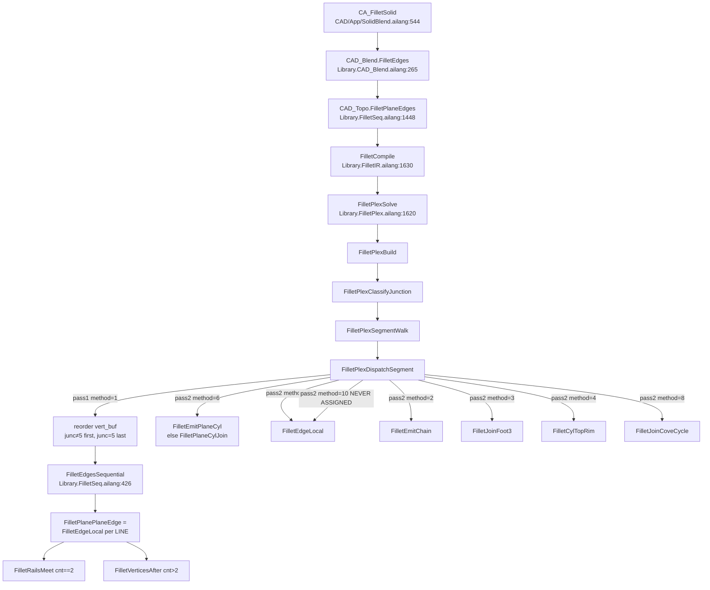

# Fillet multi-segment LINE sequential vs working cylinder/circle

**2026-10-29 live handoff:** `docs/cad/FILLET_JUNC5_HANDOFF.md`. Latest GUI: `CAD/screenshots/junc5-latest.png`.

| Field | Value |
|-------|-------|
| **Title** | Multi-segment straight-LINE fillet: architecture review + emit-time terminator plan |
| **Author** | (draft for review) |
| **Date** | 2026-10-28 |
| **Status** | Draft (rev 4). PR0–PR4 landed 2026-10-29. NotchHost swaps the **lid twin only** of the host CIRCLE (blocker rim stays full). Method-9 top-edge mer sew uses `FilletMerCloser` (proximity), not curve kind. |
| **Workspace** | `/home/bob/Ailang-Self-Hosting-` |
| **Verified in code** | 2026-10-28 (re-read, not reconstructed from memory) |
| **Parent docs** | `docs/cad/AILANG_FILLET_COVE_DESIGN.md` (2026-08-23 join-cove; **call graph there is STALE** — `FilletPlaneEdges` now returns `FilletPlexSolve`), `docs/cad/CAD_PROGRESS.md` §4, `docs/cad/CAD_BREP_BOOL_FILLET.md` |
| **This task** | Document the live architecture, lock the constraints that already failed, and stage PRs so the first geometry change cannot degenerate the lid. Do not ship another post-pass. |

Do **not** rewrite the parent docs. Cite them. The 2026-08-23 join-cove design still owns concave inner plane–plane *cycles* (method 8). This document owns the **open all-LINE chain** that stops against an **unselected** cylindrical face (junc=5).

---

## Overview

Three (or more) selected straight LINEs on a box lid, with an unselected extruded 2D-arc as the south wall, classify correctly and then fail at emit. Plex tags the south ends `junc=5` (open LINE vs cylindrical blocker), tags the NE/NW corners `junc=1` (two-LINE cope), and assigns **method 1 SEQUENTIAL** to every rail. `FilletEdgesSequential` then calls `FilletEdgeLocal` per LINE. EdgeLocal never reads plex junction tags. Shared vertices and cylindrical end-faces zero `endf` (`mer skip cyl seq`). `FilletRailsMeet` copes the two `cnt==2` rear corners. The lid loop still contains the **unshortened south CIRCLE** (that CIRCLE *is* the 4th lid side — lid ∩ blocker, one shared edge) → rhombus/trapezoid. The two south ends (`cnt==1`, `junc=5`) have **no terminator after the skip**, so the fillet cylinders hang past the inverted south arc. The blend 4-cycle already has both mers (`arc0`/`arc1` at the original vertices); hang-past is the cylinder spanning the original edge, not a missing mer object.

Pure circle fillets on cylinders are fine: `n=1 CIRCLE` → method 6 → analytic torus (`FilletEmitPlaneCyl`, IR pair=1), one rail, no copes. A lone box LINE is also fine: `n=1 LINE` → method 9 → `FilletEdgeLocal` with meridians sewn into the two **planar end walls** and no vertex join.

The proposed fix is **not** a new method, **not** emit-chain on the whole ring, and **not** a post-pass that plants `Th` after EdgeLocal has already built the blend. Sequential method 1 and junc=5 stay. The vertex function owns the south end **when the rail is emitted**, identical left and right: shorten that end's `C` so the existing `MakeMinorArcEdge` runs at the Th∩blocker station (same circular mer as a closed method-9 end, different parameter). Host CIRCLE stays full through PR2. PR3 is a **PR2 review checklist** (same GitHub PR as PR2; do not open an empty surgery PR): both south mers exist, identical L/R, host still full, lid still rhombus — honest incomplete. PR4 is the rhombus-kill: **`FilletEdgesSequential` calls `FilletPlexResolveNotch` after VerticesAfter**, ignores the return (same as RailsMeet), always `ReturnValue(h)`. ResolveNotch walks already-minted mer lid-side vertices, then calls `NotchHost` with both Th. Sequential does **not** call `NotchHost(...)` with missing args. Shrink the shared south CIRCLE to the minor arc Th_a–Th_b on the original SW→SE sense. “Outside cliff” is the limiter **face** remaining as a wall, not a complementary curve. Do not sew the mer twin into the lid — the mer is ⊥ rail (Th on lid to Tw on wall) and does not lie on the lid. Method-9 mer sew is into the **end face**, not the lid.

---

## Background & Motivation

### Why this change is needed

Commercial CAD treats an open LINE that dies into an unselected cylinder as a **rolling-ball cylinder whose end is a notch/cliff trim** (fillet ∩ limiter). It is **not** a 3-face blend of the unselected arc, and it is **not** a 4th fillet of that arc. The user's "emit longer then lathe-cut" is the same notch-trim.

The kernel already classifies this case. `FilletPlexIdentifyRailArc` + `FilletPlexJuncAt` compute `junc=5` and stash the blocker in plex slots 10/11. Dispatch even reorders `vert_buf` so `junc≠5` rails run first. None of that changes rail geometry, because EdgeLocal ignores the tags and the junc=5 helpers are dead.

Historical failure mode (do not repeat): implementing junc=5 as a **post-pass after EdgeLocal planted `Th`**, or as **sequential `CircleEnd` of the host**, degenerated the top face. The live parked solid is accepted as *incomplete*, not as a degeneration — lid is a rhombus, fillets hang past the south arc, topology is still a solid. The next geometry PR must not make that worse.

### Current state (product path)

```
CA_FilletSolid                          CAD/App/SolidBlend.ailang:544
  → CAD_Blend.FilletEdges               Library.CAD_Blend.ailang:265
      → CAD_Topo.FilletPlaneEdges       Library.FilletSeq.ailang:1448
          → FilletCompile               Library.FilletIR.ailang:1630
          → FilletPlexSolve             Library.FilletPlex.ailang:1620
```

`CAD_Blend.FilletEdge` (single pick) packs the edge and calls `FilletEdges` (`Library.CAD_Blend.ailang:74–87`). There is no remaining try-chain on the product path. `docs/cad/AILANG_FILLET_COVE_DESIGN.md` lines 38–54 still draw `FilletPlaneEdges` → Digon-vs-sequential and `FilletEdge` try-chain; that graph is **STALE**. `docs/cad/CAD_PROGRESS.md` §4 still describes Digon as the multi-edge shared-vert path; that is **STALE** for the plex dispatcher (method 7 DIGON is defined in `FilletPlexDispatchSegment` Case 7 and **never assigned** by `FilletPlexClassifyJunction`).

### Pain points (live)

| Symptom | Cause in code |
|---------|----------------|
| Fillets hang past the unselected south arc | `cnt==1` south junc=5: EdgeLocal skips mer sew (`FilletIRFaceKind==2`); cylinder still spans the original edge |
| Lid becomes a rhombus / trapezoid | After `FilletRailsMeet` at NE/NW (`cnt==2`), the lid loop still contains the **unshortened south CIRCLE**. That CIRCLE *is* the 4th lid side (shared edge, lid ∩ blocker). RailsMeet does not read lid sides; the rhombus is a result, not an input |
| West vs east tess triangle vs round (when RailArcShift was live) | Off-plane Th (Th written, C not). `MeshRuledLoop` then zipped a collapsed 2-point against a round arc. West south at blend-loop slot 1 and east south at slot 3 is **required** (edge orientation), not the bug |
| Comments claim a solver that does not run | Three lying comments vs zero call sites for `FilletPlexRailArcShift(` / `FilletPlexJunc5(` |
| Dispatch reorder looks like a fix | Pass 1 puts `junc≠5` first, `junc=5` last, then still calls sequential EdgeLocal. Order ≠ geometry |

### Live parked case (user-accepted incomplete)

No frozen STEP of this solid is in the repo today. Do not invent a path. Reconstruct (interactive or a future headless demo):

- ~50 mm box pad (sketch rectangle ≈ 50×50 mm, extrude ~20 mm).
- South wall is an **extruded 2D-arc, unselected**. Arc R varies ~43–65 mm, centre ≈ `(0, −72..−86)`.
- Three LINE top rails **selected** (west, north, east). South CIRCLE not in the pick set.
- Fillet `R_um=8000`.

```text
              north  (j0=1, j1=1 — both copes)
         NW •─────────────────────• NE
            │                     │
     west   │        lid          │  east
   j0=1     │                     │  j0=5
   j1=5     │                     │  j1=1
            │                     │
         SW •────── (arc) ───────• SE
              south CIRCLE unselected
              (extruded 2D-arc; inverted vs the three LINEs)
              4th lid side = this CIRCLE (shared with blocker)
```

Live log this session (classify dump; attach the full `/tmp/cad_app/fillet_math.log` excerpt at PR0/PR1 once the next interactive run of *this* solid happens — the log currently in `/tmp/cad_app/` may be a different apply):

- All three rails `meth=1`.
- West `j0=1 j1=5`, north both copes, east `j0=5 j1=1`.
- Both south mers: `mer skip cyl seq`.
- Rear meet ok NE/NW (`FilletRailsMeet` `cnt==2`).
- South `cnt=1` (no RailsMeet, no `FilletVerticesAfter`).
- Lid rhombus; fillets hang past the inverted south arc.

A lone selected box LINE on the same kernel logs `meth=9`, `nsel=1`, `"fillet LOCAL not plane-cyl"` and sews both meridians into the planar end walls. A lone cylinder CIRCLE logs method 6 and emits a torus.

**Headless gates that already exist** (do not launch the GUI):

| Gate | Recipe | Command |
|------|--------|---------|
| `n=1 LINE` method 9 | `CAD/demo_fillet_edge.ailang` — box 40×30×20, R=5 one vertical | `./ailang.x CAD/demo_fillet_edge.ailang /tmp/dfe && /tmp/dfe` → `test-stl/cad_fillet_edge.stp` |
| `n=1 LINE` method 9 top edge | `CAD/demo_fillet_horiz.ailang` — same box, R=5 top-front along X | `./ailang.x CAD/demo_fillet_horiz.ailang /tmp/dfh && /tmp/dfh` → `test-stl/cad_fillet_horiz.stp`. Log must show `hdZ` and `lnZ` differ by R (20 vs 15), not both Tw. |
| `n=1 CIRCLE` method 6 | `CAD/demo_fillet_cyl.ailang` — cyl r=15 h=30, R=4 top rim | `./ailang.x CAD/demo_fillet_cyl.ailang /tmp/dfc && /tmp/dfc` → `test-stl/cad_fillet_cyl_top.stp` (also `CAD/smoke_phase_c.sh`) |

**Parked three-LINE solid — no in-repo STEP.** After the next interactive reconstruct, freeze:

- Log excerpt: copy `/tmp/cad_app/fillet_math.log` (the `plex nd=` / `mer skip cyl seq` / `meet ok` lines) to `docs/cad/notes/` when that run happens. Do not claim that notes file exists today.
- STEP: `cad_cmd.sh step` on a *already running* cad_app writes `test-stl/cad_app_live.stp` (`CAD/App/IpcS.ailang:220–227`). Suggested freeze name once captured: `test-stl/cad_fillet_multi_segment_parked.stp`. **That path does not exist today.**
- IPC helper: `CAD/scripts/cad_cmd.sh` (exists). Sends one command to a running cad_app. **Do not start `run_cad_app.sh` from this plan.**

Until that freeze exists, PR0/PR1 gates are: (a) method 9 / method 6 demos still green, (b) comment-only / log-only diffs, (c) reconstruct recipe above as the visual look-at when the user next has the solid.

`CAD/demo_fillet_box_2round.ailang` is **not** this case (selected MIXED 3 LINE + 2 ARC). Do not use it as the parked-case fixture.

---

## Goals & Non-Goals

### Goals

1. **Document truth.** This file is the architecture review. PR0 also rewrites the three lying comments so the next reader is not sent into dead helpers.
2. **Keep plex as the exclusive classifier.** Sequential junc=5 + three-LINE method=1 stay. Do not force whole all-LINE rings onto emit-chain.
3. **Emit-time terminator, same function left and right.** At a junc=5 end, inside `FilletEdgeLocal`, shorten that end's `C` to the Th∩blocker hit **after `ln` is set (411), immediately before contact `MakeVertex` (413)**, so the existing `MakeMinorArcEdge` runs at that station. The blend already has both mers; PR2 moves the station. Vertex function owns the south end **when the rail is emitted**.
4. **Do not degenerate the lid in the first geometry PR.** PR2 shortens rails; host CIRCLE stays full; lid stays rhombus (honest incomplete). PR3 is a PR2 review checklist (no empty surgery PR). PR4 is the rhombus-kill: Sequential after VerticesAfter calls `FilletPlexResolveNotch` (ignore return, always `ReturnValue(h)`); ResolveNotch calls `NotchHost` with both Th. Kept curve is the original SW→SE host shrunk to the minor arc Th_a–Th_b. A closed 4-LINE box (method 1, no cyl blocker) is a ResolveNotch no-op (return 1).
5. **Mer loop-slot stability.** Keep EdgeLocal ring order: mer v1 = slot 1, mer v0 = slot 3, always. West south at slot 1 and east south at slot 3 is **required** (edge orientation), not a defect. Do **not** call existing `FilletPlexRailArcShift` (that wrote Th off the fillet circle). Tess constraint is **Th stays on the fillet circle** (planar circular section of C), not “south occupies the same numeric slot on both rails.”
6. **Observability before geometry.** PR1 logs `FilletPlexJuncAt` at v0/v1 vs mer skip with no geometry change, proving classify matches emit.
7. **No regression** on: `n=1 CIRCLE` method 6 torus; `n=1 LINE` method 9 local; closed-end mer construction of method 9 (PR2 copies it at a different parameter); closed 4-LINE box (method 1, no cyl blocker) — PR4 ResolveNotch is a no-op return 1.

### Non-Goals (locked — do not ship)

- Force whole all-LINE rings onto emit-chain (`FilletEmitChain`).
- Assign method 10 in **PR0–PR4**. Case 10 may keep calling `FilletEdgeLocal` as a label later, only after the terminator already lives inside EdgeLocal. Splitting west/east onto method 10 would skip `FilletRailsMeet` for those segments (pass 1 only runs `method==1`).
- West/east remainder recipes. Left and right are the **same function**.
- Later host rewrite as the first step. No sequential `CircleEnd` of the south host. No `FilletPlexClipHostArc` live. Host trim is PR4, after PR2+PR3 verify L/R with the host still full. PR4 does **not** run inside EdgeLocal (that is a two-path remainder). Sequential does **not** call `NotchHost` with missing args. Do not reuse `FPlex.th0` / `th1` / `j5` / `j5host`. Do not keep the complementary (long-way) host arc. Do not `FindEdgeBySig` on stale plex slot 0. Do not hunt nearby CIRCLEs (that can pick the NE/NW cope ellipse).
- Sew the native mer twin into the **lid**. Method-9 mer sew is into the planar **end face**. The mer does not lie on the lid. Sewing it there is the 17:47 frustum class.
- Invent cope/sphere for selected sharp mixed (`nsel==2`). XYZ sphere only `nsel>2`. Two-LINE cope. G1 LINE+ARC skip. Sharp ARC+LINE refuse is `MixFixSharp` reason 12.
- Call `FilletPlexRailArcShift` from EdgeLocal as currently written.
- Resurrect `Library.FilletUnused.ailang` (parked, not imported from `Librarys/Cad/Library.CAD_Topo.ailang`).
- Restore / ship any of: `CloseBot`; `CylClipVert` as mer; `SampleEllipseByEnds` as mer; line-stitch; θ-zip; off-edge/far-sheet root; N2 `PointInSolid` flip; `inner=0→mode=2`; rim-circle overlay; sequential `CircleEnd` of the south host; `CylMer` lathe samples (`k·π/8` over π/2); `ClipHostArc` live; `CylMer`+sew `nswap`; `FaceRetargetVert` as a geometry move on inner loops (and do not retarget original SW/SE onto Th).
- Degree-4 bicylindrical mer for unequal-R plane×cyl (later; PR2 is the circular section of the fillet cylinder). Sewing that mer into the **blocker** is the method-9 analog for a cylindrical end — forbidden until the mer actually lies on the cylinder.
- Closed 4-LINE box ring lid audit; MIXED selected LINE+CIRCLE (later).
- Launch the CAD GUI (`CAD/scripts/run_cad_app.sh`) unless asked.
- Gtk / camera / pick changes. Feature-tree persistent naming of blend faces. Variable-R / G2.

---

## Current Architecture (verified 2026-10-28)

### Call graph



`FilletPlaneEdges` (`Library.FilletSeq.ailang:1448–1465`) is a two-call wrapper: `FilletCompile` then `return FilletPlexSolve(...)`. The old Digon-vs-sequential Branch that `AILANG_FILLET_COVE_DESIGN.md` documents no longer lives here.

### Plex node slots (`Library.FilletPlex.ailang` header, lines 40–72)

| Slot / field | Meaning |
|--------------|---------|
| 0 | Edge handle |
| 1 | Face A |
| 2 | Face B |
| 3 | v0 |
| 4 | v1 |
| **5** | **IR pair type** (`FilletIRGet(i, 11)`). 0 = LINE, 1 = plane–cyl, … An implementer reading slot 5 as curve kind sees 0 for LINE, not 1 |
| **Plex type** | Set at `Plex.Alloc(ckind)` (`FilletPlexBuild` 125–128): **1 = LINE** if `pair_t==0`, **2 = CIRCLE** otherwise. Classify uses `Plex.Type(cur)` / `RingCountType`, not slot 5 |
| 6 | Assigned solve method |
| **7** | **Not a stable v0 encoding.** Classify writes `junc_type = j0; if j0==0: junc_type = j1` then `Plex.Set(cur, 7, junc_type)` (1302–1303, 1381). A rail with `j0=0` and `j1=5` stores slot 7 = 5. Dump lines log raw `j0`/`j1` (1385–1386) |
| 8 | Segment ID |
| 9 | Fillet IR index |
| 10 | Blocking cyl face at v0 (`b0`; only set if nonzero) |
| 11 | Blocking cyl face at v1 (`b1`; only set if nonzero) |
| **12** | Junction at v1 — **always `j1`** (1382). No fallback |

A rail can be cope at the back and rail-arc at the south. `FilletPlexJuncAt` is independent per vertex (comment at 355–356). **PR1/PR2 must call `FilletPlexJuncAt(v0, f1, f2)` and `FilletPlexJuncAt(v1, f1, f2)`.** Do not treat slot 7 as “junction at v0.” Slot 7's fallback is a classifier quirk, not the EdgeLocal API. Do not invent a parallel `j5[]` (`CAD_Topo_FPlex.j5` is the dead post-pass bank; `FilletPlexInit` 86 already `Allocate(512)` for it every solve — leave it unused; PR1 must not start writing it).

Node lookup that already exists: `FilletPlexGetNode(idx)` at line 187 (IR index, 0..count-1). Pair with `FilletIRIndexOf(FLoc.edge)` (`Library.FilletIR.ailang:228`). Slots 10/11 are per-end and do **not** have the slot-7 fallback; they may be read after that lookup for the blocker handle. Junction tests still go through `JuncAt`.

### Junction per vertex — `FilletPlexJuncAt` (357–370)

This is the sequential/plex tag. It is **not** the MixFixSharp enum in `Library.FilletClassify.ailang`.

```text
FilletPlexIdentifyRailArc(v, skip1, skip2) nonzero
    → 5 RAIL_ARC
    IdentifyRailArc (341–353): FilletIRCountAt(v)==1 AND FilletPlexBlockingFace
    returns a face whose surface kind is 2 (cylinder). skip1/skip2 are the
    rail's two support faces.

else nsel > 2  → 4 XYZ_SPHERE
else nsel == 2 → 1 SHARP_COPE
else           → 0 NONE
```

`FilletPlexBlockingFace` header 272–273 says “Any surface kind”; the body 311–317 returns only surf kind 2. IdentifyRailArc as described here is accurate. That header is **not** in the PR0 comment list (do not expand PR0 into a comment sweep).

`FilletPlexJuncAt` does not inspect curve kind. On an all-LINE ring `nsel==2` is two-LINE cope, which is the intended tag. Selected sharp mixed (`nsel==2` LINE+ARC, not G1) is **MixFixSharp / classify policy**, not this function: `MixFixSharp` (`Library.Fillet.ailang:1035`) refuses with `fillet_reason = 12` (`"fillet refuse: sharp arc-line in compound"`). G1 LINE+ARC is skip (`ClassifyFilletJunction` returns 4 MIXED_ARC_LINE on the emit-chain path). **Do not invent cope/sphere for selected sharp mixed.** XYZ sphere only `nsel>2`. Two-LINE cope. G1 LINE+ARC skip.

`FilletPlexClassifyJunction` MIXED branch (1338–1376) may overwrite the local `j0` with 2/3/4 for emit-chain colouring and then write that into slot 7 while slot 12 stays original `j1`. Sequential all-LINE never takes that branch. Do not treat the MixFixSharp header enum (`0 none, 1 TRIHEDRAL_SPHERE, 2 SHARP_COPE, 3 STADIUM_ARC, 4 MIXED_ARC_LINE, 5 RAIL_ARC` in `Library.FilletClassify.ailang:5–6`) as the plex slot 7/12 encoding. Plex header comment (48) is the sequential encoding: `1=cope 2=tangent 4=sphere 5=rail-arc`.

### Method assignment — `FilletPlexClassifyJunction` (1276–1398)

| Condition | Method | Solver |
|-----------|--------|--------|
| `total_nodes==1` and node type 2 (CIRCLE) | **6 PLANE_CYL** | `FilletEmitPlaneCyl` else `FilletPlaneCylJoin` |
| `total_nodes==1` and LINE | **9 EDGE_LOCAL** | `FilletEdgeLocal` |
| all-LINE `n≥2` | **1 SEQUENTIAL** | `FilletEdgesSequential`. Plex does **not** call `FilletJoinFootOk` / `FilletJoinHasGlue` (those read leftover `FSeq` and GPF after a prior sequential). Method 3/8 stay defined; classify does not assign them on all-LINE. |
| all CIRCLE and `FilletIRRimCycle==1` | **4 CYL_TOP_RIM** | `CAD_Blend.FilletCylTopRim` |
| all CIRCLE, else | **2 EMIT_CHAIN** | `FilletEmitChain` |
| MIXED LINE+CIRCLE | **2 EMIT_CHAIN** | `FilletEmitChain` |
| **10 RAIL_ARC** | **DEFINED, NEVER ASSIGNED** | Case 10 still calls `FilletEdgeLocal` |

Methods **5 CYL_BOT_RIM** and **7 DIGON** are dispatch cases (`FilletPlexDispatchSegment` 1570–1587) with **no assign site** in `FilletPlexClassifyJunction`. A lone cylinder bottom rim is `n=1 CIRCLE` → method 6, not 5. A closed 4-LINE box rim is all-LINE `n≥2` → method 1, not Digon. Out of this plan except: do not regress those Case arms, and do not "fix" box rings by assigning method 7 here.

Default `method = 1` at line 1293 is overwritten for `n==1`. Comment at 1315–1317 is the locked policy: *"Open rails vs an unselected curve stay sequential — emit-chain + open-end cope rips the host."*

### Sequential body — `FilletEdgesSequential` (426–525)

1. Snapshot 12-word edge sigs + original handles at `sigs[200+i]`.
2. `FilletVertNote` every endpoint into `CAD_Topo_FVert` (`cnt` per XYZ).
3. Per edge: `FindEdgeBySig`, refuse non-LINE (`curve kind ≠ 1`), `FilletPlanePlaneEdge` = `FilletEdgeLocal` (`Library.Fillet.ailang:690–697`, one-line wrapper).
4. `FilletRailsMeet(h, r)` — **`cnt==2` only** (`FilletRailsMeet` 91–96 → `FilletRailsMeetAt`). Called at line 522, **after** the EdgeLocal loop (426–517).
5. `FilletVerticesAfter(h, r)` — **`cnt>2` only** (`Library.FilletVertex.ailang:537–562` → `FilletVertexSphere`). Called at line 523.
6. **PR4 insert:** `FilletPlexResolveNotch` after step 5, before `ReturnValue` (524). Ignore the return, same as `FilletRailsMeet` at 522. Sequential always `ReturnValue(h)` (524). Sequential does **not** call `NotchHost(...)` with missing args. Not inside the EdgeLocal loop.

`cnt==1` (south junc=5) is in the vert table and is ignored by both join passes. Sequential's `sigs[200+i]` holds the three selected LINEs; the unselected south CIRCLE is not in that list. After the EdgeLocal loop, `FLoc.ring` is gone (overwritten per rail) and plex slot 0 is stale (original LINE already swapped to the generator at EdgeLocal 516–534).

### EdgeLocal mer skip and method-9 sew — `FilletEdgeLocal` (273–687)

EdgeLocal does **not** read plex slots 7/12 and does not call `FilletPlexJuncAt`. End-face selection (535–573):

1. `endf = FindFaceWithVert(solid, vv, f1, f2)`.
2. `FilletVertShared(x,y,z)==1` (shared vert, `cnt>1`) → `endf = 0` (defer cope to RailsMeet).
3. If still 0, `endf = FilletPlexBlockingFace(...)` (the cylindrical south wall).
4. `FilletIRFaceKind(endf)==2` → log `"mer skip cyl seq"` and `endf = 0`.

Reason for (4), in-code at 566–569: sequential `CircleEnd` of a shared host CIRCLE is two paths (west remainder vs east remainder = triangle vs round). Skip both ends. Same function, same mer.

**Method-9 mer sew is into `endf`, the planar end wall, not the lid.** When `endf` is a plane (`FilletIRFaceKind≠2`) and not shared, EdgeLocal inserts the mer coedge into that end face (`CoedgeInsertAfter`) and `FilletEmitMerSupport`s the two host edges at Th/Tw. The **lid is a support face**, trimmed by `CoedgeSwapEdge` of the original LINE onto the generator — the lid never receives the mer. The mer is `MakeMinorArcEdge` on the fillet circle in the end plane: quarter-circle Th (on the lid) to Tw (on the wall). Only Th lies on the lid.

**Method-9 LINE/LINE end wall assigns Th/Tw by proximity, not curve kind.** The old `kind==2 → Th / LINE → Tw` rule gave both end-wall LINEs `Tw` on a top-edge fillet (`hdZ=lnZ=Tw`). `EdgeRetargetVert` then pulled the lid corner down — the triangular spike on the first box top-front fillet. `FilletMerCloser` picks, for each host edge at V, the mer vertex closer to that edge's other end. Vertical-edge demo hid this because Th and Tw share Z on the top plane. Gate: `demo_fillet_horiz` log `hdZ`/`lnZ` differ by R. Kind=2 mer-sew skip is unchanged.

A cylindrical `endf` does **not** contain that circular mer (the mer plane is ⊥ rail; the blocker is a different cylinder). Kind=2 skip is the correct refusal of the method-9 analog. Sewing the mer into the blocker is forbidden until a curve that actually lies on that cylinder (degree-4, later). Sewing it into the lid puts a non-planar (vertical) edge on a planar face — the 17:47 frustum class.

After the skip, **nothing shortens the rail.** The blend 4-cycle still exists (generators + two native mers on the fillet circles at the **original** vertices, `arc0`/`arc1` at 482–510). Those mers are not sewn into the lid or the blocker. The cylinder therefore spans the original edge and hangs past the arc. PR2 moves the station of those same `MakeMinorArcEdge` calls; it does not add a mer object.

Native blend loop (493–510), **always this order**:

```text
ring[0]  A-gen  (ega)  origin va0
ring[1]  mer v1 (arc1) origin va1     ← south mer when south is v1 (west rail)
ring[2]  B-gen  (egb)  origin vb1
ring[3]  mer v0 (arc0) origin vb0     ← south mer when south is v0 (east rail)
```

Comment at 493–494: *"junc=5 lathe is a later pass, after every LINE rail exists."* That pass never runs.

Comment at 431–435 (true; do not violate):

> Native mer on the fillet circle. Do not RailArcShift here: `which=0` vs `which=1` puts the south mer at loop slot 3 vs 1, then `MeshRuledLoop` samples circle-first vs ellipse-first — off-plane Th makes one end a 2-point triangle and the other a round arc. Same function, two tess paths. Not a sign flip.

The tess failure of RailArcShift was **off-plane Th** (Th written, C not). `MeshRuledLoop` (`Librarys/Cad/Tess/Library.TessCollect.ailang:437`) zips the curved opposite pair of a 4-cycle. Keep ring order. Do not require west and east south mers to share a numeric slot.

### RailsMeet lid rewrite — `FilletRailsMeetAt` (231–423)

For each `cnt==2` vertex, find two nearby CIRCLE meridians on **blend faces** near P, build the Steinmetz far point `pa+pb−P`, `MakeEqualRDigonEdge`, `FilletRailsMeetLineTo` / `FilletRailsMeetPin`, swap both mer coedges onto the cope ellipse. On the parked solid this fires at NE and NW (`"meet ok"` / `"fillet rails meet"`). RailsMeet does **not** iterate lid sides. The rhombus is a *result* of the lid loop still containing the unshortened south CIRCLE after those copes. That CIRCLE is the 4th lid side (shared with the blocker). Killing the rhombus is host-side trim of that CIRCLE between the two Th points (PR4), not a mer-sew into the lid, and not something RailsMeet “sees.”

### Dispatch pass 1 reorder (1498–1535)

`vert_buf` is filled `junc≠5` first, then `junc=5`. Then `FilletEdgesSequential(solid, vert_buf, count, r)`. Reorder does not change rail span, mer construction, or the skip. It is not a terminator. (Pass 1's junc test reads slots 7 and 12 — the slot-7 fallback can mark a rail “junc=5” because of v1. Harmless for reorder; **do not copy that test into EdgeLocal's which-end branch.**)

### Why cylinder CIRCLE works

`n=1 CIRCLE` → method 6 → `FilletEmitPlaneCyl` (`Library.FilletEmit.ailang:959`). Gates: IR pair type 1 (slot 11) and SOLVE class 4 (slot 15). Emits a torus (`FilletEmitMakeGeom`), one rail, meridians analytic, no copes. Fallback `CAD_Blend.FilletPlaneCylJoin` → `FilletBossBaseCove`. A lone cylinder may also take method 4 `FilletCylTopRim` when the classified set is an all-CIRCLE rim cycle (`n≥3`, every vert `FilletIRCountAt==2`). `FilletSolvePlaneCyl` (`Library.FilletEmit.ailang:71`) is the EdgeLocal plane–cyl station solver (`mode=1`); sequential LINEs log `"fillet LOCAL not plane-cyl"` and never enter it.

### Why single box LINE works

`n=1 LINE` → method 9 → `FilletEdgeLocal`. One cylinder. Meridians are `MakeMinorArcEdge` on the fillet circles in the two **end planes** (the planar walls at v0/v1) and are sewn **into those end faces**. `FilletVertShared` is 0 (`cnt==1` both ends, and those ends are planes, `FilletIRFaceKind≠2`), so both mers sew. No vertex join. Live log: `meth=9`, `nsel=1`, `"fillet LOCAL not plane-cyl"`.

PR2's south mer is this same construction at a **different parameter**, not a new surface type. PR2 does **not** sew it: the south end-face is cylindrical.

---

## Dead code and lying comments

### Zero call sites (grep 2026-10-28)

| Symbol | Definition | Call sites |
|--------|------------|------------|
| `FilletPlexRailArcShift(` | `Library.Fillet.ailang:150` | **none** (only the def + two comments) |
| `FilletPlexJunc5(` | `Library.FilletPlex.ailang:1112` | **none** from EdgeLocal / Sequential / Dispatch |
| `FilletPlexJunc5At` / `Shift` / `EmitEnd` / `FindHost` / `ResolveHost` / `ReplaceMer` / `SewSouth` / `ClipHostArc` | same file 605–1143 | only each other |
| `FilletPlexCylMer(` | 470 | **none**. Samples `k=1..3` at `k·π/8` (`0x3FD921FB54442D18`), 5 samples over π/2, not strictly “π/4 lathe samples.” Do-not-ship intent stands |
| `FilletPlexCylClipVert(` | 374 | **none** |

`FilletPlexJunc5` is a post-pass: stash during skip → resolve shared host → shift Th onto host CIRCLE → `ClipHostArc`. That is the failed architecture. Do not resurrect these helpers as-is. Math worth stealing (Z-cyl quadratic hit, Th vs Tw selection by `|Nz|`) can be copied into a **new** emit-time helper; the control flow cannot. Name the new helper so it does not look like a caller of this cluster.

`Library.FilletUnused.ailang` is parked, not in the `CAD_Topo` facade import list (`Librarys/Cad/Library.CAD_Topo.ailang:51–63`; FilletPlex is line 63). Do not resurrect. Facade header line 22 still says *“FilletSeq classifier + FilletPlaneEdges Branch”* — stale; **out of this doc's PR0 rewrite set.**

### Lying comments (PR0 rewrites these three only)

| File | Lines | Lie | Truth |
|------|-------|-----|-------|
| `Library.FilletPlex.ailang` header | 55–60 | `"FilletPlexJunc5EmitEnd runs INSIDE EdgeLocal at that end"` | `FilletPlexJunc5EmitEnd` has no caller outside the dead Junc5 cluster. EdgeLocal does not call it. |
| `Library.FilletClassify.ailang` | 7–8 | `"sequential calls FilletPlexRailArcShift"` | Zero calls. Sequential calls EdgeLocal, which skips cyl ends. |
| `Library.FilletPlex.ailang` Case 10 | 1597–1599 | `"FilletPlexRailArcShift inside FilletEdgeLocal"` | Method 10 is never assigned; Case 10 calls `FilletEdgeLocal` with no shift. |

Do not expand PR0 into a comment sweep of `BlockingFace` / `CAD_Topo` facade.

### True comments (leave / cite)

- EdgeLocal 431–435 — tess failure of RailArcShift was off-plane Th (quoted above).
- EdgeLocal 493–494 — "later pass" (honest about intent; the pass is missing).
- `FilletPlexSolve` 1643–1649 — *"Junction tags (cope / rail-arc) are NOT read by EdgeLocal. Case 10 is never assigned. This is a classifier in front of the old sequential recipe, not a per-vertex solver."* Dump line `"seq EdgeLocal, skip cyl both"` is honest.

---

## Key Decisions

1. **Plex is the classifier, not the solver.** `FilletPlexSolve` builds rings, writes method + junc tags, and dispatches. Geometry stays in EdgeLocal / RailsMeet / Emit*. Do not grow plex into a second surgery kernel. EdgeLocal's junction API is **`FilletPlexJuncAt(v, f1, f2)` per end**, not slot 7. Slots 10/11 may supply the blocker after `FilletIRIndexOf` + `FilletPlexGetNode`. Do not invent a parallel `j5[]`.

2. **Method 1 stays for all-LINE `n≥2`.** Open rails vs an unselected curve stay sequential. Rationale: emit-chain + open-end cope ripped the host. The three-LINE parked case is exactly this class. Plex classify does **not** call `JoinFootOk` / `HasGlue` (FSeq leftover from a prior sequential GPF'd the inward-arc n=3 case). Method 3/8 remain defined in dispatch; all-LINE rings do not assign them.

3. **Emit-time terminator, not post-pass.** The vertex function owns the south end **when the rail is emitted**. Identical L/R. No later host rewrite as the first step. Rationale: every post-pass that planted Th after EdgeLocal, or CircleEnd'd the host first, degenerated the lid.

4. **Kind=2 mer-sew skip stays in v1.** `FilletIRFaceKind(endf)==2` continues to zero `endf` in PR0–PR4. After a successful PR2 shorten, still skip. Do not `FilletEmitMerSupport`. Do not sew the circular mer into the blocker (it does not lie on that cylinder) or the lid (it does not lie on the lid). Rationale: method-9 sew is into a planar end wall that contains the mer. Sequential CircleEnd of the shared host is the triangle-vs-round bug.

5. **Host trim is last (PR4) and is the rhombus-kill.** Host CIRCLE stays full through PR2 and the PR3 verify gate. Sequential's call is **`FilletPlexResolveNotch` after `FilletVerticesAfter` (523)** — not EdgeLocal, not `NotchHost` with missing args. Ignore the return; always `ReturnValue(h)`. ResolveNotch calls `NotchHost` only when it has exactly two Th and one host. Notch-trim is fillet ∩ limiter, **one call, both Th**, both twins. Kept curve = the live south CIRCLE **shrunk to Th_a–Th_b on the original SW→SE sense** (minor arc on that same circle). Origin map (no `j5[]`): `Th_a` nearer `host.v0`, `Th_b` nearer `host.v1`; `CoedgeSwapEdge(ce, new_arc, Th nearer ce.origin)` — the EdgeLocal 522–525 map. “Outside cliff” is the limiter **face** remaining as a wall, not a complementary curve. The 4th lid side *is* that CIRCLE; you cannot have “lid 4-of-4 shortened” and “host CIRCLE still full” as two facts about the same shared edge. Closed 4-LINE box (method 1, no cyl blocker) is a no-op return 1, not fail. Rationale: trimming the host before L/R mers match inverted the south arc; sewing a mer into the lid is the 17:47 frustum; NotchHost inside EdgeLocal is the triangle-vs-round two-path remainder.

6. **Same function left and right.** No west/east remainder recipes, no `which=0` vs `1` control-flow split that rebuilds the blend loop in a different order, no N2 PointInSolid sign pick as the primary root (RailArcShift used `in0`/`in1` as a last resort; do not revive that as the design).

7. **Mer loop-slot rule is ring order, not west==east index.** Mer v1 always slot 1, mer v0 always slot 3 (`FilletEdgeLocal` 493–510). West south at slot 1 and east south at slot 3 is required. Tess constraint: do not write Th off the fillet circle. Do not call existing `FilletPlexRailArcShift`.

8. **Do not resurrect dead Junc5 helpers as-is.** They encode the failed post-pass (stash → resolve host → shift Th onto host → ClipHostArc). `FilletPlexCylMer` (`k·π/8` lathe samples) and `FilletPlexCylClipVert` (Tw as mer) are on the do-not-ship list. New helper name must not look like a caller of that cluster.

9. **Do not assign method 10 in PR0–PR4.** Keep method 1, branch inside EdgeLocal at the junc=5 end. Method 10 stays unused until a single open LINE vs cyl is classified `n=1` — and that case is already method 9 with **no blocker** (`IdentifyRailArc` requires `nsel==1` *and* a cyl face; a lone box LINE's ends are planes). Assigning method 10 to west/east would split the sequential batch and skip `FilletRailsMeet` for those segments. See Open Question 3.

10. **Junction policy stays MixFixSharp/JuncAt as written.** XYZ sphere only `nsel>2`. Two-LINE cope. G1 LINE+ARC skip. Sharp mixed `nsel==2` refuse reason 12. Do not invent a 3-face blend of the unselected arc.

11. **Commercial CAD target is notch/cliff trim, not a 4th fillet.** True mer against an unequal-R host is degree-4 bicylindrical — later. v1 mer is the circular section of the fillet cylinder (equal-R Steinmetz with a plane), matching method 9.

---

## Proposed Design

### Staging invariant

Each shippable PR must be independently reviewable. PR3 is a named checklist inside the PR2 review, not a separate commit. **The first PR that touches geometry (PR2) must not rewrite the host and must not sew a mer into the lid.** Historical failure: junc=5 as post-pass after EdgeLocal planted Th, or as sequential CircleEnd of the host, degenerated the top.

Staging: comments → log → shorten host-uncut → (PR2 review checklist: verify L/R, no mutation) → Sequential-after-RailsMeet notch-trim kills rhombus.

```mermaid
sequenceDiagram
  participant Plex as FilletPlexClassifyJunction
  participant Seq as FilletEdgesSequential
  participant EL as FilletEdgeLocal
  participant RM as FilletRailsMeet
  participant Host as south CIRCLE

  Note over Plex,Host: Today (broken)
  Plex->>Plex: tag j0/j1, meth=1, slots 10/11
  Seq->>EL: per LINE, original span
  EL->>EL: mer skip cyl seq (mers exist at original C)
  Seq->>RM: cnt==2 NE/NW cope
  Note over Host: lid still contains full CIRCLE → rhombus
  Note over EL: cnt==1 south: hang-past

  Note over Plex,Host: PR2 (host uncut)
  EL->>EL: junc=5: ShortenRailEnd, C'=C+s·ed, mer at new station
  Note over Host: still full CIRCLE; lid still rhombus

  Note over Plex,Host: PR3 = PR2 review checklist (no mutation)
  Note over EL: log gate: both south mers exist, L/R match, host full

  Note over Plex,Host: PR4 rhombus-kill
  Seq->>RM: cnt==2 NE/NW cope (unchanged)
  Seq->>Host: ResolveNotch after VerticesAfter; ignore return; always ReturnValue(h)
```

### PR0 — Document + comment truth (no behaviour change)

This document in `docs/cad/FILLET_MULTI_SEGMENT.md`. Rewrite the **three** lying comments listed above. **No EdgeLocal dump** (that is PR1). Lid and hang-past stay. Gate: binary behaviour unchanged; method 9 / method 6 demos still green.

### PR1 — Observability only

EdgeLocal calls `FilletPlexJuncAt(v0, f1, f2)` and `FilletPlexJuncAt(v1, f1, f2)` — **not** `Plex.Get(nd, 7)` as v0. Optional node lookup via `FilletIRIndexOf(FLoc.edge)` + `FilletPlexGetNode(idx)` (already exists at 187) to read slots 10/11 for the blocker handle in the log. Log which end is junc=5 / cope / none, plus `FilletIRCountAt`, `FilletIRFaceKind(endf)`, `FilletVertShared`. **Still skip sew on kind=2.** Proves classify matches emit on the parked solid (west `j1=5`, east `j0=5`, north both 1, south skip). No geometry change. Do not write `CAD_Topo_FPlex.j5`.

Suggested log line (extend existing `mer ei=` dump at 561–565):

```text
mer ei=0 sh=0 endf=… k=2 junc=5 nsel=1 skip=1
mer ei=1 sh=1 endf=0 k=0 junc=1 nsel=2 skip=0
```

`junc=` here is the `FilletPlexJuncAt` result for that end, not slot 7.

### PR2 — Emit-time shorten, host uncut

The blend already has both mers (`arc0`/`arc1`). PR2 moves the station: `C' = C + s·ed` at the junc=5 end, then the existing `MakeVertex` / `MakeMinorArcEdge` path runs at `C'`. Host CIRCLE uncut. Kind=2 still `endf=0`. Fail-closed on miss.

#### Boxed contract — `CAD_Topo.FilletPlexShortenRailEnd`

Do **not** name this `FilletPlexJunc5ShortenEnd`. Do **not** call `FilletPlexRailArcShift`, `FilletPlexJunc5*`, `FilletPlexRefreshLine`, `FilletEmitCircleEnd`, `FilletEmitMerSupport`, `FaceRetargetVert`.

| | |
|--|--|
| **Input** | `which_end`: Integer. `0` = v0 / `c0*`. `1` = v1 / `c1*`. (SysV: one input.) |
| **Return** | `0` miss (fail-closed: caller leaves C alone, skip stays). `1` ok (including no-op when that end is not junc=5). |
| **Call site** | `FilletEdgeLocal`, **after `ln` is set (411), immediately before contact `MakeVertex` (413).** Call twice, `which_end=0` then `1`, same function. Do **not** insert at 405 (first line after `c0/c1` at 404) — `ln` does not exist yet. Occupancy lives in `FLoc.which` (378–383) until ring construction overwrites it at 495; the helper **must not write `FLoc.which`**. |
| **Junction test** | `FilletPlexJuncAt(vv, f1, f2)==5` for `vv = v0` or `v1`. Not slot 7. If not 5, return 1 (no-op). |
| **Blocker** | Plex slot 10 (v0) / 11 (v1) after `FilletIRIndexOf` + `FilletPlexGetNode`, else `FilletPlexBlockingFace(solid, vv, f1, f2)`. Surface kind must be 2. |
| **Z-axis guard** | Cylinder surf axis is Store slots 10–12 (`MakeCylinderSurf` writes frame[9..11] there). `HitZCyl` ignores axis (uses slots **1, 2, 13** = Oxy, R — not host CIRCLE curve slots 1, 2, 10). If kind=2 but axis is not Z (`|Zz|` not ~1), **log and skip** (return 0). Parked case is Z-up; a non-Z blocker returning an XY hit is a silent wrong shorten. |
| **Th vs Tw** | Lid N = the support with larger `\|Nz\|` (same test as `FilletPlexRailArcShift` 156–164). Provisional Thxyz = `C + ln·N_lid` using EdgeLocal's `ln` sign (407–411: `+R` convex, `−R` cove). Tw is the other contact; **Tw stays** — do not shift C off the fillet axis. Do **not** `CAD_Store.Write` Th (Th is not a Store vertex yet at this call site; after `MakeVertex`, still do not Write it). |
| **Hit** | Wrap `FilletPlexHitZCyl(surf.1, surf.2, surf.13, Thx, Thy, Thz)` (`Library.FilletPlex.ailang:425`, 6 inputs already = SysV max; do not extend it). Then **reject `s=0`** (`HitZCyl` itself does not; it rejects only `\|s\|≥1m` at 456). `HitZCyl` **clobbers `FLoc.ab` and `FLoc.pt`** (writes `s` and the hit). That is **safe at this call site**: offset `ab` is already consumed into `c0/c1` (372–404); `HitZCyl` does **not** clobber `ln` or `which`. Wrapper still rejects `s=0`. Smaller `\|s\|`. |
| **Mutation** | `C' = C + s·ed` for that end only: write `c0x,c0y,c0z` XOR `c1x,c1y,c1z`. `ed` is `FLoc.edx,edy,edz` (unit rail). Contacts are then **created** (not remade) by the existing `MakeVertex` block (413–428) from `C' + ln·N` **before** `MakeCylinderSurf` (459) / `MakeMinorArcEdge` (482–483). Do not `FilletPlexRefreshLine`. |
| **After success** | Still `endf=0` on `FilletIRFaceKind==2`. Do not `FilletEmitMerSupport`. Do not `FaceRetargetVert` original SW/SE onto Th. Planar ends (copes, method-9 walls) keep today's sew. Shared-vert `cnt>1` still zeros `endf` (RailsMeet still owns copes). |
| **Ring order** | Unchanged: mer v1 = slot 1, mer v0 = slot 3. Shortening changes **where C sits**, not which slot the mer occupies. |

Helper placement: `Library.FilletPlex.ailang` is 1653 LOC, `Library.Fillet.ailang` is 1624, both over the ~1500 target (`docs/cad/CAD_SPLIT_NOTE.md`). Prefer this small new helper in FilletPlex called from EdgeLocal rather than inlining.

PR2 success on the parked solid: west and east cylinders stop at the south arc **in space** (C' at the hit station, mer planar circular on the fillet circle); host edge still full; lid still rhombus (RailsMeet unchanged — **expected**); L/R mer geometry matches in `fillet_math.log` (s, C', mer kind=2 span; west south slot 1, east south slot 3). Fail closed if hit misses — leave the skip, do not CircleEnd. `n=1 LINE` and `n=1 CIRCLE` unchanged.

### PR3 — PR2 review checklist (no B-Rep mutation, no empty PR)

**PR3 is a PR2 review checklist (may be the same GitHub PR as PR2). Do not open an empty surgery PR.** It is a named gate in this sequence so PR4 is not started on a one-sided shorten, not a shippable commit of its own.

Once PR2 is in, confirm both south mers exist, identical L/R (same mer kind=2 span, Th on the fillet circle, C' on the blocker in XY), host CIRCLE still full, lid still rhombus (honest incomplete). Review surface: `fillet_math.log` west vs east plus method 9 / method 6 demos. No `CoedgeInsertAfter`, no host rewrite, no `FaceRetargetVert`.

### PR4 — Host notch-trim, one call, both Th (rhombus-kill)

Only after the PR3 checklist verifies L/R. This is the rhombus-kill: the 4th lid side *is* the south CIRCLE; shrinking it to Th_a–Th_b is what makes the lid 4-of-4. This is **not** a 4th fillet of the arc.

Sequential's call is `FilletPlexResolveNotch`. `FilletPlexNotchHost` is the mutation helper ResolveNotch calls once it has both Th and the host. Sequential does **not** call `NotchHost` with missing args.

#### Boxed contract — `CAD_Topo.FilletPlexResolveNotch`

Do **not** name this `FilletPlexJunc5*`. Do **not** write `th0` / `th1` / `j5` / `j5host`. Do **not** `FindEdgeBySig` on stale plex slot 0. Do **not** hunt nearby CIRCLEs (RailsMeet's pattern can pick the NE/NW cope ellipse).

| | |
|--|--|
| **Input** | Live solid (SysV: one input, `FSeq.h`). Radius is already `FPlex.r`. 0-input is also fine if the helper reads `FPlex.solid`; this plan pins one input so Sequential's call looks like RailsMeet's `h`. |
| **Return** | `1` ok **or no-op**. `0` fail-closed (host left full). Sequential **ignores** the return, same as `FilletRailsMeet` at 522, and always `ReturnValue(h)` (524). |
| **Call site** | `FilletEdgesSequential` after `FilletVerticesAfter` (523), before `ReturnValue` (524). **Not EdgeLocal.** Not `NotchHost(...)` from Sequential. |
| **Walk** | Plex nodes of the sequential batch. `FilletPlexJuncAt(v0, f1, f2)` and `JuncAt(v1, f1, f2)` per node — not slot 7. After Sequential, `FLoc.ring` is gone (overwritten per rail) and plex slot 0 is stale (original LINE already swapped to the generator, EdgeLocal 516–534). Blend face = the **cylinder-surf twin** of the lid generator coedge for that rail (the other coedge of the generator whose face has cylinder surface). Mer = that 4-cycle's slot 1 if south is v1, slot 3 if south is v0. Th = that mer's endpoint incident to the lid (larger `\|Nz\|` support). Host = the CIRCLE in the lid loop whose other face is the blocker (plex slots 10/11). |
| **Pattern gate** | Exactly two Th and one host → call `NotchHost`. Else return **1** (no-op). A closed 4-LINE box is method 1 Sequential with no cylindrical blocker: 0 Th, return 1, not fail. |
| **Th order** | `Th_a` = Th nearer `host.v0`, `Th_b` = Th nearer `host.v1` (host.v0/v1 are still original SW/SE). No `j5[]`. |
| **Then** | `FilletPlexNotchHost(Th_a, Th_b, host_edge)`. If NotchHost returns 0, ResolveNotch returns 0 (host still full). If 1, return 1. |

#### Boxed contract — `CAD_Topo.FilletPlexNotchHost`

Do **not** name this `FilletPlexClipHostArc`. Do **not** call `FilletPlexClipHostArc`, `FilletEmitCircleEnd`, `FilletPlexJunc5*`. Do **not** run this from EdgeLocal or Sequential. Only `ResolveNotch` calls it.

| | |
|--|--|
| **Input** | `th_a`, `th_b`, `host_edge` (SysV: three inputs). Vertex handles of the two Th, already ordered, and the live south CIRCLE edge. |
| **Return** | `0` fail-closed (no mutation; host full, rhombus stays). `1` ok. |
| **Caller** | `FilletPlexResolveNotch` only. |
| **Preflight** | If `host_edge` is 0, or either Th is 0, or swapping would move blend mer slots (4-cycle would cease to be A-gen / mer v1 / B-gen / mer v0) → return 0, no swap. Return 0 **only** when the notch pattern is present **and** the trim would move mer slots / miss the host. Pattern-absent is ResolveNotch's no-op 1, not this 0. |
| **Kept curve** | Shrink the live south CIRCLE to Th_a–Th_b on the **original SW→SE sense** (minor arc on that same circle). `host_crv = Store.Read(host_edge, 2)`. Curve primitive: `MakeMinorArcEdge(Th_a, Th_b, host_crv)` — ClipHostArc 1058 does this *curve* correctly. **Not** the complementary (long-way) arc. **Not** two sequential CircleEnds. “Outside cliff” is the limiter **face** remaining as a wall, not a complementary curve. |
| **Origin map (no `j5[]`)** | Lid twin of the host CIRCLE → short Th–Th (`CoedgeSwapEdge`, origin = Th nearer `ce.origin`, keeps old sense). Then `FilletPlexNotchSew`: swap the blocker twin onto the same short arc, insert a plane∩Z-cyl ellipse Th→Tw at each end (`FilletPlexNotchEllipse` + `MakeMinorArcEdge`), split the original verticals at Tw (`EdgeRetargetVert`), and `CoedgeSwapEdge` the fillet circular mer onto that ellipse. Dual-twin of the short arc **alone** on a 4-cycle is a warped funnel (`MeshRuledLoop` rim mismatch). nring=6 with both ellipses and split gens is 2-manifold and `MeshCylLoopUV`. Circular mer is not sewn into the blocker (it is off the wall); the ellipse is. |
| **Mer slots** | South mer of each junc=5 rail is swapped onto the wall ellipse. Other blend 4-cycle slots stay A-gen / mer / B-gen. |
| **Kind=2 skip** | Still holds for EdgeLocal circular-mer sew. NotchHost sews the ellipse terminator instead. |

### Later (out of v1 of this plan)

- Degree-4 bicylindrical mer for unequal-R fillet-cyl ∩ blocker-cyl (true space curve). The nring=6 clip uses the planar plane∩cyl ellipse through Th and Tw, which is on the wall.
- Closed 4-LINE box ring lid audit (method 1 + four copes; Digon Case 7 still unassigned).
- MIXED selected LINE+CIRCLE (method 2 emit-chain; MixFixSharp reason 12 stays).
- Optional method 10 assignment **after PR0–PR4**, and only if the emit-time terminator already lives in EdgeLocal so Case 10 is a label, not a second implementation. Not required for the three-LINE parked case.

---

## API / Interface Changes

No public API change. `CA_FilletSolid` / `CAD_Blend.FilletEdges` / `CAD_Topo.FilletPlaneEdges` signatures stay.

| PR | Internal interface |
|----|-------------------|
| PR0 | Three comments only. |
| PR1 | EdgeLocal calls `FilletPlexJuncAt` at v0 and v1. Node lookup via existing `FilletIRIndexOf` + `FilletPlexGetNode` if logging slots 10/11. No new exported function required. |
| PR2 | `CAD_Topo.FilletPlexShortenRailEnd(which_end) → Integer` (input 0/1 = v0/v1; return 0 miss / 1 ok). Called twice from EdgeLocal after `ln` (411), immediately before `MakeVertex` (413). Boxed contract above. |
| PR3 | None. PR2 review checklist; same GitHub PR as PR2. |
| PR4 | Sequential calls `CAD_Topo.FilletPlexResolveNotch(solid) → Integer` (1 ok or no-op / 0 fail-closed). Ignores return, always `ReturnValue(h)`. ResolveNotch calls `FilletPlexNotchHost(th_a, th_b, host_edge)` only when it has exactly two Th and one host. Boxed contracts above. |

AILang constraints unchanged: SysV ≤6 inputs; pin state in FixedPools (`CAD_Topo_FLoc`, `CAD_Topo_FPlex`); integer `Branch`; no nested functions. Do not insert fields in the middle of existing pools (`CAD_SPLIT_NOTE.md`). If PR1/PR2 need a "current plex node" handle, append on `CAD_Topo_FPlex`. Do not start writing the dead `j5` bank.

---

## Data Model Changes

None in Store tags. Plex slots 10/11/12 already exist and are already written by `FilletPlexClassifyJunction` (1296–1382). Slot 7's fallback write stays as a classifier quirk; EdgeLocal does not consume it as v0. PR1–PR4 **call `JuncAt`**. Do not add a parallel `j5[]` stash as the source of truth — `CAD_Topo_FPlex.j5` is the dead post-pass bank (`FilletPlexStashJunc5`, 712; allocated at Init 86). Leave the bank in place unused; do not wire EdgeLocal to it.

**PR4 does not write `FPlex.th0` / `th1` / `j5` / `j5host`** (pool fields 33–37; ClipHostArc 1033–1096 consumes them). **Do not append new FPlex Th-stash fields.** Named choice: `FilletPlexResolveNotch` walks already-minted mer lid-side vertices (cylinder-surf twin of the lid generator coedge; not stale slot 0; not a nearby-CIRCLE hunt). If PR1/PR2 need a "current plex node" handle, append that on `CAD_Topo_FPlex` at the **end** of the pool; that is not a Th stash.

IR occupancy (slot 3 cove/convex) and `FilletIRFaceKind` stay. `FilletVert` `cnt` table stays the RailsMeet / VerticesAfter classifier. `FLoc.which` is occupancy (378–383) until ring construction overwrites it at 495; `ShortenRailEnd` must not write it.

---

## Alternatives Considered

### A. Assign method 10 and write `FilletPlexRailArc` as a distinct solver

**Trade-off:** Clean dispatch story; matches the unused enum. **Reject for PR0–PR4.** Case 10 today calls EdgeLocal. A separate solver will drift from method 9's mer construction (the whole point of "same as closed end"). Assigning method 10 to west/east splits the sequential batch and skips RailsMeet. Method 10 stays reserved if a future `n=1` open LINE vs cyl needs a label; the three-LINE parked case is method 1 with a junc=5 *end*, not a different edge method.

### B. Force the three-LINE chain onto emit-chain (method 2)

**Trade-off:** MixFixSharp already strings N junction types on mixed rings. **Reject.** ClassifyJunction 1315–1317: emit-chain + open-end cope rips the host. Locked constraint: do not force whole all-LINE rings onto emit-chain.

### C. Post-pass `FilletPlexJunc5` after sequential (restore the dead cluster)

**Trade-off:** Helpers already exist. **Reject.** They encode the failed post-pass (Th onto host, ClipHostArc, CylMer `k·π/8` samples). Zero call sites is a feature. Do not resurrect as-is.

### D. Sequential `CircleEnd` of the south host as the terminator

**Trade-off:** `FilletEmitCircleEnd` already rewrites CIRCLE ends. **Reject.** EdgeLocal 566–569 documents the two-path remainder (triangle vs round). Host trim is PR4, one call both Th, after mers exist at the shortened station.

### E. True bicylindrical mer in PR2

**Trade-off:** Correct for unequal R (fillet R vs host R ~43–65 mm). **Defer.** Method 9 mer is a circular section; matching it is the regression-safe first step. Degree-4 later (Open Question 1).

### F. Digon the three-LINE rim (assign method 7)

**Trade-off:** Digon is the equal-R outer cap path. **Reject.** South is an unselected CIRCLE, not a 4th selected LINE. Digon on a 3-of-4 rim is the diamond-trench class of bug `AILANG_FILLET_COVE_DESIGN.md` already forbade for inner holes.

### G. Sew mer twin into the lid (old PR3)

**Trade-off:** Looks like “complete the lid loop.” **Reject.** The mer is ⊥ rail (Th on lid to Tw on wall). Only Th lies on the lid. Inserting that twin into the planar lid is the 17:47 frustum. The 4th lid side is the south CIRCLE; PR4 trims it. Method-9 mer sew is into the end face, not the lid. Default against `FaceRetargetVert` of original SW/SE onto Th (same stretch class).

### H. NotchHost inside EdgeLocal, or stash Th in `th0`/`th1`/`j5`/`j5host` (or new FPlex fields)

**Trade-off:** Each rail already knows its own Th at emit time. **Reject.** One EdgeLocal has one south end; west and east are separate calls; RailsMeet runs after both (`FilletSeq.ailang:522`). A first-rail-records / second-trims split is the two-path remainder kind=2 skip exists to prevent. Reusing `th0`/`th1`/`j5`/`j5host` is ClipHostArc's data path under the same names. Appending new FPlex Th fields is the same stash under new names; PR2 does not Write Th. Resolve after the fact from already-minted mer lid-side vertices.

### I. Keep the complementary (long-way) host arc as the “outside cliff”

**Trade-off:** Reads the word “outside.” **Reject.** Shared-edge twins share one curve. If both twins receive the complementary arc, the lid follows the outside of the cylinder — the south-arc inversion this plan exists to avoid. Kept curve is the original SW→SE host shrunk to Th_a–Th_b (minor arc). “Outside cliff” is the limiter **face**.

### J. Nearby-CIRCLE hunt or `FindEdgeBySig` on plex slot 0 to find Th / host

**Trade-off:** RailsMeet already hunts CIRCLE meridians near P. **Reject.** After Sequential, plex slot 0 is the original LINE, already swapped to the generator (EdgeLocal 516–534). `FindEdgeBySig` on that handle is stale. A nearby-CIRCLE hunt can pick the NE/NW cope ellipse. Blend face = cylinder-surf twin of the lid generator coedge; host = the CIRCLE in the lid loop whose other face is the blocker.

### K. Sequential `If ResolveNotch==0: ReturnValue(0)` after RailsMeet

**Trade-off:** Looks like fail-closed. **Reject.** RailsMeet has already mutated NE/NW. Live Sequential ignores RailsMeet's return (522) and always `ReturnValue(h)` (524). A closed 4-LINE box (method 1, no cyl blocker) must be a ResolveNotch no-op return 1, not fail. Return 0 only when the notch pattern is present and the trim would move mer slots / miss the host — and Sequential still returns `h` (host stays full, shortened rails stay).

---

## Security & Privacy Considerations

This is a local CAD kernel. No network, no secrets, no authn.

Risk is **B-Rep corruption / tess crash / Arena GPF** on bad surgery: dangling coedges, loop-slot mismatch (`MeshRuledLoop` zip of the wrong pair), `CoedgeSwapEdge` on a CIRCLE remainder, FixedPool clobber across nested `CAD_*` calls. Mitigation: PR0/PR1 geometry-free; PR2 fail-closed on miss; PR3 no mutation; pin all new state on `CAD_Topo_FPlex` / `CAD_Topo_FLoc`; do not `FaceRetargetVert` inner loops or SW/SE onto Th; do not resurrect `FilletUnused`. Observability is `/tmp/cad_app/fillet_math.log` (`FilletDumpOpen` at `Library.FilletIR.ailang:1347`, O_CREAT|O_WRONLY|O_TRUNC, flags 577) plus existing `FilletDumpI` / `FilletDumpS` / `PrintMessage`.

---

## Observability

| Channel | What |
|---------|------|
| `/tmp/cad_app/fillet_math.log` | ASCII math, microns (`FilletDumpU` multiplies by 1000). Opened by `FilletDumpOpen`. |
| stdout `PrintMessage` | `fillet plex nd= j0= j1= ns0= ns1= meth= b0= b1=`, `mer skip cyl seq`, `fillet sequential ok i=`, `fillet rails meet`, `fillet LOCAL not plane-cyl` |
| `CAD_Topo_State.fillet_class` | Set to 99 (`PLEX_CHAIN_SOLVER`) in `FilletPlexSolve` 1650. App logs `cad_app: fillet class=`. |
| `CAD_Topo_State.fillet_reason` | 12 = MixFixSharp sharp arc-line; 11 = local plane-cyl SOLVE fail; 5 = incident-collar seq. |

PR1 adds `junc=` from `FilletPlexJuncAt` to the `mer ei=` line. PR2 logs hit `s`, shortened C', mer span, blend-loop slot, Z-axis guard miss. Compare west vs east: same mer kind=2 span, Th on the fillet circle; **west south slot 1, east south slot 3**. Alerting is the headless log + look-at BMP; there is no metrics pipeline.

Load/latency: one fillet apply is tens of edges, not a service. No new allocations beyond the existing `FPlex.nodes` / `vert_buf` / EdgeLocal `ring`. Do not `Allocate` per mer sample in PR2 (native `MakeMinorArcEdge` is one edge).

---

## Rollout Plan

No feature flags in this kernel. Rollout is the PR sequence.

| Stage | Ship | Rollback |
|-------|------|----------|
| PR0 | Docs + three comments | `git revert`; zero behaviour |
| PR1 | Logs via `JuncAt` | Revert EdgeLocal dump; zero behaviour |
| PR2 | `ShortenRailEnd`, host uncut. PR3 checklist is this PR's review | Revert helper + two call sites in EdgeLocal; skip-cyl remains. Lid no worse than today (still rhombus) |
| PR3 | Not a shippable PR (checklist in PR2) | N/A |
| PR4 | Sequential calls `ResolveNotch` after VerticesAfter; ignore return; always `ReturnValue(h)` | Revert ResolveNotch + NotchHost + Sequential call site; shortened rails stay; lid rhombus returns (host CIRCLE full again) |

Gate each PR on:

1. Reconstruct recipe of the parked three-LINE solid (or the frozen STEP **once it exists** — it does not today).
2. `CAD/demo_fillet_edge.ailang` (`n=1 LINE` method 9).
3. `CAD/demo_fillet_cyl.ailang` (`n=1 CIRCLE` method 6).

Do not launch the GUI unless asked. Headless apply of the two demos + `fillet_math.log` is the review surface. Interactive reconstruct uses a *already running* cad_app and `CAD/scripts/cad_cmd.sh`; this plan does not start `run_cad_app.sh`.

---

## Risks

| Risk | Severity | Mitigation |
|------|----------|------------|
| PR2 sew-into-lid by accident (vertical mer on planar lid) | **High** — 17:47 frustum | PR2 does not sew junc=5 mer into lid or blocker. Kind=2 skip stays. Review checklist. |
| `which` end test uses slot 7 fallback | **High** — shorten the cope end | `FilletPlexJuncAt` per end, not slot 7. |
| `which` end test picks Tw not Th | **High** — Tw off wall | Use `\|Nz\|` of the two support faces. No PointInSolid primary. Do not `CAD_Store.Write` Th. |
| Hit quadratic picks the far intersection or `s=0` | **Med** | Smaller `\|s\|`; reject `s=0` and `\|s\|≥1m` in the wrapper. Fail-closed to skip. |
| Non-Z blocker, `HitZCyl` XY hit | **Med** | Z-axis guard: log and skip. |
| Off-plane Th tess (triangle vs round) | **High** | Shorten C; contacts are created from C' by existing MakeVertex. Do not write Th. Keep ring order (v1→slot 1, v0→slot 3). |
| Lid still rhombus after PR2 | **Med** — expected | Do not “fix” by CircleEnd or mer-into-lid. PR4 trims the shared CIRCLE. |
| NotchHost called from EdgeLocal | **High** — two-path remainder | Sequential calls ResolveNotch after VerticesAfter. Kind=2 skip stays. |
| Sequential calls NotchHost with missing args | **High** — invention | Sequential calls ResolveNotch (one input: solid). NotchHost is internal. |
| Nearby-CIRCLE hunt / stale slot 0 | **High** — cope ellipse as host | Blend face = cylinder-surf twin of lid generator coedge. Host = lid CIRCLE whose other face is the blocker. |
| ResolveNotch return 0 aborts Sequential | **High** — closed 4-LINE box regresses | Pattern absent → return 1 (no-op). Sequential ignores return, always `ReturnValue(h)`. |
| Complementary (long-way) host arc kept | **High** — south-arc inversion | Kept curve is original SW→SE minor arc Th_a–Th_b. Cliff is the limiter face. |
| PR4 reuses `th0`/`th1`/`j5`/`j5host` | **High** — ClipHostArc data path | Resolve after the fact. Leave those pool fields unused. |
| New coedge origin left at original SW/SE | **High** — not a vertex of the new minor-arc | Origin map: Th nearer `ce.origin`. EdgeLocal 522–525, not `j5[]`. |
| File size / pool clobber | **Med** | Helper in FilletPlex; append-only pool fields; compile `cad_app.x` per PR. |
| Temptation to restore Junc5 / CylMer / ClipHostArc | **High** | This document's Non-Goals. Dead code stays dead. |
| Empty PR3 surgery commit | **Low** | PR3 is a PR2 review checklist; same GitHub PR as PR2. |

---

## Open Questions

1. **Should PR2 mer be the fillet-cylinder circular section (equal-R Steinmetz with a plane) or the true bicylindrical (degree-4) against the host?**  
   **Recommendation:** circular section of the fillet cylinder first (matches method 9). Host R on the parked solid is ~43–65 mm vs fillet 8 mm; the visual error of a planar circular mer vs the true degree-4 curve is small compared with hang-past. Bicylindrical later, out of v1.

2. **Does RailsMeet still run at NE/NW after PR2 shortens the south ends?**  
   **Recommendation:** keep RailsMeet for `cnt==2`. South mers are at the other end of the west/east cylinders; RailsMeet hunts blend meridians near P, not lid sides. Shared-vert skip (`FilletVertShared` → `endf=0`) stays; copes remain a vertex join after both cylinders exist. Do not sew planar mers at NE/NW from EdgeLocal — that is how sequential used to double-own a corner. PR4 runs **after** RailsMeet and does not change this.

3. **Assign method 10 vs keep method 1 and branch inside EdgeLocal?**  
   **Recommendation:** keep method 1, branch inside EdgeLocal at the junc=5 end. **Do not assign method 10 in PR0–PR4.** That case is already method 9 and has no blocker (ends are planes). Assigning method 10 to the three-LINE rails would split the sequential batch (west/east method 10, north method 1) and skip `FilletRailsMeet` for the method-10 segment — worse, not better. If method 10 is assigned later, the emit-time terminator must already live in EdgeLocal so Case 10 is a label, not a second implementation.

4. **Is there any lid-plane rewrite besides PR4's host trim? Insert mer twin at SW/SE, or `FaceRetargetVert` original SW/SE onto Th?**  
   **Recommendation: neither.** Method-9 mer sew is into the **end face**, not the lid. The mer does not lie on the lid (only Th does). Insert-twin of that mer into the lid is geometrically invalid (Issue 1). `FaceRetargetVert` of SW/SE onto Th is the 17:47 frustum class — **default against**, even though the lid outer loop is not an inner loop. The 4th lid side is the south CIRCLE; PR4 trims it. No remaining lid surgery in v1.

5. **Does `FilletPlexHitZCyl` assume Z-cylinder hard enough to break a non-Z blocker?**  
   Yes — `HitZCyl` (425) uses surf slots 1, 2, 13 as `ocx,ocy,rr` and ignores axis (slots 10–12). **Not optional:** PR2 Z-axis guard logs and skips if kind=2 but axis is not Z. Parked case is Z-up. Non-Z blockers are out of v1.

---

## References

- `docs/cad/AILANG_FILLET_COVE_DESIGN.md` — join-cove redesign 2026-08-23. Call graph §"Current call graph" is STALE. Decision "FilletUnused parked" still holds. Class 3 join-cove (method 8) is a different case than junc=5.
- `docs/cad/CAD_PROGRESS.md` §4 — fillet/digon tranche. Digon-as-batch-path is STALE under plex; plane–plane local + equal-R digon *corners via RailsMeet* still describe sequential copes.
- `docs/cad/CAD_BREP_BOOL_FILLET.md` — real join edges; B8 must not roll back to Digon-on-hole; B10 analytic plane–cyl is the working cylinder CIRCLE path (now method 6, not a try-chain).
- `docs/cad/CAD_SPLIT_NOTE.md` — ~1500 LOC, append-only pools, `FilletUnused` not imported.
- `docs/cad/CAD_Kernel_Design_v3.md` — analytic B-Rep, tess is sampling.
- `Librarys/Cad/Topo/Library.FilletPlex.ailang` — classify, dispatch, dead Junc5. `FilletPlexHitZCyl` at **425** (clobbers `FLoc.ab`/`pt`, rejects `|s|≥1m`, not `s=0`). `FilletPlexGetNode` at **187**. Pool `th0`/`th1`/`j5`/`j5host` at 33–37. `FilletPlexClipHostArc` 1033–1096 (`MakeMinorArcEdge` at 1058 is the right curve primitive; stash/`nswap`/origin-from-original-V is not).
- `Librarys/Cad/Topo/Library.Fillet.ailang` — EdgeLocal mer skip 535–573, method-9 sew into `endf` 574–676 (`CoedgeInsertAfter` 672), RailArcShift (uncalled) 150, MixFixSharp reason 12 at 1035–1052. `c0/c1` at 372–404; occupancy `which` at 378–383 (ring overwrites at 495); `ln` at 407–411; contact `MakeVertex` at 413–428. Lid generator swap 516–534; origin map `v0`→`va0` / `v1`→`va1` then `CoedgeSwapEdge` at 522–525.
- `Librarys/Cad/Topo/Library.FilletSeq.ailang` — `FilletEdgesSequential` EdgeLocal loop 426–517, `FilletRailsMeet` at 522 (`cnt==2` at 91; return ignored), `FilletVerticesAfter` at 523, always `ReturnValue(h)` at 524, `FilletPlaneEdges` → Plex.
- `Librarys/Cad/Topo/Library.QueryWalk.ailang` — `CoedgeSwapEdge(ce, new_edge, new_origin)` at 834–851, keeps old sense.
- `Librarys/Cad/Topo/Library.FilletVertex.ailang` — `FilletVertShared`, `FilletVerticesAfter` (`cnt>2` at 548).
- `Librarys/Cad/Topo/Library.FilletEmit.ailang` — `FilletSolvePlaneCyl`, `FilletEmitPlaneCyl`, `FilletEmitCircleEnd` (do not use on south host in PR2; PR4 is not per-end CircleEnd).
- `Librarys/Cad/Topo/Library.FilletClassify.ailang` — MixFixSharp junction enum (not plex slot encoding).
- `Librarys/Cad/Tess/Library.TessCollect.ailang` — `MeshRuledLoop` zip of curved pair (437).
- `Librarys/Cad/Library.CAD_Blend.ailang` — `FilletEdges` / `FilletEdge` (`74–87`) both go through `FilletPlaneEdges`.
- `Librarys/Cad/Library.CAD_Topo.ailang` — facade imports 51–63; FilletPlex at 63; `FilletUnused` absent. Header line 22 stale (out of PR0).
- `Librarys/Cad/Library.CAD_Geom.ailang` — cylinder surf: kind slot 0, O 1–3, X 4–6, Y 7–9, Z 10–12, R 13.
- `CAD/App/SolidBlend.ailang` — `CA_FilletSolid`; math log path printed to the HUD log.
- `CAD/scripts/cad_cmd.sh` — IPC to a running cad_app. `step` → `test-stl/cad_app_live.stp`.
- `CAD/demo_fillet_edge.ailang`, `CAD/demo_fillet_cyl.ailang` — headless method 9 / method 6 gates.

---

## PR Plan

### PR0 — Fillet multi-segment: document + comment truth

- **Files/components:** `docs/cad/FILLET_MULTI_SEGMENT.md` (this file); `Librarys/Cad/Topo/Library.FilletPlex.ailang` header 55–60 and Case 10 comment 1597–1599; `Librarys/Cad/Topo/Library.FilletClassify.ailang` header 7–8.
- **Dependencies:** none.
- **Changes:** Rewrite the three lying comments so they state: junc=5 is tagged, EdgeLocal does not read it, `FilletPlexRailArcShift` / `FilletPlexJunc5*` have zero product-path call sites, method 10 is never assigned, Case 10 calls `FilletEdgeLocal`. **No EdgeLocal dump.** No behaviour change. Lid rhombus and hang-past stay. Gate: `demo_fillet_edge` + `demo_fillet_cyl` still green.

### PR1 — Fillet multi-segment: EdgeLocal calls JuncAt, log only

- **Files/components:** `Librarys/Cad/Topo/Library.Fillet.ailang` (`FilletEdgeLocal` mer loop ~535–573). Node lookup via existing `FilletIRIndexOf` + `FilletPlexGetNode` (187) if logging slots 10/11. Do not add `FilletPlexNodeOfEdge` unless the two-call lookup is too noisy; describe it relative to `GetNode`. Do not write `j5[]`.
- **Dependencies:** PR0.
- **Changes:** Call `FilletPlexJuncAt(v0, f1, f2)` and `FilletPlexJuncAt(v1, f1, f2)`. Log junc at each end, nsel, endf kind, shared, skip. Still `endf=0` on `FilletIRFaceKind==2`. Gate: parked-solid log (once reconstructed) shows west `j1=5` / east `j0=5` / north copes / both south `skip=1`, matching classify dump `j0`/`j1`. Method 9 / method 6 demos unchanged. No geometry change.

### PR2 — Fillet multi-segment: emit-time shorten, host uncut

- **Files/components:** new helper `FilletPlexShortenRailEnd` in `Librarys/Cad/Topo/Library.FilletPlex.ailang`; two call sites in `FilletEdgeLocal` (`Library.Fillet.ailang`) **after `ln` (411), immediately before contact `MakeVertex` (413)**. Do **not** modify `FilletPlexRailArcShift`, `FilletPlexJunc5*`, `FilletEmitCircleEnd`, `FilletPlexClipHostArc`. Helper must not write `FLoc.which`.
- **Dependencies:** PR1 (log proves the branch condition via `JuncAt`).
- **Changes:** Boxed contract above. At junc=5 only: `HitZCyl(surf 1,2,13, Thxyz)` clobbers `ab`/`pt` (safe here; does not clobber `ln`), reject `s=0`, `C'=C+s·ed` writes `c0*` XOR `c1*`; contacts are then **created** by the existing `MakeVertex` block. Host CIRCLE uncut. Kind=2 still not sewn. Fail-closed to skip on miss / non-Z axis. Gate: parked solid — cylinders stop at the arc in XYZ; host edge full; lid still rhombus; L/R mer kind=2 span match; west south slot 1, east south slot 3; `demo_fillet_edge` and `demo_fillet_cyl` unchanged. **PR3 checklist lives in this PR's review.**

### PR3 — Fillet multi-segment: PR2 review checklist (not a surgery PR)

- **Files/components:** none. **May be the same GitHub PR as PR2. Do not open an empty surgery PR.**
- **Dependencies:** PR2 (same commit / same review).
- **Changes:** Confirm both south mers exist, identical L/R, host CIRCLE still full, lid still rhombus. No `CoedgeInsertAfter`, no host rewrite, no `FaceRetargetVert`. Gate: PR4 is blocked until this review passes.

### PR4 — Fillet multi-segment: host notch-trim from Sequential after RailsMeet

- **Files/components:** new `FilletPlexResolveNotch` + `FilletPlexNotchHost` in `Library.FilletPlex.ailang`; **one call site in `FilletEdgesSequential`: `FilletPlexResolveNotch` after `FilletVerticesAfter` (523), before `ReturnValue` (524)**. Ignore the return. Always `ReturnValue(h)`. Must **not** call `NotchHost` from Sequential or EdgeLocal. Must **not** be `FilletPlexClipHostArc` as written. Must **not** be `FilletEmitCircleEnd` per end. Must **not** write `th0`/`th1`/`j5`/`j5host`. Must **not** `FindEdgeBySig` on stale slot 0. Must **not** hunt nearby CIRCLEs.
- **Dependencies:** PR2 including the PR3 checklist on the parked solid.
- **Changes:** Boxed contracts above. ResolveNotch walk: plex nodes, `JuncAt` per end, blend face = cylinder-surf twin of the lid generator coedge, mer slot 1 if south is v1 else slot 3, Th = mer endpoint on the lid, host = lid CIRCLE whose other face is the blocker. Exactly two Th + one host else return 1 (no-op; closed 4-LINE box). Then `NotchHost`: `MakeMinorArcEdge(Th_a, Th_b, host_crv)` with `Th_a` nearer `host.v0`; `CoedgeSwapEdge(ce, new_arc, Th nearer ce.origin)` (EdgeLocal 522–525 map, keep old sense). Return 0 only when the pattern is present and the trim would move mer slots / miss the host (no mutation). Gate: lid no longer a rhombus; south CIRCLE is the short original-sense arc between the two Th; closed 4-LINE box unchanged; method 9 / method 6 still green.
- **Landed 2026-10-29:** Sequential calls `ResolveNotch` after `VerticesAfter`. Headless `demo_fillet_3line_arc`: 4-LINE `nTh=0 nHost=0`; 3-LINE+arc `nTh=2 nHost=1`, Th≈(−16,−22)/(17,−22), host R=60 span 570 mrad (was ~866), top CIRCLE `full=0`. Kind=2 skip stays. `ArcSegCount` chord floor 2 mm so the extruded wall is not 8 vertical strips.
