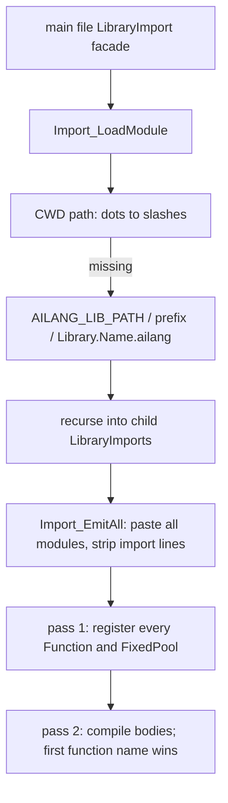
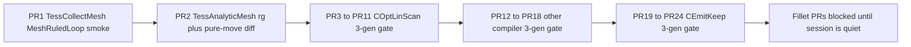

# Splitting oversized AILANG sources (1500-line rule)

| | |
|---|---|
| Author | Bob |
| Date | 2026-11-05 |
| Status | Draft |
| Repo | `/home/bob/Ailang-Self-Hosting-` |
| Kind | Implementation plan only. No source edits, no compiles, no file moves in this document. |

## Overview

An AILANG source file over 1500 physical lines is too large for an LLM to edit without blowing the context window. Physical lines are what an editor loads. Code lines, used only as a secondary figure, are non-blank lines whose first non-whitespace characters are not `//`.

The fix is a move, not a rewrite. Each oversized hand-written module becomes a facade that keeps its current `LibraryImport` name and `Function.*` names, and `LibraryImport`s new sibling files that hold whole functions. The compiler already pastes the transitive import closure into one program (`Import_LoadModule` recurses, `Import_EmitAll` concatenates, pass 1 registers every function and every `FixedPool` before codegen). That is why `LibraryImport.Cad.CAD_Topo` exposes `Function.CAD_Topo.*` defined in `Librarys/Cad/Topo/`, and why `Library.CCompilerOptimizer.ailang` can keep `FixedPool.OptState` in the shell while the passes live in other files.

Generated files are not hand-split. Fillet solver files are specified below but are not to be opened until Bob says the current fillet session is quiet. The first code change is a CAD tessellation move (`Library.TessCollect.ailang`). Its demo smoke executes `MeshRuledLoop` and exercises the facade recipe without touching the compiler or the fillet solver.

## Background & Motivation

### What was measured

Recounted 2026-11-05 with `wc -l` and a function-span walk. Where a survey figure from 2026-11-04 differs, the number below is the one from this recount. Do not invent spans; the PR sections name functions that were present at recount time.

Compiler scope (`Librarys/Compiler/**/*.ailang` plus `ailang_cli.ailang`, `ailang_console.ailang`, `ailang_lsp.ailang`): **109 files, 165,428 physical lines** (survey: 108 files, about 165,202). **20 files are at or over 1500** and hold **112,886** physical lines (survey: about 112,877). Same twenty names.

| File | Physical | Code | Fns | Kind |
|---|---:|---:|---:|---|
| `Librarys/Compiler/CodeEmit/X86/Library.CEmitX86Enc.ailang` | 53970 | 53795 | 117 | Generated by `tools/gen_x86enc.py`. Header: do not edit. "10363 instruction forms". |
| `Librarys/Compiler/Compile/Modules/Optimizer/Library.COptLinScan.ailang` | 10514 | 9184 | 269 | Hand-written linear scan. |
| `Librarys/Compiler/Compile/Modules/Library.CSysDispatch.ailang` | 7711 | — | 362 | Generated by `generate_sysdispatch.py`. Survey said 7746 physical. |
| `Librarys/Compiler/CodeEmit/X86/Library.CEmitKeep.ailang` | 6582 | 5326 | 319 | Hand-written `X86_*`. Largest body is `X86_XmmRR` at 81 lines, then `X86_NopLen` at 73. |
| `Librarys/Compiler/CodeEmit/Library.CEmitCoreArch.ailang` | 3614 | 3011 | 388 | Generated by `tools/gen_corearch.py` from `Library.CEmitCoreArch.hand.ailang`. |
| `Librarys/Compiler/Compile/Modules/Library.CCompileArith.ailang` | 3217 | 2811 | 56 | Hand-written. |
| `Librarys/Compiler/Compile/Modules/Optimizer/Library.COptHome.ailang` | 2720 | 2506 | 71 | Hand-written. Declares `FixedPool.EscMemo`. |
| `Librarys/Compiler/Compile/Modules/Optimizer/Library.COptFold.ailang` | 2612 | 2483 | 72 | Hand-written. No pool. |
| `Librarys/Compiler/Compile/Modules/Library.CCompileFunc.ailang` | 2388 | — | 54 | Survey 2383/1700. `wc -l` at the end of this writing was 2388. |
| `Librarys/Compiler/Compile/Modules/Library.CCompileStmt.ailang` | 2075 | 1544 | 22 | Hand-written. |
| `Librarys/Compiler/Compile/Modules/Optimizer/Library.COptStrength.ailang` | 1994 | 1865 | 58 | Park. See non-goals. |
| `Librarys/Compiler/Import/Library.CImportResolver.ailang` | 1971 | 1567 | 44 | Park. This file *is* the import mechanism. |
| `Librarys/Compiler/Compile/Modules/Optimizer/Library.COptScan.ailang` | 1860 | 1738 | 51 | Park. |
| `Librarys/Compiler/Compile/Modules/Optimizer/Library.COptBranch.ailang` | 1846 | 1676 | 51 | Park. |
| `ailang_lsp.ailang` | 1789 | 1390 | 24 | Park. Has `RunTask`. Not a library module. |
| `Librarys/Compiler/Compile/Library.CCompileMain.ailang` | 1751 | 1318 | 35 | Park. Survey said 1714. Compile driver; grown, still not in this wave. |
| `Librarys/Compiler/Compile/Modules/Optimizer/Library.COptMath.ailang` | 1594 | 1351 | 31 | Park. |
| `ailang_console.ailang` | 1588 | 1265 | 27 | Park. |
| `Librarys/Compiler/Compile/ModulesHDL/Library.EmitVerilogHDL.ailang` | 1576 | 1363 | 26 | Park. |
| `Librarys/Compiler/Compile/Modules/Optimizer/Library.COptVerify.ailang` | 1512 | 1453 | 46 | Park. Just over the line. |
| `Librarys/Compiler/Compile/Modules/syscall_generator_tools/syscall_table_linux.py` | 1561 | — | — | Generator input. Not a split target. |

Largest `X86Enc_Lookup_*` bodies, measured as spans (survey figures in parentheses, all matched): `X86Enc_Lookup_VCV` 4718 (about 4718), `VFN` 2258, `VPMO` 2178, `VFMA` 1998, `VFMS` 1988, `VPE` 1848, `VPA` 1788, `VMO` 1778. Also over 1500 and not in the original short list: `X86Enc_Lookup_C` 1748, `VPC` 1688, `VR` 1608, `VS` 1538. Those live inside the generated encoder. They are not hand-split.

`COptLinScan` families, sum of whole-function spans (functions are interleaved, not one line range): `Optimize_ScanPtr*` 1568 lines / 36 fn, `Optimize_ScanFlt*` 1386 / 28 (`Optimize_ScanFltUpdate` is 546 lines, 3992–4537), `Optimize_ScanByte*` 911 / 24, `Optimize_ScanRun*` 659 / 4 (`Optimize_ScanRun` is 532 lines, 791–1322). The two pools sit in the first 193 lines: `FixedPool.ScanState` at line 38 and `FixedPool.ScanPtr` at line 93. The file has no `LibraryImport` of its own. The only importer is `Library.CCompilerOptimizer.ailang` line 47.

`CCompileArith` digit cluster, whole functions: `CompileArith_TryDigitNest` 355 (2496–2850), `CompileArith_DigitPrep` 319 (1869–2187), `CompileArith_TryDigitLoop` 187 (2264–2450), `CompileArith_DigitStraight` 127 (1572–1698), `CompileArith_TryDivMod` 158 (859–1016), `CompileArith_Divide` 128, `CompileArith_Multiply` 127, `CompileArith_Modulo` 102. No pool.

CAD libraries `Librarys/Cad/**/*.ailang`: **69 files, 65,196 physical lines** (survey: about 65,129). **Nine files at or over 1500**, summing to **20,771** lines on the first pass (survey: about 20,704). The delta is almost entirely `Library.Fillet.ailang` (survey 2423/2243/30, recount 2482/2285/34) and `Library.FilletCove.ailang` (survey 2026/1949/38, recount 2034/1955/38).

| File | Physical at first recount | Notes |
|---|---:|---|
| `Librarys/Cad/Topo/Library.FilletPlex.ailang` | 4373 | 68 fn. `FixedPool.CAD_Topo_FPlex` at line 19. Arc family 1468/23, Notch 749/8, Junc 398/9, `FilletPlexResolveNotch` 220. |
| `Librarys/Cad/Topo/Library.FilletEmit.ailang` | moving | See the drift note below. No pool. |
| `Librarys/Cad/Topo/Library.Fillet.ailang` | 2482 | 34 fn. No pool. `FilletEdgeLocal` 503 (299–801). `RimMakeSeg` 326, `RimSwap` 250. |
| `Librarys/Cad/Tess/Library.TessCollect.ailang` | 2129 | 21 fn. No pool. Stable across this writing (`wc -l` 2129). |
| `Librarys/Cad/Topo/Library.FilletIR.ailang` | 2113 | 43 fn. `FixedPool.CAD_Topo_FComp` line 12, `FixedPool.CAD_Topo_FOut` line 1157. |
| `Librarys/Cad/Topo/Library.FilletCove.ailang` | 2034 | 38 fn. `FixedPool.CAD_Topo_FCove` line 24. `FCove*` 1485/33. |
| `Librarys/Cad/Tess/Library.TessAnalytic.ailang` | 1697 | 24 fn. No pool. Stable. `MeshTorusFace` 410 (1288–1697). |
| `Librarys/Cad/Topo/Library.FilletSeq.ailang` | 1565 | Park. |
| `Librarys/Cad/SketchProfile/Library.SketchPlex.ailang` | 1500 | Park. Exactly the line. |

**FilletEmit is live.** During this planning session `wc -l` on `Library.FilletEmit.ailang` went 2878, then 2929, then 2988. Do not treat any FilletEmit span in this document as an execution spec. Re-list `Function.` lines at the start of that PR. This is the concrete reason the fillet wave is gated.

CAD application `CAD/**/*.ailang`: **210 files, 43,291 physical lines** (survey: 209 / about 43,173). **Zero files at or over 1500.** Largest: `CAD/App/StateTree.ailang` 1109, `DocRepo.ailang` 1106, `DocHist.ailang` 1083, `Profile.ailang` 1064, `DrawSketch.ailang` 1006. `CAD/cad_app.ailang` is a thin runner: `LibraryImport.Cad.*` for the kernel and `Import.CAD.App.*` for local app modules. The C++ host `CAD/host/cad_shell_gtk.cxx` is 3257 physical lines. It is not an AILANG module and is not in this plan's PRs.

Out of scope, same 1500 rule, not implementation PRs here: the rest of the repo has on the order of 50 further AILANG files over 1500, concentrated in the browser VM, AIMacro, DAW, and Display. Over 4000 and known from the survey, not re-walked as split targets: `Library.JSRegexPropData.ailang` (data, about 13,814), `Library.JSVMDispatch.ailang` (about 11,976), `Library.JSBridge.ailang` (about 11,870), `Library.JSCompStmt.ailang` (about 6,756), `Library.AIMacroParserCore.ailang` (about 4,654), DawSong about 3,512, DawRoute about 3,407.

### Why a split is a move

`docs/cad/CAD_SPLIT_NOTE.md` already records the 2026-08 CAD split and the rule that still holds: AILANG imports inline the file. There is no header, and there is no Python-style circular-import failure. That note is historical (it still talks about splitting `CAD/App`, which is done). Do not execute it as this plan, and do not edit it in a split PR.

The pain is mechanical. A 10,514-line scan allocator or a 4,373-line fillet classifier cannot be loaded into an editor session next to the diff the model is supposed to write. Cutting the file on function boundaries, keeping every `Function` name, and adding one `LibraryImport` removes that without changing register allocation or fillet geometry.

## Goals & Non-Goals

### Goals

- Every hand-written file this plan marks in-wave ends under 1500 physical lines, by moving whole functions into new `Library.*.ailang` files.
- Public `LibraryImport` names stay: `Cad.CAD_Topo`, `Cad.CAD_Tess`, `Compiler.Compile.Modules.Optimizer.COptLinScan`, `Compiler.CodeEmit.X86.CEmitKeep`, `Compiler.Compile.Modules.CCompileArith`, and the other shells listed per PR.
- Qualified function names stay: `Function.CAD_Topo.*`, `Function.CAD_Tess.*`, `Function.Optimize_*`, `Function.X86_*`, `Function.CompileArith_*`, `Function.CompileStmt_*`, `Function.CompileFunc_*`, `Function.Emit_*`, `Function.Sys_*`.
- Each PR is one source module, reviewable as a move, and reverts with `git revert` of that commit only.
- Behavior is unchanged. A split does not retune a heuristic, reorder pool fields, or rewrite a body.

### Non-goals

- Do not change the assembler or the language syntax. One `Input:` line per parameter stays as it is; do not reformat moved bodies. Do not nest `Dereference` or `StoreValue` inside `StoreValue`. Library files must not gain `RunTask`. Only a main file has `RunTask(Main)`.
- Do not hand-edit generated sources: `Library.CEmitX86Enc.ailang`, `Library.CSysDispatch.ailang`, `Library.CEmitCoreArch.ailang`, `Library.CEmitCoreArch.hand.ailang`, `syscall_table_linux.py`, `Library.JSRegexPropData.ailang`. Do not hand-edit `tools/gen_x86enc.py`, `tools/gen_corearch.py`, or `generate_sysdispatch.py` in this plan.
- Do not put new x86 encodings in `CEmitCoreArch`. They belong in `CEmitKeep` (or, after the Keep split, in the Keep child that already holds that prefix), via the existing `X86_*` pattern. That is a separate change, not a split PR.
- Do not split a file that is under 1500. Do not split `CAD/App/**` (already under the line; largest 1109). Do not split `CAD/cad_app.ailang`.
- Do not split, in this wave: `COptVerify` (1512, barely over), `SketchPlex` (1500 exactly; the task parks it), `FilletSeq` (1565, fillet-adjacent and barely over), `EmitVerilogHDL` (1576, HDL backend, not on the self-host critical path), `ailang_lsp.ailang`, `ailang_console.ailang`, `COptMath`, `CCompileMain` (1751, the compile driver; splitting it risks the pass order), `COptBranch`, `COptScan`, `CImportResolver` (the resolver itself; do not move it while depending on it), `COptStrength`. One-line reason for each: either just over the line, or a driver/entrypoint, or actively the wrong file to learn the recipe on.
- Do not split `CAD/host/cad_shell_gtk.cxx` (3257). It is C++, it has no `LibraryImport`, and this recipe does not apply.
- Do not split browser, AIMacro, DAW, Display, or `JSRegexPropData` in these PRs. Parked backlog, same 1500 rule, same facade recipe, later.
- Do not add new `*.ailang.pre_split` files. Do not run `tools/cad_split_ailang.py` or `tools/cad_split_topo.py`.
- Do not overwrite `./ailang.x`, `./cad_app.x`, `./ailang-next.x`, `./analyzer.x`, or any `/tmp/linscan_sNN.x`. Do not pass `-TS` or `-asm` on a compiler build; those are real flags. Do not insert `-o`. A dash token is skipped, not a hard error, and it can swap source and output depending on position (`./ailang.x -o /tmp/out.x src.ailang` compiles `/tmp/out.x` and writes `src.ailang`). Positional output path only. Do not launch the CAD GUI and do not run `CAD/scripts/run_cad_app.sh` (it rebuilds `./cad_app.x` and opens a display).
- Do not "helpfully" split a function body inside a move PR. `Optimize_ScanFltUpdate` (546), `Optimize_ScanRun` (532), `FilletEdgeLocal` (503), `CAD_Tess.MeshRuledLoop` (490), `CompileArith_TryDigitNest` (355), `CAD_Tess.MeshTorusFace` (410), `FilletSolvePlaneCyl` (362 at the 2929-line snapshot), and `Optimize_FoldSink` (250) move whole or stay whole.

## Proposed Design

### Import resolution (verified)

`LibraryImport.` is 14 characters. `Import_ExtractImports` (`Library.CImportResolver.ailang`) strips that prefix and keeps the dotted module name. `Import.` (7 characters) is the local-file form used by `CAD/App`.

`Import_LoadModule` tries a CWD-relative path first (`Import_BuildFilePath`: every `.` becomes `/`, then `.ailang`). If that file does not read, it calls `Import_BuildPath`:

- `lib_base` is `AILANG_LIB_PATH`, else the directory of `/proc/self/exe` plus `/Librarys`, else the relative string `Librarys` (`Import_FindLibBase`).
- Dots in the module name *before the last dot* become slashes.
- The last component is prefixed with `Library.` and suffixed with `.ailang`.

So `LibraryImport.Cad.Topo.FilletPlex` resolves to `{AILANG_LIB_PATH}/Cad/Topo/Library.FilletPlex.ailang`, which in this repo is `Librarys/Cad/Topo/Library.FilletPlex.ailang`. The CWD candidate `Cad/Topo/FilletPlex.ailang` does not exist, so the library path wins. The same rule gives:

- `LibraryImport.Cad.Tess.TessCollectMesh` → `Librarys/Cad/Tess/Library.TessCollectMesh.ailang`
- `LibraryImport.Compiler.Compile.Modules.Optimizer.COptLinScanFlt` → `Librarys/Compiler/Compile/Modules/Optimizer/Library.COptLinScanFlt.ailang`
- `LibraryImport.Compiler.CodeEmit.X86.CEmitKeepAlu` → `Librarys/Compiler/CodeEmit/X86/Library.CEmitKeepAlu.ailang`
- `Import.CAD.App.DocHist` → local `CAD/App/DocHist.ailang` (this is how `CAD/App/Doc.ailang` loads its parts)

A new file that does not match this pattern will not load. Do not invent a directory layout.

### Transitive visibility is paste, not a re-export

`Import_LoadModule` records the module, then recursively loads every `LibraryImport` / `Import` in it (already-loaded paths return immediately, so a cycle is safe). `Import_EmitAll` writes every loaded module, with import lines stripped, then the main file. `Compile_DiscoverDeclarations` (`Library.CCompileMain.ailang`) walks the whole program and registers every function and every pool before pass 2 emits a body.

Consequences, all checked against code that already ships:

- `Librarys/Cad/Library.CAD_Topo.ailang` defines **zero** functions. It is 64 lines of comments plus `LibraryImport`s. `Function.CAD_Topo.FilletPlexInit` is defined in `Library.FilletPlex.ailang`. Callers such as `dev/compiler-regression/test_fillet_plex.ailang` import only `LibraryImport.Cad.CAD_Topo` and still call those functions. A one-line facade import is sufficient. There is no re-export table to maintain.
- The parent module is marked loaded **before** its children, so the parent's text is emitted before the children's text. Where the `LibraryImport` line sits inside the parent does not change that emit order and does not move pool text. That order does **not** decide whether a pool is visible. Pass 1 registers every `FixedPool` in the concatenated program before any body is compiled.
- Cross-file pool use already exists: `FixedPool.EscMemo` is declared in `Library.COptHome.ailang` (line 337) and written from `CompileFunc_Function` in `Library.CCompileFunc.ailang` (`EscMemo.in_prep`, `EscMemo.ast_epoch`). `CCompileFunc` does not import `COptHome`. Both are in the compiler program because `CCompileMain` imports the func module and the optimizer shell, and the shell imports `COptHome`.
- `Compile_RegisterFunction` keeps the **first** definition and returns without registering the second. It does not abort. `Compile_RegisterPool` appends every field of every pool to `Compile.variables` and bumps `Compile.pool_member_count`. It does not reject a second `FixedPool` of the same name. A duplicate pool silently shifts every later pool slot in that program. A duplicate function silently binds calls to whichever copy was emitted first, and pass 2 may still emit the second body.
- A missing callee in `CompileFunc_UserCall` returns 0 when `Compile_FindFunction` is negative (`Library.CCompileFunc.ailang` 965–969); the expression dispatcher then prints `[COMPILE] ERROR: Unknown function` and calls `Compile_Error` (`Library.CCompileMain.ailang` 1367–1380). A missing *uncalled* function still compiles. Do not treat "it compiled," or identical demo stdout, as proof an uncalled body survived the move. Compiler gates compare output bytes. The CAD demo checks only the bodies that demo calls.



### Facade recipe

This is alternative A, and it is the one the code supports. Alternative B (edit every caller) is not required.

Worked example, and PR 1: `Library.TessCollect.ailang`. The public facade is `Librarys/Cad/Library.CAD_Tess.ailang`, which already has `LibraryImport.Cad.Tess.TessCollect` and no function definitions. Nothing else in the repo imports `Cad.Tess.TessCollect` directly (search of `LibraryImport.Cad.Tess.TessCollect`). `CAD_Tess` does not change. `TessCollect` grows one import and loses a contiguous tail of functions. The new sibling is loaded because `TessCollect` imports it, which `CAD_Tess` already imports.

Before (tail of the import block, and the first moved function):

```
LibraryImport.Cad.CAD_Sys
LibraryImport.Cad.CAD_Store
LibraryImport.Cad.CAD_Num
LibraryImport.Cad.CAD_Topo
LibraryImport.Cad.CAD_Geom
LibraryImport.StringUtils

Function.CAD_Tess.CoedgeRev {
```

After, in `Librarys/Cad/Tess/Library.TessCollect.ailang` only — the sampling functions stay, the mesh functions leave:

```
LibraryImport.Cad.CAD_Sys
LibraryImport.Cad.CAD_Store
LibraryImport.Cad.CAD_Num
LibraryImport.Cad.CAD_Topo
LibraryImport.Cad.CAD_Geom
LibraryImport.StringUtils
LibraryImport.Cad.Tess.TessCollectMesh

Function.CAD_Tess.CoedgeRev {
```

The new file `Librarys/Cad/Tess/Library.TessCollectMesh.ailang` starts with the same SCSL copyright as the parent, the same six dependency imports (they are already loaded by the time this module is reached, so pool order does not move), and then the moved functions unchanged, still named `Function.CAD_Tess.*`. It does **not** import `TessCollect` (no cycle, not needed). It declares **no** `FixedPool`.

The mesh functions are a contiguous tail, lines 859–2129 of the 2129-line file: `MeshRuledLoop` (490), `CylChordRefine` (146), `FlipDelaunay` (164), `MonoXBefore` (16), `MonoVert` (12), `MonoDx` (18), `MonoEmit` (37), `MonoStrip` (300), `MeshCylLoopUV` (88). Sum of spans 1271. Parent left at lines 1–858 (through `SampleArcArcEdge`). Both under 1500. Same recipe as `CAD_Topo` / `Doc.ailang` / `CCompilerOptimizer.ailang` lines 15–17 ("The compiler pastes the passes into this unit, so the pools stay visible there.").

`Optimize_ScanFlt*` uses the same recipe. The shell import `LibraryImport.Compiler.Compile.Modules.Optimizer.COptLinScan` stays. `Library.COptLinScan.ailang` gains `LibraryImport.Compiler.Compile.Modules.Optimizer.COptLinScanFlt` at the end of the file's import list (the file has none today, so the new lines go after the copyright, before `FixedPool.ScanState`). The child contains only the 28 `Optimize_ScanFlt*` functions. `FixedPool.ScanState` and `FixedPool.ScanPtr` stay in the parent. `ScanFlt` functions are interleaved with other scan functions (the span runs 1369–8059 but other families sit in between). Move by `Function` name, in the order the functions appear today. Do not cut a line range.

### Where pools and constants live

Hard rules for every PR:

1. A new file in this plan declares **zero** `FixedPool` and **zero** `DynamicPool`. Grep the new file for `FixedPool.` and expect no hits.
2. Do not reorder fields inside an existing pool. Do not copy a pool into a second file. `Compile_RegisterPool` will not save you; it will shift slot indexes for every pool registered later in that program. That changes the compiler binary's own pool layout if it happens inside the compiler, and it changes a CAD binary's pool layout if it happens inside `Librarys/Cad`.
3. Pools that already sit next to the functions that own them stay in that file: `CAD_Topo_FPlex` stays in `Library.FilletPlex.ailang` (not in the Arc or Notch child), `CAD_Topo_FCove` stays in `Library.FilletCove.ailang`, `CAD_Topo_FComp` and `CAD_Topo_FOut` stay in `Library.FilletIR.ailang`, `ScanState` and `ScanPtr` stay in `Library.COptLinScan.ailang`, `EscMemo` stays in `Library.COptHome.ailang`, `OptState` stays in `Library.CCompilerOptimizer.ailang`. This matches the existing split: `FilletPlex` defines `CAD_Topo_FPlex` in its own file; `FilletCove` defines `CAD_Topo_FCove` in its own file; neither pool is on the `CAD_Topo` facade.
4. `ScanPtr.*` is read by functions that are not named `ScanPtr` (for example `Optimize_ScanLoopMask` and the mark/reset paths around lines 1731, 1976, 2227, 2801). Moving the pool into the Ptr child would still be visible, but it is an unnecessary order risk. Leave it.
5. File-level "constants" in these modules are comments (Plex slot notes, Cove slot map). There is no file-scope constant object to relocate. Numeric immediates move with the function that contains them.
6. When the parent already has imports, add the child's `LibraryImport` as the last of those imports. Do not insert it above imports that already exist. When the parent has no imports (`COptLinScan`, `COptHome`), the new import may sit with the copyright, before the first function, the way PR 3 places `COptLinScanFlt` before `FixedPool.ScanState`. Import-line position does not move pool text and does not preserve slot order. `Import_LoadModule` marks the parent loaded, then recurses, and `Import_EmitAll` emits the whole parent before any child. What keeps slots stable is that the child declares no `FixedPool` and no `DynamicPool`. Do not relocate an existing pool so that it sits above or below the new import. Copying the parent's dependency imports onto the child is allowed and matches `Library.Fillet.ailang`; those modules are already loaded, so `Import_IsLoaded` skips them and they are not emitted twice.

### Naming

Follow the existing pattern. Facade module name unchanged. Child module name is the facade name plus a short family suffix, PascalCase, no new punctuation.

| Parent file that remains the `LibraryImport` target | New file | `LibraryImport` line added to the parent |
|---|---|---|
| `Librarys/Cad/Tess/Library.TessCollect.ailang` | `Librarys/Cad/Tess/Library.TessCollectMesh.ailang` | `LibraryImport.Cad.Tess.TessCollectMesh` |
| `Librarys/Cad/Tess/Library.TessAnalytic.ailang` | `Librarys/Cad/Tess/Library.TessAnalyticMesh.ailang` | `LibraryImport.Cad.Tess.TessAnalyticMesh` |
| `Librarys/Compiler/Compile/Modules/Optimizer/Library.COptLinScan.ailang` | `Library.COptLinScanFlt.ailang` and the other `COptLinScan*` siblings in that same directory | `LibraryImport.Compiler.Compile.Modules.Optimizer.COptLinScanFlt` (and siblings) |
| `Librarys/Compiler/CodeEmit/X86/Library.CEmitKeep.ailang` | `Library.CEmitKeepAlu.ailang` and siblings in that directory | `LibraryImport.Compiler.CodeEmit.X86.CEmitKeepAlu` (and siblings) |

`Library.CEmitCoreArch.ailang` (generated) imports `LibraryImport.Compiler.CodeEmit.X86.CEmitKeep`. That line stays. The Keep file remains the facade the generator expects. Do not edit CoreArch to import the children.

Copyright: copy the SCSL block from the parent onto every new file. Do not drop it. Do not copy a multi-hundred-line design comment into the child; leave that comment on the parent. A child header is the copyright plus a four-line note of the form already used by `Library.Fillet.ailang`: API stays `Function.…`, loaded via the parent, which the existing facade already imports.

### Generated files, if they are ever sharded (not this plan)

`tools/gen_x86enc.py` builds one string and writes one path (`open(out_path)` near the bottom). The default path is a Windows path under `/mnt/c/Users/Sean/...`. It cannot emit shards. A later generator change, in its own PR, would have to preserve:

- The public module `Compiler.CodeEmit.X86.CEmitX86Enc`, still resolved to `Librarys/Compiler/CodeEmit/X86/Library.CEmitX86Enc.ailang`, as a facade that imports the shards.
- Function names callers use: `X86Enc_Assemble`, `X86Enc_Lookup`, `X86Enc_LookupTrie`, `X86Enc_Lookup_<prefix>`, `X86Enc_ParseAsm`, `X86Enc_Emit`, `X86Enc_RegType`, `X86Enc_RegNum`. `X86Enc_Lookup` calls the prefix leaves. All of those names must remain in one compilation unit.
- One `FixedPool.X86AsmParse` and one `FixedPool.X86EncResult`.
- The "DO NOT EDIT / run tools/gen_x86enc.py" header on every generated shard.

`tools/gen_corearch.py` reads `Library.CEmitCoreArch.hand.ailang` and writes a single `Library.CEmitCoreArch.ailang` (`OUT.write_text`). The generated header says `AUTO-GENERATED by tools/gen_corearch.py — DO NOT HAND-EDIT` and also still contains the sentence `INPUT to tools/gen_corearch.py — not loaded by the compiler`. That sentence is stale text copied from the hand file: `main()` only replaces the token `Library.CEmitCoreArch.hand.ailang` with `Library.CEmitCoreArch.ailang`. The `.hand` file is the input. The `.ailang` file is the live dispatcher (`CCompileMain` and others import `Compiler.CodeEmit.CEmitCoreArch`). Do not hand-edit either file, and do not hand-edit the generator. Class A bodies call `X86Enc_Assemble`. Class B/C stay as `X86_*` calls into `CEmitKeep`. New encodings go in Keep.

`generate_sysdispatch.py` `generate_header()` emits one file: the DO-NOT-EDIT banner, three `LibraryImport`s (`CEmitTypes`, `CEmitCoreArch`, `CHaikuEmit`), then `FixedPool.LinuxSys` / `FixedPool.HaikuSys`, then one `Function.Sys_*` per syscall. `generate_file()` concatenates those parts and the `-o` path is `Library.CSysDispatch.ailang`. A future shard would have to keep the module name `Compiler.Compile.Modules.CSysDispatch` and every `Sys_*` name. Not in this plan. `syscall_table_linux.py` is an input table, not a source module.

Until a generator emits shards, the right way to read `CEmitX86Enc` is a line range around one `X86Enc_Lookup_*` leaf. That is alternative C, and it is the correct answer for those files.

### Backups

`*.ailang.pre_split` files exist next to old CAD facades (`CAD/cad_app.ailang.pre_split`, `CAD/App/{Doc,Draw,Plane,Solid,State,Tools}.ailang.pre_split`, `Librarys/Cad/Library.CAD_{Topo,Tess,Sketch,SketchProfile}.ailang.pre_split`, and four files under `Librarys/Cad/Topo/`). `.gitignore` does not mention `pre_split`. The compiler and the build scripts do not open them. Only `tools/cad_split_ailang.py`, `tools/cad_split_topo.py`, and `docs/cad/CAD_SPLIT_NOTE.md` refer to them, as human rollback copies from 2026-08. Git is the backup. Do not add new `.pre_split` files. Do not delete the old ones in a split PR (unrelated).

### Verification commands

All commands run from the repo root `/home/bob/Ailang-Self-Hosting-`. `AILANG_LIB_PATH` is this repo's `Librarys`. No `-TS`, no `-asm`. Do not insert `-o`; a dash token is skipped, not a hard error, and it can swap source and output depending on position.

CAD PR (does not rebuild the compiler, does not rebuild `./cad_app.x`):

```bash
cd /home/bob/Ailang-Self-Hosting-
env AILANG_LIB_PATH="$PWD/Librarys" \
  ./ailang.x CAD/demo_rect_circ_hole.ailang /tmp/demo_rect_circ_hole.x
/tmp/demo_rect_circ_hole.x > /tmp/demo_rect_circ_hole.out
```

`CAD/demo_rect_circ_hole.ailang` imports `LibraryImport.Cad.CAD_Tess` (the facade loads `TessCollect` at line 17 and `TessAnalytic` at line 15) and `LibraryImport.Cad.CAD_Topo`, and calls `CAD_Tess.MeshSolid` on one extruded rectangle with one circular hole. `MeshSolid` (`Library.TessFace.ailang` 481) sends a 4-edge face that is not a sphere or a torus, and whose loop is not a circle, to `MeshRuledLoop` (line 580). The four rectangular walls are that case. Record `/tmp/demo_rect_circ_hole.out` on the parent commit first. After PR 1 the stdout must be byte-identical, including `ncont=`, `solid=`, the `face` lines, `mesh nt=`, `nv=`, and `DONE`. That match is smoke that executes `MeshRuledLoop` only.

`MeshCylLoopUV`, `MonoStrip`, `FlipDelaunay`, `CylChordRefine`, `MonoXBefore`, `MonoVert`, `MonoDx`, and `MonoEmit` are link-checked (`MeshSolid` contains the calls, reached only from `MeshCylLoopUV` at `Library.TessCollect.ailang` 2106–2122, for a kind-2 face with `nring == 6` or with `nring` other than 4 or 6) but not behavior-checked. This solid does not build that face. A corrupted body in those eight can still print the same `mesh nt=` / `DONE` line.

Do not call this stdout the proof for PR 2. None of `MeshCylinderAnalytic`, `MeshTubeAnalytic`, `MeshLatheAnalytic`, `MeshSphereRoll`, or `MeshTorusFace` run on this solid. `MeshLatheAnalytic` is only the no-shell path (`TessFace.ailang` 494–498). `MeshSphereRoll` and `MeshTorusFace` run only for surface kinds 3 and 4. `MeshCylinderAnalytic` and `MeshTubeAnalytic` have zero callers (the only other hit is a comment in `Library.MakeSweep.ailang`); dropping either still compiles. Behavior of the moved analytic bodies rests on the pure-move diff. PR 1 requires one `rg` hit for `MeshRuledLoop`. PR 2 requires `rg` of all five names, each exactly one definition:

```bash
rg -n "^Function\\.CAD_Tess\\.MeshRuledLoop" Librarys/Cad
rg -n "^Function\\.CAD_Tess\\.(MeshCylinderAnalytic|MeshTubeAnalytic|MeshLatheAnalytic|MeshSphereRoll|MeshTorusFace)" Librarys/Cad
```

Do not use the fillet demos as the tess gate. They are mid-debug and a red result would not say whether the move broke them. Fillet PRs, once unblocked, add the existing headless gates, each compiled to `/tmp` with the same `AILANG_LIB_PATH` form:

- `CAD/demo_fillet_edge.ailang` prints `FILLET EDGE OK`
- `CAD/demo_fillet_horiz.ailang` prints `FILLET HORIZ OK`
- `CAD/demo_fillet_cyl.ailang` prints `FILLET CYL OK`
- `CAD/demo_fillet_3line_arc.ailang` prints `FILLET 3LINE ARC OK`

Compiler PR. Host build of the moved sources, scan unset, output under `/tmp`. This is the `docs/compiler/NEXT.md` shape (`./ailang.x ailang_cli.ailang ailang-next.x`) with the output path moved off the repo root so `tools/contract_identity.sh`'s `./ailang-next.x` is not clobbered:

```bash
cd /home/bob/Ailang-Self-Hosting-
env -u AILANG_LINSCAN AILANG_LIB_PATH="$PWD/Librarys" \
  ./ailang.x ailang_cli.ailang /tmp/ailang-split-prN.x
```

Codegen identity of an unchanged legal program (host compiler vs the compiler just built). `true.ailang` is the corpus `tools/contract_identity.sh` already uses:

```bash
env -u AILANG_LINSCAN AILANG_LIB_PATH="$PWD/Librarys" \
  ./ailang.x AiLang_CoreUtils/dist/true_util/true.ailang /tmp/true-host.x
env -u AILANG_LINSCAN AILANG_LIB_PATH="$PWD/Librarys" \
  /tmp/ailang-split-prN.x AiLang_CoreUtils/dist/true_util/true.ailang /tmp/true-next.x
cmp /tmp/true-host.x /tmp/true-next.x
```

Self-host fixed point, required on every PR that moves a file under `Librarys/Compiler/`. Not required on CAD-only PRs. The host-built binary and the scan-on binary are not supposed to match each other. `g2` and `g3` must be byte-identical. They will not match an older `/tmp/linscan_sNN.x`, and they must not be copied over those files or over `./ailang.x`.

```bash
env AILANG_LINSCAN=1 AILANG_LIB_PATH="$PWD/Librarys" \
  /tmp/ailang-split-prN.x ailang_cli.ailang /tmp/ailang-split-prN-g2.x
env AILANG_LINSCAN=1 AILANG_LIB_PATH="$PWD/Librarys" \
  /tmp/ailang-split-prN-g2.x ailang_cli.ailang /tmp/ailang-split-prN-g3.x
cmp /tmp/ailang-split-prN-g2.x /tmp/ailang-split-prN-g3.x
```

Do not run `tools/contract_identity.sh` as the gate. It pins `./ailang.x` to sha256 `9d7f005a88cd075312d370b0b94d58929825dd22b9b31bc84ee913b0cb3cb87f` (the historical hash in `docs/compiler/NEXT.md`) and it expects `./ailang-next.x` in the repo root. The procedure above is the same idea (host vs next on `true.ailang`, then next2 vs next3) with paths that do not touch live binaries. A self-host compile is on the order of a minute; three of them is the cost of a compiler PR. Do not add the full core-1 benchmark survey to a move PR. Identical codegen on `true.ailang` plus a fixed point is the merge bar. A survey is a performance measurement, and a pure move that keeps codegen byte-identical has nothing to time.

Before committing, for every moved name:

```bash
rg -n "^Function\\.<ExactName>" <parent dir>
```

Exactly one hit. `wc -l` on every file the PR touched is under 1500, except a parent that this PR is not yet finished shrinking. Say that explicitly in the PR body when the parent stays over the line until a later PR in the same series.

Rollback of any one PR is `git revert` of that commit. Pathspec only the files named in the PR. Do not revert a later PR to undo an earlier one.



## API / Interface Changes

No signature changes. No new `Input:` lines. No renamed functions.

What changes is only which file a function's text lives in, plus one `LibraryImport` on the parent. Callers keep the import they already have:

- CAD programs keep `LibraryImport.Cad.CAD_Tess` or `LibraryImport.Cad.CAD_Topo`.
- The optimizer shell keeps `LibraryImport.Compiler.Compile.Modules.Optimizer.COptLinScan` (and `.COptHome`, `.COptFold`). `Library.CCompilerOptimizer.ailang` is not edited.
- `Library.CCompileMain.ailang` keeps `LibraryImport.Compiler.Compile.Modules.CCompileArith` (line 26) and `LibraryImport.Compiler.Compile.Modules.CCompileStmt` (line 33). It is not edited.
- Generated `Library.CEmitCoreArch.ailang` keeps `LibraryImport.Compiler.CodeEmit.X86.CEmitKeep`. It is not edited.

## Data Model Changes

None. No pool field is added, removed, renamed, or reordered. No migration. The invariant that makes "none" true is the pool rule in Proposed Design: new files contain no pool, and existing pools stay in the file that declares them today, with their fields in the same order.

`FixedPool` slot indexes are assigned by walking the concatenated program (`Compile.pool_member_count` in `Compile_RegisterPool`). Inserting a pool into a child, or duplicating one, is a data-model change even if the field names look the same. That is forbidden in these PRs.

## Alternatives Considered

### A. Facade keeps the old `LibraryImport` name and imports siblings. Chosen.

This is `Library.CAD_Topo.ailang`, `Library.CAD_Tess.ailang`, `CAD/App/Doc.ailang`, and `Library.CCompilerOptimizer.ailang`. Function names stay global because the closure is pasted. Call sites do not change. One new import line per child. The failure mode is a wrong path, which `[IMPORT ERROR] Cannot read:` prints, or a duplicated `Function.` name, which the compiler does not reject.

### B. Callers import the new modules directly. No facade. Rejected.

Works, and the graph is more honest, but every caller of `CAD_Tess`, `CAD_Topo`, `COptLinScan`, and `CEmitKeep` would have to be updated. Those callers are the shell files plus every CAD demo and the generated CoreArch. The churn is the opposite of a move. Use B only if a future compiler stops pasting child modules into the parent program. Today's `Import_LoadModule` does paste them. Do not update callers in this plan.

### C. Leave the file intact and read line ranges. Rejected for hand-written files. Required for generated tables.

A 1500-line cap that is not enforced in the tree will be exceeded again the next time a model appends to the file. Line ranges are the right tool for `CEmitX86Enc` (one `X86Enc_Lookup_VCV` leaf is 4718 lines of generated comparisons), for `CSysDispatch` (362 tiny `Sys_*` functions), and for `CEmitCoreArch`, until the generator writes shards. Hand-splitting those files loses to the next regen.

### D. Also split functions that are themselves over about 400 lines, inside the move PR. Rejected.

A move PR that also rewrites `Optimize_ScanFltUpdate` or `FilletEdgeLocal` cannot be reviewed as a move and cannot be reverted as a move. Those bodies stay intact. A later PR may split a function only if it has a real internal seam (a helper that is already a straight-line block with its own locals, not a new algorithm). No such PR is scheduled here.

## Security & Privacy Considerations

No new trust boundary, no new input, no auth change. The hazard is integrity of the program the compiler emits:

| Risk | Severity | What goes wrong | Mitigation |
|---|---|---|---|
| Wrong `LibraryImport` path | High | `[IMPORT ERROR] Cannot read:` and the build fails, or a CWD file with a colliding name loads instead of the library file | Follow `Import_BuildPath`. Do not create `Cad/Tess/TessCollectMesh.ailang` at the repo root. Set `AILANG_LIB_PATH` to this repo's `Librarys`. |
| Pool defined twice, or fields reordered | High | Later pool slots shift. Compiler miscompiles, or a CAD solid reads the wrong field. `Compile_RegisterPool` does not error. | New files have no `FixedPool`. Existing pools stay put, field order unchanged. Grep. |
| Function left in both files, or prefix renamed | High | First definition wins, calls may bind to a stale copy, binary layout changes, demo stdout can still look fine if the first copy is the live one | `rg` exactly one `Function.` definition. Do not rename `Function.CAD_Topo.*` / `Optimize_*` / `X86_*`. |
| Geometry or scan edit mixed into the move | High | A "split" that also changes `FilletEdgeLocal` or `ScanFltUpdate` cannot be bisected | Diff must be a deletion in the parent and the same text in the child, plus import lines and a copyright header. No other hunks. |
| Self-host drift treated as success or as failure for the wrong reason | Medium | g2 will not match an old `linscan_sNN.x`. That is expected. g2 must match g3. | Gates in Verification. Never copy the result onto `./ailang.x`. |
| Regenerator overwrites a hand split | High | Next `gen_x86enc.py` / `gen_corearch.py` / `generate_sysdispatch.py` run deletes the hand split | Do not hand-split those files. |
| Fillet session race | High | `Library.FilletEmit.ailang` grew by more than 100 lines while this plan was being written (2878, then 2929, then 2988). A move on top of an uncommitted geometry fix will ship both. | Fillet PRs are blocked until Bob says the session is quiet. `git status` on the fillet paths must be clean. The PR contains no numeric or control-flow change. |
| `RunTask` copied into a library file | Low | File-scope contract rejects library `RunTask` | None of these modules have `RunTask`. Do not add one. |

No privacy impact. These files are compiler and CAD kernel source. They do not gain logging of user documents.

## Observability

No new metrics and no new logs. Existing compiler prints are the signal:

- `[IMPORT] Loaded: <module>` for each module actually read.
- `[IMPORT ERROR] Cannot read: <module>` when the path is wrong (`Import_LoadModule`).
- `[ERROR] Duplicate LinkagePool:` exists for linkage pools (`CompilePool_Declaration`). There is no matching error for a duplicate `FixedPool` or a duplicate function across files. Do not wait for one.

A CAD failure of a body the demo executes (`MeshRuledLoop`) shows up as demo stdout differing, or as `FAIL extrude` / `FAIL too few tris` from `CAD/demo_rect_circ_hole.ailang`. A moved body the demo does not call will not show up there. A compiler failure shows up as `cmp` non-zero on `true.ailang` or on g2 vs g3, or as a non-zero compile status. Do not add `PrintMessage` traces in a split PR.

## Rollout Plan

There is no feature flag. Each PR is the rollout. Order is the sequence in PR Plan.

1. CAD smoke, then the analytic move (PR 1, PR 2). PR 1 gate: `demo_rect_circ_hole` stdout identical. That run executes `MeshRuledLoop` only. `MeshCylLoopUV` and the mono/Delaunay helpers are link-checked, not behavior-checked. PR 2 does not treat that stdout as the proof. Its gate is `rg` of all five analytic names (`MeshCylinderAnalytic`, `MeshTubeAnalytic`, `MeshLatheAnalytic`, `MeshSphereRoll`, `MeshTorusFace`) plus the pure-move diff. `MeshCylinderAnalytic` and `MeshTubeAnalytic` have zero callers. Compiler sources untouched, so no self-host.
2. Compiler hand-written modules, `COptLinScan` first because it is the largest LLM problem (10,514 lines) and it is not under an active geometry edit. Each of those PRs pays the 3-generation gate. `CEmitKeep` is last among hand-written compiler files because every helper is already small; the file is wide, and the split is the least likely to hide a logic change, but it is also the least urgent.
3. Fillet files only after the session-quiet signal. Each is its own commit. A geometry fix that is ready does not ride along.

Rollback is `git revert` of the one commit. The parent import line and the new file disappear together. No data migration, no binary promotion. `./ailang.x` and `./cad_app.x` stay as they are for the whole series.

If a PR's parent is still over 1500, merge it anyway when its own new file is under 1500 and the gates pass. The following PR in that series finishes the parent. Do not widen the PR to "finish the file" by also rewriting bodies.

## Open Questions

1. **When does the fillet wave start?** The plan's decision is that it does not start until Bob says the current fillet session is quiet. `Library.FilletEmit.ailang` changed length three times on 2026-11-05 while this document was being written, and fillet math (lost faces, vertical-face mesh, history prune) is still being corrected in `Fillet.ailang`, `FilletCove.ailang`, `FilletEmit.ailang`, and `FilletPlex.ailang`. The PR text below is the recipe for that later wave. It is not permission to open those files.

2. **If `./ailang.x` cannot compile `CAD/demo_rect_circ_hole.ailang`, which compiler is the CAD gate allowed to use?** This plan did not compile anything, so it does not know whether the live host accepts today's CAD sources. Recommendation: stop and ask. Do not search `/tmp` for a newer `linscan_sNN.x` and do not overwrite `./ailang.x`. The compiler-PR gate is specified against `./ailang.x` as the host and does not depend on this question.

Everything else in this document is decided.

## Risks not already in the table

- **PR 1 still touches mesh code that fillet bugs have edited.** `MeshRuledLoop` and `MonoStrip` are on the vertical-face mesh path. The PR is a move of that text, not a change to it. If `git diff` already shows edits in `Library.TessCollect.ailang`, do not start PR 1; wait until that mesh edit is committed on its own. Severity: medium. Same rule for PR 2 and `MeshTorusFace` in `Library.TessAnalytic.ailang`.
- **Interleaved functions.** `ScanFlt` / `ScanPtr` / `ScanByte` are not contiguous. A line-range cut will take someone else's function with them. Severity: high if ignored. Move by function name, source order preserved inside the child.
- **`CEmitKeep` plain-`Mov` is 1957 lines.** It does not fit in one child. The PR plan splits it by name shape (`Deref`/`Mem`/`Sib`/`Ip` vs the rest), measured at 1043 and 914 lines. Re-measure; the rule is the measurement, not the memory of 1043.
- **Header budget on `FilletPlexArc`.** 23 functions sum to 1468 lines. A long comment pasted into the child will cross 1500. Cap the new header at the copyright plus a short note plus the parent's existing import lines (about 30 lines). If `wc -l` is still at or over 1500, leave `FilletPlexArcSharpClear`, `FilletPlexArcSharpZero`, and `FilletPlexArcSharpSame` (12+18+14 lines) on the parent.

## Parked backlog (not PRs)

Same 1500 rule, same facade recipe, not scheduled:

- Compiler borderline list in Non-goals (`COptStrength`, `CImportResolver`, `COptScan`, `COptBranch`, `ailang_lsp.ailang`, `CCompileMain`, `COptMath`, `ailang_console.ailang`, `EmitVerilogHDL`, `COptVerify`).
- `FilletSeq` (1565) and `SketchPlex` (1500), even after the fillet gate opens, unless a later explicit request pulls them in. They are the bottom of the CAD list.
- `CAD/host/cad_shell_gtk.cxx` (3257) and the two X11 C hosts (together about 912 lines, under the line). A C++ split is a different design.
- Browser VM, AIMacro, DAW, Display, and `Library.JSRegexPropData.ailang`. Generated data and VM dispatch get alternative C (line ranges) until their generators, if any, emit shards. Hand-written files in that set use alternative A when someone schedules them.
- Generator sharding of `CEmitX86Enc`, `CSysDispatch`, and `CEmitCoreArch`.

## References

- `Librarys/Compiler/Import/Library.CImportResolver.ailang` — `Import_FindLibBase`, `Import_BuildPath` (1264–1354), `Import_BuildFilePath`, `Import_LoadModule` (1397–1492), `Import_EmitAll`, `Import_ExtractImports`.
- `Librarys/Compiler/Compile/Library.CCompileMain.ailang` — `Compile_DiscoverDeclarations` (pass 1), `Compile_RegisterPool` (1488).
- `Librarys/Compiler/Compile/Modules/Library.CCompileFunc.ailang` — `Compile_RegisterFunction` (first wins, 1520), `CompileFunc_UserCall` (missing callee returns 0, 966).
- `Librarys/Compiler/Compile/Modules/Library.CCompilerOptimizer.ailang` lines 15–17 and 47 — shell holds pools and imports `COptLinScan`.
- `Librarys/Cad/Library.CAD_Topo.ailang`, `Librarys/Cad/Library.CAD_Tess.ailang`, `CAD/App/Doc.ailang`, `CAD/cad_app.ailang` — facades that already ship.
- `Librarys/Cad/Topo/Library.FilletPlex.ailang` line 19 and `Library.FilletCove.ailang` line 24 — pool lives in the file that uses it.
- `tools/gen_x86enc.py`, `tools/gen_corearch.py`, `Librarys/Compiler/Compile/Modules/syscall_generator_tools/generate_sysdispatch.py`.
- `docs/compiler/NEXT.md` — host vs next, next2 vs next3. `tools/contract_identity.sh` — same idea, stale pinned host hash; do not run it as this gate.
- `docs/cad/CAD_SPLIT_NOTE.md` — historical. Not the procedure for this wave.
- `CAD/demo_rect_circ_hole.ailang` — PR 1 smoke for `MeshRuledLoop` only. Not a behavior check of the other TessCollect helpers or of the PR 2 analytic bodies. Fillet gates: `CAD/demo_fillet_edge.ailang`, `demo_fillet_horiz.ailang`, `demo_fillet_cyl.ailang`, `demo_fillet_3line_arc.ailang`.

## Key Decisions

1. **Alternative A, not B.** The facade keeps the `LibraryImport` name and imports siblings. Verified: imports are a transitive paste, pass 1 sees every function and pool, and `CAD_Topo` already publishes child `Function.CAD_Topo.*` names this way. Callers are not edited.
2. **PR 1 is `TessCollect`, not `COptLinScan` and not `FilletPlex`.** It is over 1500, it has no pool, the moved functions are a contiguous tail, the public facade `CAD_Tess` does not change, and the check is a headless `MeshRuledLoop` smoke test rather than a three-generation self-host. The other eight moved helpers are link-checked by that demo, not behavior-checked. `COptLinScan` is the largest hand-written file and is next, after that smoke has passed. `FilletPlex` is the hottest debug file and waits.
3. **Fillet `Library.Fillet*.ailang` splits wait for an explicit quiet signal.** The emit file's length changed during this writing. A move mixed with a geometry fix is the failure this plan is written to prevent.
4. **Generated files are not hand-split, and their generators are not edited here.** Alternative C (read a line range) is the standing answer for `CEmitX86Enc`, `CSysDispatch`, `CEmitCoreArch`, the syscall table, and `JSRegexPropData`. New encodings go in `CEmitKeep`, not CoreArch.
5. **New files declare no pools. Existing pools do not move and their fields are not reordered.** Pass 1 makes a pool visible across files, which is why this is safe. `Compile_RegisterPool` makes a duplicate unsafe, which is why the rule is absolute. `EscMemo` staying in `COptHome` while `CCompileFunc` writes it is the existence proof. Import-line position inside the parent does not preserve slot order; the child declaring no pool does.
6. **One source module per PR, whole functions only, git as the only backup.** No new `.pre_split` files. No function-body splits (alternative D) in the same PR. A parent may remain over 1500 for the middle PRs of a series; the last PR of that series brings it under.
7. **Compiler PRs pay host-vs-next on `true.ailang` and a g2-vs-g3 fixed point, to `/tmp`, scan-off for the host build.** They do not replace `./ailang.x` and they do not run the full benchmark survey. Do not insert `-o`; a dash token is skipped, not a hard error, and it can swap source and output depending on position. CAD PR 1 compiles `demo_rect_circ_hole` with the existing host as `MeshRuledLoop` smoke and does not self-host. PR 2's analytic bodies are checked by `rg` and the pure-move diff. `contract_identity.sh` is not the gate; its pinned host hash is historical.
8. **`CEmitKeep` is last among compiler files.** Helpers are already under 100 lines. The split is a packing problem (the plain `Mov` prefix alone is 1957 lines), not an algorithm problem. `COptLinScan` is first among compiler files because 269 interleaved functions in one 10,514-line file are the actual editing problem.

## PR Plan

Each PR: pathspec only the files named. Copy the parent's SCSL copyright onto each new file. Do not edit function bodies. After the move, `rg` shows one `Function.` definition of each moved name. `wc -l` of each new file is under 1500. Rollback is `git revert` of that PR only.

Commands below assume the repo root and `AILANG_LIB_PATH="$PWD/Librarys"`. `PRN` in `/tmp` paths is the PR number.

### PR 1 — Split TessCollect mesh tail into TessCollectMesh

- **Depends on:** none.
- **Files:** edit `Librarys/Cad/Tess/Library.TessCollect.ailang`. Add `Librarys/Cad/Tess/Library.TessCollectMesh.ailang`. Do not edit `Librarys/Cad/Library.CAD_Tess.ailang`.
- **Move,** in source order, these functions (contiguous, lines 859–2129 of the 2129-line file): `CAD_Tess.MeshRuledLoop`, `CAD_Tess.CylChordRefine`, `CAD_Tess.FlipDelaunay`, `CAD_Tess.MonoXBefore`, `CAD_Tess.MonoVert`, `CAD_Tess.MonoDx`, `CAD_Tess.MonoEmit`, `CAD_Tess.MonoStrip`, `CAD_Tess.MeshCylLoopUV`.
- **Stays in the parent:** `CoedgeRev`, `CollectLoopVerts`, `LoopHasCircle`, `ReverseSamp`, `SampleCircleEdge`, `SampleEllipseByEnds`, `CopePhi`, `CopePointAtZ`, `SampleCopeEdge`, `ArcArcPhi`, `ArcArcPointAtZ`, `SampleArcArcEdge`. No pool in either file.
- **Import added** as the last import of the parent: `LibraryImport.Cad.Tess.TessCollectMesh`. The child repeats the parent's six existing imports (`Cad.CAD_Sys`, `Cad.CAD_Store`, `Cad.CAD_Num`, `Cad.CAD_Topo`, `Cad.CAD_Geom`, `StringUtils`) and does not import `TessCollect`.
- **Abort if** `git diff` already touches `Library.TessCollect.ailang`.
- **Verify:** record `demo_rect_circ_hole` stdout, apply the move, compile to `/tmp/demo_rect_circ_hole.x`, stdout matches, `rg` one hit for `Function.CAD_Tess.MeshRuledLoop`. No compiler rebuild. This demo executes `MeshRuledLoop` only (the four rectangular walls). `MeshCylLoopUV` and the mono/Delaunay helpers (`MonoStrip`, `FlipDelaunay`, `CylChordRefine`, `MonoXBefore`, `MonoVert`, `MonoDx`, `MonoEmit`) are link-checked (`MeshSolid` contains the calls) but not behavior-checked. Identical stdout is not a behavior check of those eight.
- **Parent after:** about 858 lines. Child about 1271 plus a short header.

### PR 2 — Split TessAnalytic surface meshers into TessAnalyticMesh

- **Depends on:** PR 1 merged (recipe proved). Not a code dependency.
- **Files:** edit `Librarys/Cad/Tess/Library.TessAnalytic.ailang`. Add `Librarys/Cad/Tess/Library.TessAnalyticMesh.ailang`. Do not edit `CAD_Tess`.
- **Move:** `CAD_Tess.MeshCylinderAnalytic` (90, lines 14–103), `CAD_Tess.MeshTubeAnalytic` (151, lines 104–254), `CAD_Tess.MeshLatheAnalytic` (179, lines 255–433), then `CAD_Tess.MeshSphereRoll` (80, lines 1208–1287) and `CAD_Tess.MeshTorusFace` (410, lines 1288–1697). Spans sum to 910 lines. The move is three functions at lines 14–433, then `MeshSphereRoll` and `MeshTorusFace` after `SphereRollFrame`, with the helpers left between them. Move by function name, source order.
- **Stays:** the helpers from `RayHitRect2D` (line 434) through `SphereRollFrame` (lines 1041–1207), and anything not in the list. No pool.
- **Import added** last on the parent: `LibraryImport.Cad.Tess.TessAnalyticMesh`. Child repeats the parent's existing `LibraryImport` lines and does not import `TessAnalytic`.
- **Abort if** the file is already dirty (`MeshTorusFace` has been edited for fillet visuals).
- **Verify:** do not call `demo_rect_circ_hole` stdout the proof that the analytic bodies are unchanged. The same smoke command may still be run; it does not execute these five functions. Require `rg` of all five names, each exactly one `Function.` definition: `MeshCylinderAnalytic`, `MeshTubeAnalytic`, `MeshLatheAnalytic`, `MeshSphereRoll`, `MeshTorusFace`. `MeshCylinderAnalytic` and `MeshTubeAnalytic` have zero callers, so a dropped body still compiles. Behavior of the moved analytic bodies rests on the pure-move diff.
- **After:** parent about 787 lines, child about 930 plus header.

### PR 3 — Extract Optimize_ScanFlt* from COptLinScan

- **Depends on:** PR 1. Compiler gate from here through PR 24.
- **Files:** edit `Librarys/Compiler/Compile/Modules/Optimizer/Library.COptLinScan.ailang`. Add `Librarys/Compiler/Compile/Modules/Optimizer/Library.COptLinScanFlt.ailang`. Do not edit `Library.CCompilerOptimizer.ailang`.
- **Move** these 28 functions, source order, 1386 lines: `Optimize_ScanFltInvariant`, `Optimize_ScanFltFill`, `Optimize_ScanFltFrame`, `Optimize_ScanFltFrameLoad`, `Optimize_ScanFltNoFma`, `Optimize_ScanFltScratchOk`, `Optimize_ScanFltInto1`, `Optimize_ScanFltSrc`, `Optimize_ScanFltPublish`, `Optimize_ScanFltUpdate`, `Optimize_ScanFltFlush`, `Optimize_ScanFltLast`, `Optimize_ScanFltMem`, `Optimize_ScanFltPark`, `Optimize_ScanFltUsesScratch`, `Optimize_ScanFltParkTake`, `Optimize_ScanFltParkClear`, `Optimize_ScanFltParkWritten`, `Optimize_ScanFltParkReload`, `Optimize_ScanFltHoist`, `Optimize_ScanFltHoistWalk`, `Optimize_ScanFltKeep`, `Optimize_ScanFltBlocked`, `Optimize_ScanFltCand`, `Optimize_ScanFltFind`, `Optimize_ScanFltSpillInv`, `Optimize_ScanFltArm`, `Optimize_ScanFltDrop`.
- **Stays:** `FixedPool.ScanState`, `FixedPool.ScanPtr`, and every function not in the list. Do not split `Optimize_ScanFltUpdate`.
- **Import added** before the pools, and after the copyright (this file has no imports today): `LibraryImport.Compiler.Compile.Modules.Optimizer.COptLinScanFlt`. Child has **no** `LibraryImport` and **no** pool. It relies on the shell paste, which is the same way `COptLinScan` itself has no imports today.
- **Verify:** compiler gate (`/tmp/ailang-split-pr3.x`, `cmp` of `true.ailang`, `cmp` of g2 vs g3). `rg` one hit for `Function.Optimize_ScanFltUpdate`. Parent remains over 1500; say so in the PR body.
- **Child size:** 1386 plus a header under 40 lines, so under 1500. If the header pushes it over, the header is too long; do not drop functions.

### PR 4 — Extract Optimize_ScanPtr* through ScanPtrConsider

- **Depends on:** PR 3.
- **Files:** edit `Library.COptLinScan.ailang`. Add `Library.COptLinScanPtr.ailang` in the same directory.
- **Move** the first 22 `Optimize_ScanPtr*` functions in source order, 790 lines: `Optimize_ScanPtr`, `Optimize_ScanPtrPure`, `Optimize_ScanPtrReg`, `Optimize_ScanPtrAddr`, `Optimize_ScanPtrHit`, `Optimize_ScanPtrRmBuf`, `Optimize_ScanPtrRmFind`, `Optimize_ScanPtrRmClear`, `Optimize_ScanPtrHeld`, `Optimize_ScanPtrRmKill`, `Optimize_ScanPtrRmSet`, `Optimize_ScanPtrRmNote`, `Optimize_ScanPtrForm`, `Optimize_ScanPtrBad`, `Optimize_ScanPtrSeeStep`, `Optimize_ScanPtrShape`, `Optimize_ScanPtrTake`, `Optimize_ScanPtrLea`, `Optimize_ScanPtrRevLea`, `Optimize_ScanPtrRevLeaK`, `Optimize_ScanPtrEmit`, `Optimize_ScanPtrConsider`.
- **Stays:** `FixedPool.ScanPtr` (the pool, not the functions), and the later `ScanPtr*` functions (PR 5). The whole `ScanPtr*` family is 1568 lines and does not fit in one child.
- **Import:** `LibraryImport.Compiler.Compile.Modules.Optimizer.COptLinScanPtr` on the parent, after the PR 3 import.
- **Verify:** compiler gate as PR 3, with `pr4` in the `/tmp` names.

### PR 5 — Extract the rest of Optimize_ScanPtr*

- **Depends on:** PR 4.
- **Add** `Library.COptLinScanPtrArm.ailang`.
- **Move** the remaining 14, 778 lines: `Optimize_ScanPtrBaseName`, `Optimize_ScanPtrHoldEmit`, `Optimize_ScanPtrHoldWalk`, `Optimize_ScanPtrHold`, `Optimize_ScanPtrEmitRev`, `Optimize_ScanPtrSwap`, `Optimize_ScanPtrArm`, `Optimize_ScanPtrSpill`, `Optimize_ScanPtrReload`, `Optimize_ScanPtrPush`, `Optimize_ScanPtrSpillOuter`, `Optimize_ScanPtrPop`, `Optimize_ScanPtrDef`, `Optimize_ScanPtrBump`.
- **Import:** `LibraryImport.Compiler.Compile.Modules.Optimizer.COptLinScanPtrArm`.
- **Verify:** compiler gate. `rg "^Function\\.Optimize_ScanPtr"` under `Librarys/Compiler` hits only these two children plus no leftovers in the parent.

### PR 6 — Extract Optimize_ScanByte*

- **Depends on:** PR 5.
- **Add** `Library.COptLinScanByte.ailang`.
- **Move** all 24 `Optimize_ScanByte*` functions, 911 lines, source order: `ScanByteSafe`, `ScanByteSee`, `ScanByteHold`, `ScanByteAdd`, `ScanByteSlot`, `ScanByteCursor`, `ScanBytePattern`, `ScanByteOne`, `ScanByteSum`, `ScanByteXmmBusy`, `ScanByteAccLoad`, `ScanByteWide`, `ScanByteReload`, `ScanBytePark`, `ScanByteArm`, `ScanByteIdx`, `ScanByteLoad`, `ScanByteBase`, `ScanByteGet`, `ScanByteSet`, `ScanByteBump`, `ScanByteAcc`, `ScanByteMatDrop`, `ScanByteRepair` (each prefixed `Optimize_`).
- **Import:** `LibraryImport.Compiler.Compile.Modules.Optimizer.COptLinScanByte`.
- **Verify:** compiler gate.

### PR 7 — Extract Optimize_ScanRun*

- **Depends on:** PR 6.
- **Add** `Library.COptLinScanRun.ailang`.
- **Move** four functions, 659 lines: `Optimize_ScanRun` (532 lines, do not split the body), `Optimize_ScanRunArm`, `Optimize_ScanRunDef`, `Optimize_ScanRunBump`. They are not contiguous (791, then 8358, 9112, 9134).
- **Import:** `LibraryImport.Compiler.Compile.Modules.Optimizer.COptLinScanRun`.
- **Verify:** compiler gate.

### PR 8 — Extract index / scale / IV helpers

- **Depends on:** PR 7.
- **Add** `Library.COptLinScanIdx.ailang`.
- **Move** by exact name, not by a bare `startswith("Optimize_ScanAdd")`. That prefix also matches `Optimize_ScanAddrBase` (`"ScanAddrBase"` starts with `"ScanAdd"`). The six `ScanAdd*` functions the 282-line sum refers to are `Optimize_ScanAddConst`, `Optimize_ScanAddIds`, `Optimize_ScanAddPair`, `Optimize_ScanAddHome`, `Optimize_ScanAddSaved`, and `Optimize_ScanAddRax`. Also move every remaining function whose name starts with `Optimize_ScanScale` (276, 5), `Optimize_ScanIv` (225, 4), `Optimize_ScanGb` (181, 3), or `Optimize_ScanCtr` (181, 5). Total 1145. `Optimize_ScanAddrBase` (line 2428, 28 lines, span 2428–2455) stays on the parent. `Optimize_ScanDefAdd` is a different prefix and stays for PR 11. Do not use a bare `startswith("Optimize_ScanAdd")` instruction.
- **Import:** `LibraryImport.Compiler.Compile.Modules.Optimizer.COptLinScanIdx`.
- **Verify:** compiler gate. `wc -l` of the child under 1500. If a prefix was mis-counted and the child would cross 1500, stop at `Optimize_ScanCtr*` and put `ScanCtr*` in the next PR instead of forcing the child over.

### PR 9 — Extract mark / note / forbid / spill / if helpers

- **Depends on:** PR 8.
- **Add** `Library.COptLinScanCfg.ailang`.
- **Move** every remaining function whose name starts with `Optimize_ScanMark`, `Optimize_ScanNote`, `Optimize_ScanForbid`, `Optimize_ScanSpill`, or `Optimize_ScanIf`. Measured: 330, 215, 170, 164, 167. Total 1046.
- **Import:** `LibraryImport.Compiler.Compile.Modules.Optimizer.COptLinScanCfg`.
- **Verify:** compiler gate.

### PR 10 — Extract mat / loop-mask / cold / borrow / park helpers

- **Depends on:** PR 9.
- **Add** `Library.COptLinScanMat.ailang`.
- **Move** every remaining function whose name starts with `Optimize_ScanMat`, `Optimize_ScanLoop`, `Optimize_ScanWant`, `Optimize_ScanDump`, `Optimize_ScanCold`, `Optimize_ScanBorrow`, `Optimize_ScanPark`, `Optimize_ScanSave`, or `Optimize_ScanXmm`. Measured total 901.
- **Import:** `LibraryImport.Compiler.Compile.Modules.Optimizer.COptLinScanMat`.
- **Verify:** compiler gate.

### PR 11 — Extract reg / take / evict / drop / seed / find helpers

- **Depends on:** PR 10.
- **Add** `Library.COptLinScanReg.ailang`.
- **Move** every remaining function whose name starts with `Optimize_ScanReg`, `Optimize_ScanTake`, `Optimize_ScanEvict`, `Optimize_ScanDrop`, `Optimize_ScanSeed`, or `Optimize_ScanFind`. Measured total 596. This includes `Optimize_ScanForgetCallers` only if the name actually starts with `Optimize_ScanReg` or one of those prefixes; it does not. Leave it.
- **Also move** in this same PR, because the parent is otherwise still over 1500, every remaining function whose name starts with `Optimize_ScanDen`, `Optimize_ScanDefAdd`, `Optimize_ScanLea`, `Optimize_ScanTri`, `Optimize_ScanId`, `Optimize_ScanIdent`, `Optimize_ScanPlus`, `Optimize_ScanSrc`, `Optimize_ScanFoldSkip`, `Optimize_ScanSwap`, `Optimize_ScanIp`, `Optimize_ScanTouch`, `Optimize_ScanRefine`, `Optimize_ScanRm`, `Optimize_ScanFrame`, or `Optimize_ScanCanFrame`. Measured total about 1026. Put **these** in a second new file, `Library.COptLinScanLea.ailang`, not in the Reg file (596+1026 would exceed 1500).
- **Imports:** `LibraryImport.Compiler.Compile.Modules.Optimizer.COptLinScanReg` and `LibraryImport.Compiler.Compile.Modules.Optimizer.COptLinScanLea`.
- **Stays on the parent:** `FixedPool.ScanState`, `FixedPool.ScanPtr`, and the small helpers not matched above (`Optimize_ScanEnsure`, `Optimize_ScanActive`, `Optimize_ScanArm`, `Optimize_ScanHold`, `Optimize_ScanClobber`, `Optimize_ScanCaller`, `Optimize_ScanAddrBase` (line 2428, 28 lines), and the other unmatched `Optimize_Scan*` names). There is no function named `Optimize_ScanAddr`. Expected parent size about 1300 physical lines (193 lines of header and pools plus about 1083 lines of unmatched functions). If `wc -l` of the parent is still at or over 1500, move the largest remaining `Optimize_Scan*` prefix into `Library.COptLinScanLea.ailang` only while that child stays under 1500; otherwise add `Library.COptLinScanMisc.ailang` with the same rules. Leave `Optimize_ScanAddrBase` on the parent in that fallback too. Do not select it with `startswith("Optimize_ScanAdd")`. Do not move either pool.
- **Verify:** compiler gate. This PR is the one that must leave `Library.COptLinScan.ailang` under 1500.

Two new files in one PR is deliberate: both are the same module's extraction, and splitting them across PRs would leave the parent over 1500 with no other difference. If that is too large to review, land Reg first and Lea second; both gates are the same.

### PR 12 — Extract CompileArith digit helpers through DigitPrep

- **Depends on:** PR 11 (so a failing self-host has a known-good scan layout). Not a source dependency.
- **Files:** edit `Librarys/Compiler/Compile/Modules/Library.CCompileArith.ailang`. Add `Library.CCompileArithDigit.ailang` in that directory. Do not edit `Library.CCompileMain.ailang` (it already imports `Compiler.Compile.Modules.CCompileArith`).
- **Move,** source order, from `CompileArith_DigitHi` through `CompileArith_DigitPrep` inclusive. Span 1148–2187, 1040 lines. Includes `CompileArith_DigitStraight` and `CompileArith_DigitPrep`. Does not include `CompileArith_TryDigitLoop` or `CompileArith_TryDigitNest`.
- **No pool** in the parent or the child.
- **Import:** `LibraryImport.Compiler.Compile.Modules.CCompileArithDigit` as the last import on the parent. Child has no imports.
- **Verify:** compiler gate. Parent still over 1500.

### PR 13 — Extract the digit loop and nest

- **Depends on:** PR 12.
- **Add** `Library.CCompileArithDigitLoop.ailang`.
- **Move:** `CompileArith_DigitTake`, `CompileArith_DigitPut`, `CompileArith_TryDigitLoop`, `CompileArith_BufStride`, `CompileArith_TryDigitNest`. Span 2188–2850, 663 lines. Do not rewrite `TryDigitNest`.
- **Import:** `LibraryImport.Compiler.Compile.Modules.CCompileArithDigitLoop`.
- **Verify:** compiler gate. Parent still slightly over 1500 (about 1514 before PR 14).

### PR 14 — Extract div/mod from CCompileArith

- **Depends on:** PR 13.
- **Add** `Library.CCompileArithDiv.ailang`.
- **Move:** `CompileArith_TryDivMod`, `CompileArith_CommitQuot`, `CompileArith_Divide`, `CompileArith_Modulo`. About 426 lines.
- **Stays:** `TryCompile`, `Add`, `Subtract`, `Multiply`, `Negate`, `Increment`, `Decrement`, `Power`, and the non-digit helpers above `DigitHi`.
- **Import:** `LibraryImport.Compiler.Compile.Modules.CCompileArithDiv`.
- **Verify:** compiler gate. Parent must be under 1500 (3217 − 1040 − 663 − 426 = 1088, plus the small effect of import lines).

### PR 15 — Extract While and Switch from CCompileStmt

- **Depends on:** PR 14.
- **Files:** edit `Librarys/Compiler/Compile/Modules/Library.CCompileStmt.ailang`. Add `Library.CCompileStmtCtrl.ailang`. Do not edit `CCompileMain` (import at line 33 stays).
- **Move:** `CompileStmt_While` (416 lines), `CompileStmt_SwitchScanBits`, `CompileStmt_ScanJoinAccum`, `CompileStmt_ScanJoinArm`, `CompileStmt_SwitchJoinDrop`, `CompileStmt_SwitchTable`, `CompileStmt_SwitchFast`, `CompileStmt_Switch`. Sum about 930 lines. One child, under 1500.
- **Stays:** `CompileStmt_Assignment`, `CompileStmt_PointerFieldAssign`, `CompileStmt_Return`, `CompileStmt_If`, `CompileStmt_Block`, `CompileStmt_Break`, `CompileStmt_Continue`, `CompileStmt_ForEvery`, `CompileStmt_Fork`, `CompileStmt_Try`, `Compile_PushLoop`, `Compile_PopLoop`, `InlineAsm_HexNibble`, `CompileStmt_InlineAsm`. No pool.
- **Import:** `LibraryImport.Compiler.Compile.Modules.CCompileStmtCtrl` last on the parent.
- **Verify:** compiler gate. Parent about 1145, under 1500. This PR matters because `CompileStmt_SwitchTable` has been a self-host bug site before; the body must be unchanged and g2 must match g3.

### PR 16 — Extract the call half of CCompileFunc

- **Depends on:** PR 15.
- **Files:** edit `Librarys/Compiler/Compile/Modules/Library.CCompileFunc.ailang` (2388 lines at last `wc`). Add `Library.CCompileFuncCall.ailang`.
- **Move** every function from `CompileFunc_UserCall` through the end of the file, in source order. That is the contiguous tail starting at line 929. It includes `CompileFunc_UserCall`, `Compile_CountLocals`, `Compile_RegisterFunction`, `CompileFunc_CanHold`, and the rest of that tail.
- **Stays:** `Compile_FrameAlign` through `CompileFunc_RunTask` (the prologue, `CompileFunc_Function`, `CompileFunc_SubRoutine`, `CompileFunc_CompileBody`, `CompileFunc_RegisterParams`, `Compile_RegisterLocal`, `CompileFunc_RunTask`). No pool of its own. `EscMemo` is not in this file; do not declare it here.
- **If** the new file's `wc -l` is at or over 1500, leave `Compile_FindFunction`, `Compile_RegisterFunction`, `Compile_RegisterExtern`, and `Compile_FindExtern` on the parent (they sit around lines 1501–1575, about 75 lines) so the child drops under 1500. Parent is then still under 1500.
- **Import:** `LibraryImport.Compiler.Compile.Modules.CCompileFuncCall` last on the parent. Callers of `Compile_RegisterFunction` do not change; the shell paste still sees the name.
- **Verify:** compiler gate.

### PR 17 — Extract the fold sink/walk tail

- **Depends on:** PR 16.
- **Files:** edit `Librarys/Compiler/Compile/Modules/Optimizer/Library.COptFold.ailang`. Add `Library.COptFoldSink.ailang` in that directory. Do not edit the optimizer shell (import of `COptFold` at line 36 stays).
- **Move** the contiguous tail from `Optimize_FoldFree2` (line 1466) through `Optimize_AssignCount` (end of file). 1147 lines of functions, including `Optimize_FoldSink` (250 lines; do not rewrite it), `Optimize_FoldImport`, `Optimize_FoldOnce`, `Optimize_PlainAssign`, `Optimize_PureName`, `Optimize_DivModKeep`.
- **Stays:** everything above line 1466, including `Optimize_FoldValue`, the `FltConst*` / `ConstTemp*` helpers, and `Optimize_TryFltConst`. No pool.
- **Import:** `LibraryImport.Compiler.Compile.Modules.Optimizer.COptFoldSink`.
- **Verify:** compiler gate. Parent is lines 1–1465, under 1500.

### PR 18 — Extract Home* and Try* from COptHome

- **Depends on:** PR 17.
- **Files:** edit `Librarys/Compiler/Compile/Modules/Optimizer/Library.COptHome.ailang`. Add `Library.COptHomePick.ailang` and `Library.COptHomeTry.ailang`. Shell import at line 30 stays.
- **Move to Pick:** `Emit_HomeMove` and every `Optimize_Home*` function. Measured about 723 lines.
- **Move to Try:** every `Optimize_Try*` function. Measured 709 lines (`Optimize_TryHomeAssign`, `Optimize_TryLocArith`, `Optimize_TryHomeCompare`, `Optimize_TryAccMem`, and the other `Optimize_Try*` names in that file).
- **Stays:** `FixedPool.EscMemo` and every function that is neither `Home*` nor `Try*` (`Optimize_LoopHomes`, `Optimize_RdxChain`, `Optimize_CmpChain`, and the live-range helpers). `CCompileFunc` writes `EscMemo.in_prep`; the pool must remain the single definition, in this file, fields unmoved.
- **Imports:** `LibraryImport.Compiler.Compile.Modules.Optimizer.COptHomePick` and `...COptHomeTry` may sit with the copyright, before `Emit_HomeMove`, like the other no-import parents (PR 3). Neither child declares a pool. That is what keeps pool slots stable. Placement of the import relative to `FixedPool.EscMemo` does not preserve slot order: the parent is emitted whole before either child, and moving `EscMemo` to sit above or below the import would shift slots. Do not move `EscMemo`.
- **Verify:** compiler gate. Parent 2720 − 723 − 709 ≈ 1288, under 1500.

### PR 19 — Extract CEmitKeep ALU helpers

- **Depends on:** PR 18.
- **Files:** edit `Librarys/Compiler/CodeEmit/X86/Library.CEmitKeep.ailang`. Add `Library.CEmitKeepAlu.ailang` in that directory. Do not edit `Library.CEmitCoreArch.ailang`. Its `LibraryImport.Compiler.CodeEmit.X86.CEmitKeep` stays valid because this file remains the facade.
- **Move** every `Function.X86_*` whose name after `X86_` starts with `Add`, `Sub`, `And`, `Or`, `Xor`, `Cmp`, `Inc`, `Dec`, `Neg`, `Not`, `Sar`, `Shl`, `Shr`, `Imul`, `Mul`, `Div`, or `Test`. Measured 73 functions, 1423 lines. Re-count before committing. If the child would reach 1500, leave `X86_Test*` and then `X86_Cmp*` on the parent, in that order, until the child is under.
- **No pool** in Keep.
- **Import** last on the parent: `LibraryImport.Compiler.CodeEmit.X86.CEmitKeepAlu`. Child repeats the parent's three imports (`Compiler.CodeEmit.CEmitTypes`, `Compiler.CodeEmit.CEmitCore`, `Compiler.CodeEmit.CListing`) so a reader sees them. Those modules are already loaded by CoreArch before Keep; repeating them does not move pools.
- **Verify:** compiler gate. Parent still far over 1500.

### PR 20 — Extract extending moves (Movzx, Movsd, Movd)

- **Depends on:** PR 19.
- **Add** `Library.CEmitKeepMovExt.ailang`.
- **Move** every `X86_` function whose name starts with `X86_Movzx`, `X86_Movsx`, `X86_Movsd`, `X86_Movss`, `X86_MOVSD`, `X86_Movd`, `X86_Movq`, or `X86_MOVD` (this includes `MOVDQU`). Measured movx 239 + movsd 305 + movd 254 = 798 lines. Re-count.
- **Import:** `LibraryImport.Compiler.CodeEmit.X86.CEmitKeepMovExt`.
- **Verify:** compiler gate.

### PR 21 — Extract plain Mov memory forms

- **Depends on:** PR 20.
- **Add** `Library.CEmitKeepMovMem.ailang`.
- **Move** every remaining `X86_Mov*` (not already moved in PR 20) whose name contains `Deref`, `Mem`, `Sib`, or `Ip`. Measured 57 functions, 1043 lines.
- **Import:** `LibraryImport.Compiler.CodeEmit.X86.CEmitKeepMovMem`.
- **Verify:** compiler gate.

### PR 22 — Extract the rest of plain Mov

- **Depends on:** PR 21.
- **Add** `Library.CEmitKeepMov.ailang`.
- **Move** every remaining `X86_Mov*`. Measured 40 functions, 914 lines.
- **Import:** `LibraryImport.Compiler.CodeEmit.X86.CEmitKeepMov`.
- **Verify:** compiler gate. `rg "^Function\\.X86_Mov"` in the parent must be empty.

### PR 23 — Extract Lea and SSE helpers

- **Depends on:** PR 22.
- **Add** `Library.CEmitKeepLea.ailang` and `Library.CEmitKeepSse.ailang`.
- **Lea file:** every remaining function whose name starts with `X86_Lea` or `X86_LEA`. Measured 11 functions, 338 lines.
- **Sse file:** every remaining function whose name starts with `X86_Xmm`, `X86_Vex`, `X86_Ucomi`, `X86_Broadcast`, `X86_Pxor`, `X86_Padd`, `X86_Psub`, `X86_Pand`, `X86_Cvt`, `X86_Addsd`, `X86_Subsd`, `X86_Mulsd`, `X86_Divsd`, `X86_Xorps`, or `X86_Andps`. The bucket that matched these was 14 functions, 501 lines, including `X86_XmmRR` (81) and `X86_NopLen` is **not** in this set (it stays). Re-count by the prefix list, not by the old 501, if a name does not match.
- **Imports:** `LibraryImport.Compiler.CodeEmit.X86.CEmitKeepLea` and `...CEmitKeepSse`.
- **Verify:** compiler gate.

### PR 24 — Extract jumps so the Keep facade is under 1500

- **Depends on:** PR 23.
- **Add** `Library.CEmitKeepJmp.ailang` only if the parent is still at or over 1500. It will be: after PR 23 the parent is expected to be about 1565 lines.
- **Move** every remaining function whose name starts with `X86_J`, `X86_Call`, or `X86_Ret`. Hand count of those names is about 217 lines (`X86_Jcc`, `X86_Jmp`, `X86_JneBack`, `X86_Call`, `X86_Ret`, and the seven-line `X86_J*` predicates).
- **Expected parent after:** about 1350 lines, which is the header, the child imports, and the misc helpers (prologue, `X86_Sib*`, `X86_Rep*`, `X86_Nop`, `X86_NopLen`, lock/xadd, byte-sum). That is under 1500, so stop. If `wc -l` is still at or over 1500, also move `X86_Sib*` into `Library.CEmitKeepSib.ailang` in this same PR.
- **Import:** `LibraryImport.Compiler.CodeEmit.X86.CEmitKeepJmp`.
- **Verify:** compiler gate. Parent under 1500. `LibraryImport.Compiler.CodeEmit.X86.CEmitKeep` still resolves to this file, and CoreArch was not edited.

### Fillet wave — do not start

These PRs are specified so they do not have to be rediscovered. They stay blocked until Open Question 1 is answered. Each one: clean `git status` on the fillet paths, pure move, no geometry hunk, its own commit, CAD gate of `demo_rect_circ_hole` **plus** the four fillet demos listed in Verification. Re-list `Function.` lines at the start of each PR. `Library.FilletEmit.ailang` was 2878, then 2929, then 2988 lines on 2026-11-05; the names below were read from the 2929-line snapshot and may have gained neighbors.

Do not edit `Librarys/Cad/Library.CAD_Topo.ailang` if the child is imported by the existing module (`FilletPlex`, `Fillet`, `FilletEmit`, `FilletIR`, `FilletCove`). That is the same shape as PR 1. `FixedPool.CAD_Topo_FPlex`, `CAD_Topo_FCove`, `CAD_Topo_FComp`, and `CAD_Topo_FOut` stay in the files that declare them today.

**PR F1 — FilletPlex notch.** Add `Librarys/Cad/Topo/Library.FilletPlexNotch.ailang`. Move `FilletPlexNotchEllipse`, `FilletPlexNotchInsertTerm`, `FilletPlexNotchSew`, `FilletPlexNotchSewOne`, `FilletPlexNotchRetargetMer`, `FilletPlexNotchRetargetGen`, `FilletPlexNotchHost`, `FilletPlexNotchHostOne` (8 functions, 749 lines at recount). Import on `Library.FilletPlex.ailang`: `LibraryImport.Cad.Topo.FilletPlexNotch`, last. Child repeats FilletPlex's existing imports (`Arena`, `Plex`, `Cad.CAD_Store`, `Cad.CAD_Num`, `Cad.CAD_Geom`, `Cad.CAD_Err`, `Cad.CAD_Sys`, `Cad.CAD_Blend`) and declares no pool. Parent stays over 1500.

**PR F2 — FilletPlex arc.** Add `Library.FilletPlexArc.ailang`. Move all 23 `FilletPlexArc*` functions (1468 lines), source order, from `FilletPlexArcSharpG1` through `FilletPlexArcSharp`. Header budget about 30 lines. If the child is at or over 1500, leave `FilletPlexArcSharpClear`, `FilletPlexArcSharpZero`, and `FilletPlexArcSharpSame` on the parent. Import: `LibraryImport.Cad.Topo.FilletPlexArc`. Do not rewrite `FilletPlexArcSharpSeam` (227) or `FilletPlexNotchEllipse` (already moved).

**PR F3 — FilletPlex junction, and finish the parent.** Add `Library.FilletPlexJunc.ailang`. Move the nine `FilletPlexJunc*` functions (398 lines) and `FilletPlexResolveNotch` (220). Import: `LibraryImport.Cad.Topo.FilletPlexJunc`. Then `wc -l` the parent. Recount arithmetic said this still leaves the parent near 1540. If it is at or over 1500, move the single largest remaining `Function.CAD_Topo.FilletPlex*` into `Library.FilletPlexWalk.ailang` and repeat until the parent is under 1500. Do not split a body. Pool stays on the parent for the whole F1–F3 series.

**PR F4 — Fillet rim.** Add `Librarys/Cad/Topo/Library.FilletRim.ailang`. From `Library.Fillet.ailang` move `FilletOuterRoundedRim`, `FilletMixedRim`, `RimFillHost`, `RimTagArcs`, `RimWallN`, `RimSolveVert`, `RimMakeSeg`, `RimSwap` (spans sum to 982). Import: `LibraryImport.Cad.Topo.FilletRim`, last. No pool in `Fillet.ailang` today. If the parent is still at or over 1500, PR F5 is required; do not stuff `FilletEdgeLocal` into the rim file (982+503 exceeds 1500).

**PR F5 — FilletEdgeLocal, only if the parent is still at or over 1500.** Add `Library.FilletEdge.ailang`. Move the whole of `Function.CAD_Topo.FilletEdgeLocal` (503 lines at recount) and nothing else. Import: `LibraryImport.Cad.Topo.FilletEdge`. Do not edit the body.

**PR F6 — FilletEmit open end.** Re-list functions first. From the 2929-line snapshot, the open-end set was `FilletEmitCapEnd`, `FilletEmitOpenPatch`, `FilletOpenSwap`, `FilletSewOpenEnd`, `FilletEmitOpenRimEdge` (about 536 lines). Add `Library.FilletEmitOpen.ailang`. Import: `LibraryImport.Cad.Topo.FilletEmitOpen` on `Library.FilletEmit.ailang`. Include any new function whose name starts with `FilletEmitOpen`, `FilletOpen`, or `FilletSewOpen` that appeared after the snapshot, as long as the child stays under 1500.

**PR F7 — FilletEmit plane/cyl.** Add `Library.FilletEmitPlane.ailang`. Move `FilletSolvePlaneCyl`, `FilletEmitPlaneMer`, `FilletEmitPlaneCyl`, `FilletSolveAng`, `FilletEmitSidePlane`, `FilletEmitRestorePlaneCyl`, plus any later function with `PlaneCyl` or `PlaneMer` in the name, stopping before 1500 lines. Snapshot sum of those six was 708.

**PR F8 — FilletEmit chain.** Add `Library.FilletEmitChain.ailang`. Move `FilletEmitPickChain`, `FilletEmitSplitHosts`, `FilletEmitChain`, `FilletEmitBindFromIR`, `FilletEmitTagFromIR`, `FilletEmitCircleEnd`, `FilletEmitCircleRemainder` (snapshot sum 800) and stop. Then `wc -l` the parent. If it is still at or over 1500, move the next largest remaining `FilletEmit*` function, whole, into `Library.FilletEmitRest.ailang` until the parent is under. No pool.

**PR F9 — FilletIR.** Add `Library.FilletIRComp.ailang`. Move every `Function.CAD_Topo.FilletIR*` (snapshot 990 lines, 27 fn). Leave `FilletSolve*` (383), `FilletAnalyze*` (206), `FilletDump*`, `FilletChain`, `FilletCompile`, `FilletParseSel` on the parent with both pools (`CAD_Topo_FComp`, `CAD_Topo_FOut`). Import: `LibraryImport.Cad.Topo.FilletIRComp`. Parent 2113 − 990 ≈ 1123, under 1500. If the `FilletIR*` set has grown past 1450 lines, leave the dump-style `FilletIR*` functions on the parent.

**PR F10 — FilletCove.** Add `Library.FilletCoveF.ailang`. `FCove*` was 1485 lines / 33 fn, which plus a header crosses 1500. Move `FCove*` largest-first onto the child until the parent is under 1500, and stop before the child reaches 1500. Leave the shortest `FCove*` functions, all `FilletBoss*` functions, `FilletJoinCoveCycle`, and `FixedPool.CAD_Topo_FCove` on `Library.FilletCove.ailang`. Import: `LibraryImport.Cad.Topo.FilletCoveF`.

No PR in this document splits `FilletSeq`, `SketchPlex`, `CEmitCoreArch`, `CEmitX86Enc`, `CSysDispatch`, `CAD/App`, or the C++ host.
